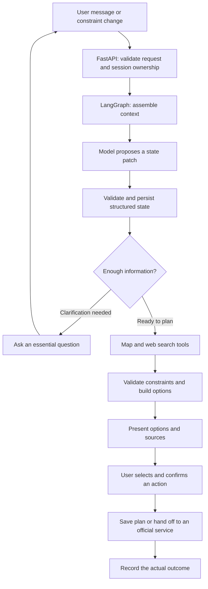

# SoloVibe

**A context-aware companion agent for solo city outings.**

SoloVibe helps people decide what to do when they want to head out alone. It brings together how the user feels, where they are, and practical constraints such as time, budget, and walking distance to suggest a small set of actionable city activities. Once the user confirms a specific action, the agent helps them take the next step.

> **Project status: V1 redesign in progress.** Stages 0–4 are implemented on `Refactor`. Real DeepSeek, Supabase PostgreSQL, Amap, Tavily, and browser checks verify planning and confirmed plan saving. Amap route revalidation verifies navigation handoff. Actual spending, live opening status, and availability remain unknown. [Redesigned Plan V2](docs/AI_AGENT_REDESIGNED_PLAN_V2.md) defines the remaining release work.

## Why SoloVibe?

A list of nearby places does not always help someone make a decision. A useful suggestion also needs to account for their energy, available time, budget, willingness to walk, and preferences for spending time alone.

SoloVibe aims to turn those constraints into a manageable choice, with enough information to act on it.

For example:

> “I'm near Xuhui in Shanghai. I'm a little tired, have one hour and a budget of RMB 50, and don't want to walk far.”

The intended experience is to record those constraints, clarify anything essential, retrieve real place and route information, and offer at most two or three options. Each option should explain why it fits, its estimated cost and duration, its sources, and any unknowns. If the user changes their budget, subsequent planning should use the new value. Saving a plan or handing off to navigation requires confirmation of that action.

**The current implementation generates conditional place options only after a real provider lookup. Saving a selected option or preparing a walking-navigation link requires a separate confirmation. Cost, opening hours, and availability stay unknown unless separately verified.**

## Planned V1 Capabilities

| Capability | Intended behavior |
| --- | --- |
| Context understanding | Capture location, energy, budget, time, preferences, and exclusions; preserve user corrections across turns |
| External information retrieval | Use map services such as Amap for places and routes, with web search for supporting venue and activity information |
| Activity options | Present a small set of comparable options with timing, cost, route information, fit, and sources |
| Conversation continuity | Preserve recent messages and structured constraints; summarize older history when the input budget requires it |
| Confirmed actions | Save a plan, hand off to navigation, or provide an official booking entry point after the user confirms the action |
| Plan adjustments | Update affected parts of the plan when the user's constraints or situation change |

Ratings, offers, menus, and opening hours depend on actual provider coverage. Missing information must remain unknown, and failed calls must be reported as failures. The model must not invent a successful lookup. Automatic payments, general-purpose automated bookings, and continuous background location tracking are outside the initial scope.

## Architecture

The frontend uses **React, TypeScript, and Vite**, with **FastAPI** on the backend. **LangGraph** is the workflow orchestrator, **Supabase / PostgreSQL** persists business state and native checkpoints, and model calls go through a dedicated adapter.

The diagram below shows the **target V1 workflow**, not an end-to-end flow already running in the application:



LangGraph coordinates node execution, conditional routing, and recovery. The model handles language understanding and explanation. Application code controls ownership, validation, request deduplication, and authorization for actions.

### Context and State

- **Raw messages:** Stored separately for conversation display and traceability.
- **Structured snapshots:** Authoritative constraints and execution progress, updated after each validated change with a version and source reference.
- **Recent messages and rolling summaries:** The latest four complete turns retain their original text. When estimated full input reaches about 80% of the node budget, eligible older turns are summarized; raw messages remain stored. The budget uses the model's reported context window and a conservative estimate, not an exact tokenizer count.
- **LangGraph checkpoints:** Persist graph execution state for recovery. They do not replace business snapshots or automatically compress conversation history.

## Development Status

| Stage | Deliverable | Status |
| --- | --- | --- |
| 0 · Development baseline | Reproducible setup, locked dependencies, health checks, developer workbench, and baseline tests | Completed and pushed to the development branch |
| 1 · LangGraph and state | Graph execution, structured state, native persistence, session isolation, and retries | Implemented; live model/database integration and cross-process recovery verified. Failure/retry paths have contract tests but have not been fault-injected against the live provider |
| 2 · Context management | Token budgets, recent-message windows, rolling summaries, and recovery consistency | Implemented; live compaction, raw-message retention, newer correction priority, and cross-process summary recovery verified |
| 3 · Real activity options | Amap POI, detail and walking route, Tavily links, bounded screening, and persisted options | Implemented; real model/database/map/search/browser flow verified |
| 4 · Confirmation and actions | Version-bound proposal, durable LangGraph interrupt, atomic confirmation, plan saving, navigation handoff, recovery | Implemented; real database/map and browser flows verified. Merchant booking entry points remain unavailable without verified provider data |
| 5 · Integration and release | End-to-end validation, failure handling, and deployment | Planned |

**Branches:** `main` retains the historical prototype. The active redesign is on [`Refactor`](https://github.com/wangyux07-cmd/SOLOVIBE_APP/tree/Refactor). Its default frontend is `frontend/src/StageOneApp.tsx`, and its backend entry point is `backend/main.py`. The earlier frontend and backend are retained as migration references.

Readiness requires a working database connection, current migrations, and a successful model generation probe. With either unavailable, health reports `ready=false` and chat requests fail explicitly. Missing map credentials leave chat available but return `provider_unavailable` for planning requests. Confirmed actions use the same conversation's durable LangGraph checkpoint and a separate PostgreSQL authorization ledger.

## Run the Development Baseline

These instructions target **Windows PowerShell and the development branch**. Install Git, Node.js 20.19 or newer, and a Python installation with working `python -m pip`. The setup script uses uv to create an isolated Python 3.12.14 environment.

```powershell
git clone --branch Refactor --single-branch https://github.com/wangyux07-cmd/SOLOVIBE_APP.git
Set-Location SOLOVIBE_APP
powershell -NoProfile -File scripts/setup.ps1
```

Setup installs locked dependencies and copies environment templates only when local `.env` files are missing. **External API keys are not required to view the readiness screen.** Real conversation execution requires PostgreSQL and a model account that can complete generation requests. Real place options and navigation handoff additionally require an Amap Web Service key; Tavily search is optional. Run the additive migration in `scripts/migrate_stage1.py` after reviewing the intended database connection; rerun it when upgrading to Stage 4 to create the plan-set and action tables.

Open two terminals at the repository root:

```powershell
# Terminal 1: backend
powershell -NoProfile -File scripts/dev.ps1 -Service backend
```

```powershell
# Terminal 2: frontend
powershell -NoProfile -File scripts/dev.ps1 -Service frontend
```

- Frontend: <http://127.0.0.1:5173>
- API documentation: <http://127.0.0.1:8000/docs>
- Health endpoint: <http://127.0.0.1:8000/api/v1/health>

The frontend development server proxies `/api` requests to the local backend. Configure model, map, search, and database credentials in ignored `backend/.env`. Frontend `VITE_*` variables are public configuration and must not contain secrets.

### Validation

```powershell
# Backend baseline tests, frontend type checking, and production build
powershell -NoProfile -File scripts/check.ps1

# Run after starting both services; the current browser configuration uses Microsoft Edge
npm run test:e2e --workspace frontend
```

The local suite covers boundary behavior and the browser UI. To verify live Stage 1 behavior after configuring the ignored `backend/.env`, run `python scripts/migrate_stage1.py` once and `python scripts/verify_stage1_live.py` while the backend is running. The live script creates test conversations, makes real model calls, and checks persisted state, replay, concurrency, and owner isolation. See [Stage 1 progress and integration limits](docs/STAGE1_PROGRESS_2026-10-12.md). These checks do not validate the later planning features.

For a read-only count of completed runs, node events, and native LangGraph checkpoints, run `python scripts/verify_stage1_storage.py`. To opt into a real browser-to-model test, set `SOLOVIBE_LIVE=1` and run `npm run test:e2e --workspace frontend -- --grep "real UI"`; this consumes model credits.

The Stage 2 live check uses a second backend on port 8001 with `SOLOVIBE_UNDERSTAND_INPUT_TOKENS=4500` and then runs `python scripts/verify_stage2_live.py`. It creates test conversations and consumes model credits. See [Stage 2 delivery and validation](docs/STAGE2_PROGRESS_2026-10-12.md) for the exact boundary and observed results.

For Stage 3, add `AMAP_API_KEY` and optionally `TAVILY_API_KEY` to `backend/.env`, rerun `python scripts/migrate_stage1.py`, then run `python scripts/verify_stage3_live.py --require-options`. That test makes actual model, map, and optional search calls and requires 1–3 persisted options with real walking-route evidence. Without a map key, it reports `maps_not_configured` and zero options. See [Stage 3 progress and verification limits](docs/STAGE3_PROGRESS_2026-10-12.md).

For Stage 4, rerun `python scripts/migrate_stage1.py`, then run `python scripts/verify_stage4_live.py`. It creates a fresh conversation with real providers, checks an exact selected plan, saves it once despite duplicate confirmation, revalidates a navigation route, and verifies rejection and invalidation on new input. To check the real UI, start both services and run `$env:SOLOVIBE_LIVE_STAGE4='1'; npm run test:e2e --workspace frontend -- --grep 'real browser confirms'` in PowerShell. This covers saving, navigation-link preparation, and the recorded browser handoff. See [Stage 4 progress and verification limits](docs/STAGE4_PROGRESS_2026-10-12.md).

## Design and Development Documents

The following documents are currently written in Chinese and are linked from the development branch. Delivery notes describe the state at the time they were written.

- [Original project review and redesign proposal](https://github.com/wangyux07-cmd/SOLOVIBE_APP/blob/Refactor/docs/AI_AGENT_REDESIGN_PROPOSAL.md)
- [Redesigned Plan V1: architecture, state management, and delivery stages](https://github.com/wangyux07-cmd/SOLOVIBE_APP/blob/Refactor/docs/AI_AGENT_REDESIGNED_PLAN_V1.md)
- [Redesigned Plan V2: current release-oriented implementation plan](https://github.com/wangyux07-cmd/SOLOVIBE_APP/blob/Refactor/docs/AI_AGENT_REDESIGNED_PLAN_V2.md)
- [External tools and API integration plan](https://github.com/wangyux07-cmd/SOLOVIBE_APP/blob/Refactor/docs/EXTERNAL_TOOLS_API_PLAN_V1.md)
- [Development baseline: setup, operation, and validation record](https://github.com/wangyux07-cmd/SOLOVIBE_APP/blob/Refactor/docs/DEVELOPMENT_BASELINE.md)
