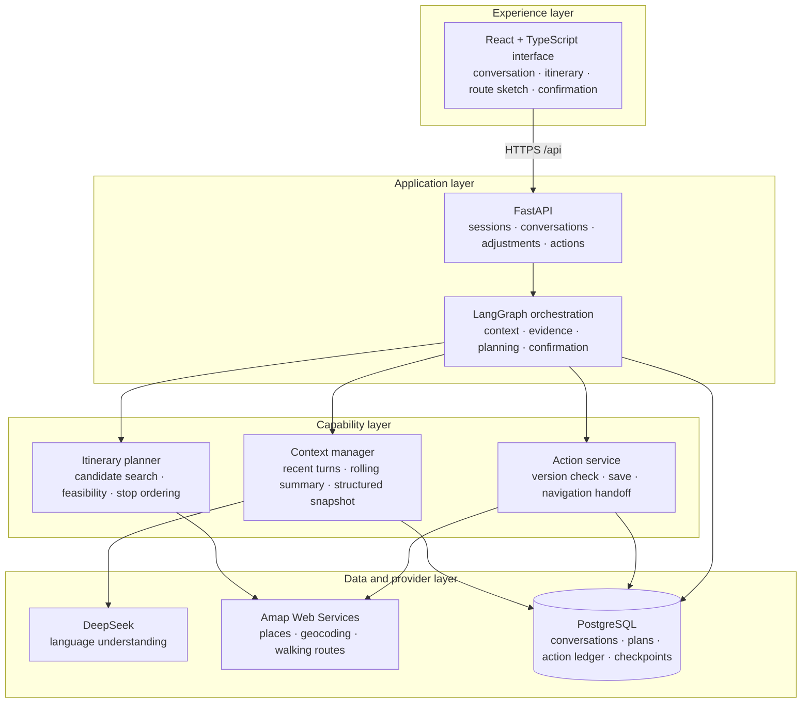
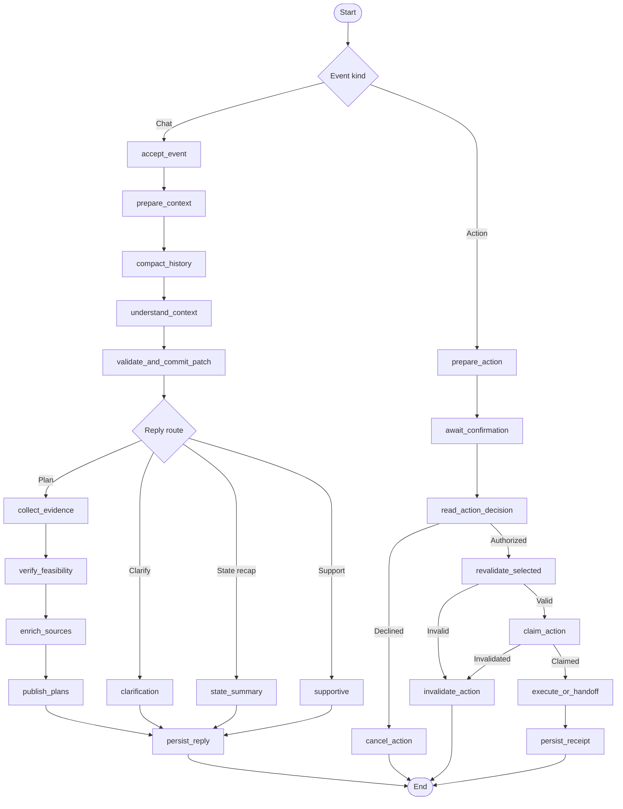

# SoloVibe

**A context-aware companion for solo city outings.**

SoloVibe turns a conversation about location, available time, walking limit, budget, interests, and dinner into one ordered city itinerary. It finds real places, checks walking routes between stops, estimates the full outing and return journey, and places dinner at the end of the route when requested. The user can revise a constraint, save a chosen itinerary, and open each leg in Amap after confirmation.

The itinerary planner searches a bounded set of nearby attractions and restaurants. It evaluates feasible stop orders against the user's time and walking limits, prioritizes the number of useful stops, and then selects the shortest verified walking route among those candidates. Each stop carries its place identity and address; each leg carries Amap walking-route evidence and route geometry.

## Product architecture



The frontend is a Vite application deployed on Vercel. Its same-origin `/api` route forwards requests to the FastAPI service. PostgreSQL stores conversation state, plan versions, action records, and LangGraph checkpoints. The model interprets user language; application code validates state changes, screens provider results, evaluates route feasibility, and authorizes actions.

## Agent workflow

The compiled `StateGraph` has two entry paths. A chat event updates context and produces a reply or an itinerary; a confirmed action resumes a durable approval flow.



Conversation history remains available as raw messages. For model calls, the context manager retains recent turns, summarizes older turns when the input budget calls for it, and combines them with a versioned snapshot of user constraints. The graph records node execution and can resume a confirmation from a PostgreSQL checkpoint. Action decisions are tied to a specific plan version and recorded with their outcome.

## Repository layout

| Path | Purpose |
| --- | --- |
| `frontend/` | React interface, Vite configuration, and browser tests |
| `backend/` | FastAPI routes, LangGraph workflow, domain rules, providers, and persistence |
| `scripts/` | Setup, database migration, verification, and evaluation commands |
| `eval/` | Fixed evaluation scenarios |
| `tests/baseline/` | API, graph, planning, and failure-path contract tests |
| `deploy/` | Container images and deployment configuration |

## Run locally

Install Python, Node.js 20.19+, and Docker if you want the container workflow. On Windows PowerShell:

```powershell
git clone --branch Refactor --single-branch https://github.com/wangyux07-cmd/SOLOVIBE_APP.git
Set-Location SOLOVIBE_APP
powershell -NoProfile -File scripts/setup.ps1
```

Add `DEEPSEEK_API_KEY`, `AMAP_API_KEY`, and `DATABASE_URL` to the generated `backend/.env`. Run the database migration once, then start the API and frontend in separate terminals:

```powershell
.\.venv\Scripts\python.exe scripts/migrate_stage1.py
powershell -NoProfile -File scripts/dev.ps1 -Service backend
```

```powershell
powershell -NoProfile -File scripts/dev.ps1 -Service frontend
```

Open <http://127.0.0.1:5173>. API documentation is at <http://127.0.0.1:8000/docs>.

For a container run with the same `backend/.env`:

```powershell
docker compose up --build
```

Run the automated checks with `powershell -NoProfile -File scripts/check.ps1` and `npm run test:e2e --workspace frontend`.
