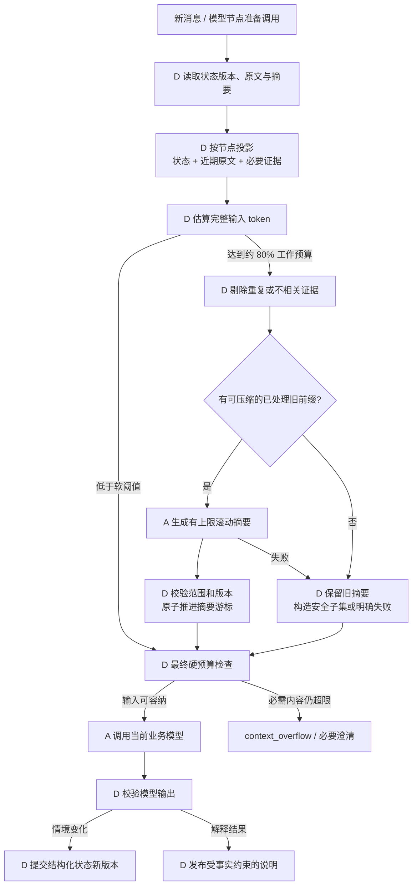
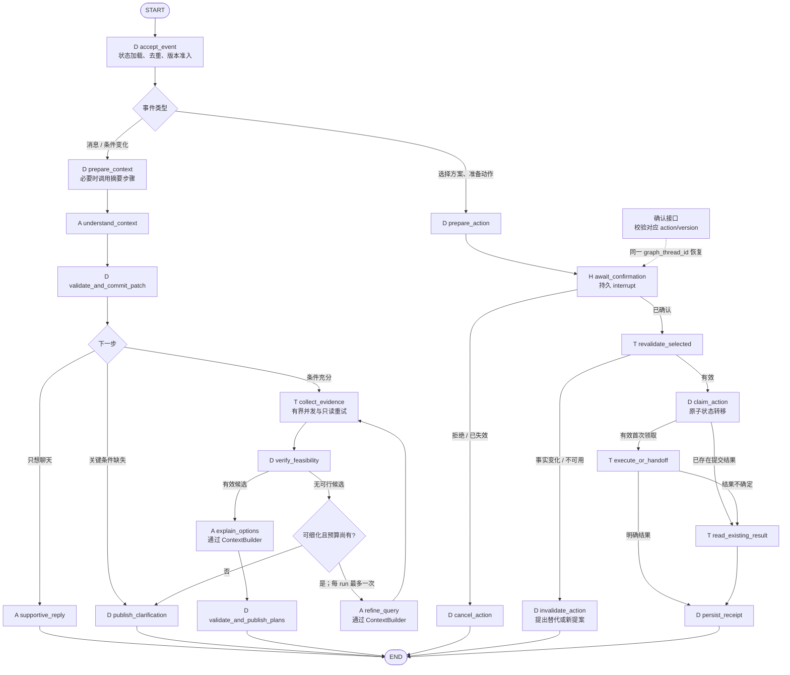

# SoloVibe Redesigned Plan — Version 1

> 版本：V1.1｜原版日期：2026-09-13｜工程验证补充：2026-10-12。原方案继续实施；本文档中的交付状态以实际验证记录为准。
>
> 决策基础：用户已选择 Option B，明确保留 LangGraph，并要求补全上下文管理与全面开发改造方案。
>
> 基线：[SOLOVIBE_APP，da89caf9][baseline]。本文件承接 [原审查与方案文档](/D:/SOLOVIBE/AI_AGENT_REDESIGN_PROPOSAL.md)，不覆盖原文。当前只新增设计文件，未修改实现、安装依赖或运行项目/测试。

## 1. 已确定的方向与本版增量

**正式采用 LangGraph。** 它负责真实节点执行、State 更新、条件路由、用户确认中断与恢复。业务 HTTP 入口必须调用编译后的图；不保留“类叫 LangGraphAgent、实际仍靠另一个顺序函数完成所有流程”的结构。

产品继续面向独自出行中的决策困难：理解当前状态与现实约束，给出最多 2–3 个可信且可比较的活动方案；用户确认具体动作后，保存计划并承接导航/官方预约入口；情况变化时调整受影响部分。

本版对原方案增加五项具体设计：

1. 将上下文管理定为 **结构化状态主导、近期原文保真、token 预算触发滚动摘要**。
2. 区分业务状态、对话原文、摘要、LangGraph checkpoint 和每次模型输入，明确各自职责。
3. 给出 Graph、节点输入输出、模型上下文装配和摘要提交规则。
4. 按现有文件列出保留、修改、替换、归档和新增内容，覆盖后端、数据库、工具、前端、配置、部署和测试。
5. 给出可依赖的开发顺序、迁移方式、回滚边界与完成标准。

V1 的发布范围包含真实推荐、上下文连续性、选择/确认/保存/导航交接、基础局部调整和可恢复状态。通用自动预约、多 Agent、任意动态 DAG、向量记忆、持续定位与后台监控不进入首版。

## 2. 对 token 预算与滚动摘要的判断

### 2.1 结论：适合采用，但结构化状态必须先于压缩而存在

你提出的“接近窗口约 80% 时保留近期对话原文、压缩较早历史、保留关键约束与执行进度”适合本项目，尤其是用户多次讨论、换方案或途中继续互动时。

需要调整的是两个时机：

- **约束与执行进度在每次有效变化时写入结构化状态。** 不能等 token 多了才抽取。用户第三轮修改预算，第十轮才压缩，也必须从第三轮开始使用新预算。
- **摘要在接近应用工作预算时按需触发。** 不必等模型总窗口到 80%；短活动决策通常不需要把长历史全部塞进去。模型大窗口只是硬上限，不是应用应主动填满的目标。

滚动摘要是辅助模型保持语义连贯的有损表示；金额、截止时间、选择、授权、订单/交接状态不能仅靠摘要保存。LangGraph 的 checkpointer 解决运行状态持久化，也不会自动替应用决定哪些历史应摘要或每个模型调用应读哪些字段。官方文档提供裁剪和摘要等模式，但本节的阈值、优先级及业务规则是本项目的设计选择。[LangGraph memory][lg-memory]

### 2.2 采用五层上下文与存储分工

| 层 | 内容 | 为什么保留 | 是否直接进入每次模型输入 |
| --- | --- | --- | --- |
| A. 原始消息记录 | 带 message_id、sequence、role 的用户/助手原文 | 对话展示、追溯修正、按范围重建摘要 | 否，只选近期或有精确引用需要的部分 |
| B. 结构化业务状态 | 位置、时间、预算、步行限制、偏好、方案版本、行动与结果 | 决策与执行的权威数据 | 按节点投影相关字段，不注入全部数据库 |
| C. 近期原文窗口 | 近期完整回合、当前输入、相关未决问题原文 | 处理“第二个”“还是刚才那个”等指代及语气 | 理解节点通常需要；执行节点不需要 |
| D. 历史滚动摘要 | 较早讨论目的、被拒绝方案及原因、未决语义背景 | 降低历史 token，保持讨论连续性 | 相关节点按需加入；标注为历史记录 |
| E. 任务证据切片 | 本次相关 POI、路线、营业状态、来源与有效期 | 支撑当前方案与解释 | 仅注入当前节点需要的有限事实 |

Graph State 是运行中的这些对象/引用与控制字段的组合；checkpoint 记录它的执行快照。**保存于数据库、存在于 Graph State、发送给模型，是三件不同的事。** 不能把一整个 checkpoint 序列化后直接作为 prompt。

### 2.3 关键状态怎样持续更新

每轮按“读取当前状态 → 模型提取补丁 → 确定性校验 → 版本化提交”处理。执行进度则由真实工具回执驱动，不由模型从聊天总结。

| 输入/事件 | 状态变化 | 不允许的行为 |
| --- | --- | --- |
| “预算 50，最多走 10 分钟” | budget=50、walking_limit=10，并记源消息 | 只放进自然语言摘要 |
| 下一轮只答“静安寺附近” | 只补起点，保留预算与步行限制 | 未提预算就重置为默认 |
| “今天可以花到 80，但还是别走远” | budget 更新到 80；原步行约束保留 | 沿用旧摘要中的 50，或清掉步行限制 |
| “其实不想喝咖啡了” | 修改类型偏好/排除条件，相关方案失效 | 关键词命中咖啡后继续优先咖啡店 |
| “第二个挺好” | 对照最近可见 plan_set 的顺序解析 plan_id | 依据摘要猜“第二个”，或使用已过期排序 |
| 点击确认导航 | 记录所确认 action_id/version 的授权 | 推导成同意自动预订或支付 |
| provider 超时但可能已提交 | action=outcome_unknown | 摘要成“失败，可重新下单” |

ContextPatch 对字段区分“不修改”“设置值”“明确清除”。每项重要补丁包含来源 message_id/证据引用及必要原文片段；模型推断与用户声明分开。数值范围、时间单位、所有权与方案引用由程序验证；模糊或冲突字段发起一个必要澄清。

**冲突处理：** 最新有效用户更正优先于旧用户值；当前结构化状态优先于历史摘要。新的自然语言尚未校验时，先作为补丁处理，不能直接变成执行权限。数据库授权和回执永远不能被摘要或模型补丁改写。

### 2.4 Token 预算：按模型调用节点计算

每次调用模型前估算实际完整输入，而不是只计算历史聊天：系统提示、结构化输出 schema、可能的工具定义、当前状态、近期原文、历史摘要、当前输入、候选证据与消息封装开销都计入。

定义：

- W：配置并核实的模型总上下文上限。
- O：本次最大输出预留，覆盖供应商计入上下文的输出/推理开销。
- S：token 估计与封装误差的安全余量。
- P_node：应用对该节点设置的输入预算上限。
- **B_node = min(P_node, W − O − S)**：本次实际可用输入预算；若供应商另有限制输入长度，还需取该限制的最小值。
- T：本次完整输入的估算 token 数。

在 **T ≥ 0.8 × B_node** 且存在可压缩的已处理旧历史时，触发摘要。摘要后尽量回落到约 **0.6 × B_node**，避免每一轮都在阈值附近重复压缩。80%/60% 是可配置初值，81% 没有特别的架构意义；不把它们视为框架标准或已验证最优值。

| 调用类型 | V1 输入预算初值 | 主要上下文 | 输出预留初值 |
| --- | --- | --- | --- |
| understand_context | 8,000 tokens | 当前状态投影、未决问题、近期原文、必要摘要 | 1,000 tokens |
| refine_query | 4,000 tokens | 当前约束、失败原因与少量候选观察 | 500 tokens |
| explain_options / supportive_reply | 6,000 tokens | 当前需求、已验证方案，或相关近期谈话 | 1,000 tokens |
| summarize_history | 6,000 tokens | 旧摘要 + 待压缩的完整历史片段 | 800 tokens |

这些是起始配置，不是选择某款模型、宣称该模型有特定窗口，也不是实测值。现有 DeepSeek 集成可继续作为模型适配的起点，开发时核实其 tokenizer、输出约束和窗口能力，兼容后锁定配置。

示例：理解节点 B_node=8,000，触发线约 6,400。若系统/schema 为 900、状态为 1,100、当前输入为 300、相关证据为 400，近期与历史合计 4,100，则总量 6,800，应压缩合格的旧历史；不是等整个模型窗口耗尽才行动。

### 2.5 超预算时先识别来源，不是全部丢给摘要模型

ContextBuilder 按以下顺序处理：

1. **按节点选择信息。** 理解节点不读所有商家详情，解释节点不读完整历史，行动执行不经过语言模型。
2. **清理不相关与重复工具内容。** 用结构化观察代替网页全文，合并同一 POI 的重复事实，限制候选数量；不删来源/时效等必要字段。
3. **保护当前语义。** 当前输入、最近被回答的问题、指代所对应的方案映射、必要明确更正原文必须保留。
4. **压缩已处理的旧对话前缀。** 优先保留最近约 4–6 个完整交互回合；这不是绝对消息条数，最终受 token 预算和未决语义边界约束。
5. **重新计数。** 仅当 T ≤ B_node 才调用业务模型。摘要完成不等于一定已满足预算。

若强制保留内容本身已超过 B_node，不能继续删关键约束来满足 60% 目标。可压缩非关键叙述、减少证据切片，或要求用户聚焦过长输入；只有明确配置允许且总窗口足够时才扩大节点预算。硬上限仍无法满足则返回 context_overflow，不发出已知会超限的请求。

单条巨大输入要在 API 准入和模型上下文装配时处理；不得静默截断它的后半段，因为最后一句可能恰好是预算更正或取消。没有可压缩旧历史时，不为了仪式感调用摘要模型。

Token 统计优先使用所选模型兼容的 tokenizer/计数方法；不可用时采用留有余量的估计，并用后续供应商 usage 校准。不要将中文字数简单当成 token，也不要声称估计值是精确值。

### 2.6 滚动摘要的格式、提交与失效

RollingSummary 至少包含 summary_id、revision、covered_until_sequence、source_message_range、source_digest、based_on_context_revision、generated_at、schema_version、内容与 token_estimate。

摘要内容限于：当前讨论主题、重要偏好理由、曾否决的选项及理由、未决语义问题。涉及旧条件时标明其历史性；当前金额、时间与动作状态由结构化状态另行提供。禁止把工具输出中的“忽略规则”等文本提升为系统指令；摘要始终作为有来源的历史数据注入。

一次摘要流程：

1. 从消息表选连续且已被成功处理的旧前缀；不包含当前输入、未回答问题或未处理的约束更正。
2. 摘要输入为“旧摘要 + 新纳入前缀”，输出长度设上限。摘要自身也必须遵守输入预算；历史过大则按完整回合分段，并设置本次压缩耗时/调用次数上限。
3. 校验覆盖范围、必需引用、输出形状与明显的状态矛盾；这能发现部分问题，不能保证摘要零信息损失。
4. 采用 summary_revision + covered_until_sequence + thread_revision 的条件提交；只有原文记录完整且摘要写成功，才推进覆盖游标。
5. 摘要后不再向模型重复发送同一旧前缀；原文仍在消息表中，按保留策略管理，不因压缩 prompt 而物理删除。

摘要超时/校验失败：不推进游标，不覆盖旧摘要。若有“状态 + 近期原文”的安全子集能完成当前任务，可以继续；涉及丢失语境的精确引用则回取少量原文或澄清。不能用一个泛化摘要兜底来改变授权或执行状态。

为限制摘要漂移，用户大幅更正目标或检测到摘要冲突时，优先从相关原文范围重建该主题摘要；多次滚动后可按配置重建当前出行主题，不对无限历史每轮重新总结。跨出行会话默认不继承整段摘要，只继承用户明确保存的结构化偏好。

### 2.7 为什么不用“只保留最近几轮”或“每轮总结全部历史”

| 方案 | 适用判断 | V1 决策 |
| --- | --- | --- |
| 全量历史直到模型窗口 80% | 成本随闲聊和工具内容膨胀，旧事实易干扰当前状态 | 不采用作为主策略 |
| 固定最近 N 条消息 | 简单，但可能截断指代、工具配对或更正来源 | 仅作有语义保护的窗口选择组件 |
| 每轮总结全部历史 | 多余延迟/费用，反复有损改写 | 不采用 |
| 只保存结构化状态 | 能保证业务规则，但会丢失偏好原因和对话连续性 | 作为主记忆，搭配近期原文 |
| 状态 + 近期原文 + 按需滚动摘要 | 同时覆盖业务正确性、指代与长会话 | **采用** |
| 向量库检索历史 | 当前历史范围与业务引用可用主键/序号读取 | 不增加 |

### 2.8 在 LangGraph 中怎样落地

V1 使用自定义 StateGraph，因此显式实现 ContextBuilder 与摘要步骤，而不是假设给任意图挂上 LangChain SummarizationMiddleware 就会生效。后者的接入示例针对 create_agent middleware；可借鉴机制，但需与当前运行方式区分。[LangChain short-term memory][lc-memory]

摘要是一个受预算控制的模型调用，不是独立“Memory Agent”。所有 agentic 节点通过同一个上下文装配入口，执行前计数；纯规则/工具节点直接读结构化状态，不调用它。

Graph State 中只保留有界的近期消息/消息引用和 summary 引用，不对全量 messages 使用无限追加然后期待 checkpoint 自动变小。若采用 add_messages reducer，裁剪必须使用与该 reducer 兼容的更新方式；普通短列表覆盖语义则明确声明。模型工具调用若存在，必须保留完整 call/result 配对，不能留下孤立 tool message。[消息裁剪约束][lc-memory]

**最终选择：实现你的机制，并让它服务于结构化状态，而不是替代结构化状态。** 短会话路径是状态快照 + 近期原文；长会话才增加 token 触发的滚动摘要。

## 3. 目标运行架构与真实 LangGraph

### 3.1 技术组成

保留 React/Vite、FastAPI 和 Supabase/PostgreSQL。新增真正的 StateGraph、原生持久 checkpointer、一个模型适配器、少量真实 provider adapters；不新增独立数据库、Redis、队列或微服务。

最小依赖方向：API → ApplicationService → Graph；Graph 节点 → 领域规则 / ContextBuilder / Provider / Repository。Provider 不反向修改全局会话，模型不直接操作数据库或授权状态。应用生命周期创建客户端连接池，结束时关闭；不在每个请求里重复创建整套 Agent。

### 3.2 图的主流程

图中 collect_evidence 内部只对合适的读错误退避重试，模型调用分别受 deadline/输出校验保护；所有不可恢复错误最终经统一错误出口产生 run_failed，不回到原入口无限重试。条件变化需提出替代时，可创建明确后续规划事件进入推荐分支，不在执行节点自行改地点。

### 3.3 节点划分与模型职责

| 节点组 | 运行方式 | 职责 |
| --- | --- | --- |
| accept_event / validate_and_commit_patch | 确定性 | 身份归属与版本、状态补丁、持久提交 |
| prepare_context / summarize_history | 程序装配 + 按需摘要模型调用 | 给节点提供有限、相关且可追溯的输入 |
| understand_context / supportive_reply | 模型 | 语言理解、偏好原因、自然表达 |
| collect_evidence / revalidate_selected | 工具 | 真实地理、路线、营业/天气等事实查询 |
| verify_feasibility | 确定性 | 预算、时段、步行、证据时效与明确排除条件 |
| refine_query | 受限模型 | 依据具体失败细化查询词，不能放宽硬约束 |
| explain_options | 模型 | 解释程序已筛选的 1–3 个方案，不创造新地点/事实 |
| prepare_action / await_confirmation | 程序 + 人工等待 | 具体动作、不可变版本、授权绑定 |
| claim_action / execute_or_handoff / persist_receipt | 确定性 + 工具 | 幂等、实际行动、真实回执 |

固定拓扑已经满足本产品依赖；本版不建设动态 DAG 生成。graph.py 只定义节点/边，不承担所有业务代码。LangGraph 对项目有实质作用，但领域规则也可以独立验证。

### 3.4 thread、run 与等待期间新输入的规则

- conversation/thread_id：产品中的一次连续对话，服务端生成并绑定 owner。
- graph_thread_id：V1 与 conversation/thread_id 一一映射，同一对话的 Graph 持久游标；不由前端随意指定另一个用户的游标。
- run_id：每次请求触发的工作运行；普通新消息产生新 run，确认恢复继续原等待 run。
- action_id：不可变具体动作的标识，记录它对应的 waiting_run_id、graph_thread_id、proposal_version。

同一 conversation 同时只允许一个活跃写运行或一个待确认中断。若等待确认时收到新的需求消息，ApplicationService 先把旧提案按“新输入导致需重评”标为失效，以拒绝/取消语义恢复并结束旧等待，再正常处理新消息。不得把新消息当 confirm，也不得向尚在等待的图直接塞新输入并期待框架自动路由。取消过程若发现动作已提交，则先核对实际结果，不能宣称撤回。

同一 graph_thread_id 会跨 run 保留图状态，因此 accept_event 在普通新 run 中必须显式重置上次的 input/output、错误、重试计数与本轮候选等瞬时字段，并加载最新业务快照；只按时效规则复用允许的事实。确认恢复不重置原 run 的提案和控制字段，节点重试也不刷新总 deadline 或重新补满预算。不能通过换一个 run_id 就自动假设 State 已经清空。

恢复使用同一 graph_thread_id 和对应中断；interrupt 所在节点恢复时可能从头执行，因此其中不做外部副作用。不同版本的 stream/interrupt API 以实施时锁定的依赖为准，不将当前文档直接套到仓库 pin 的 langgraph==0.0.30。[LangGraph interrupts][lg-interrupts]

## 4. State、数据库与一致性改造

### 4.1 Graph State 的目标字段

| 字段组 | 内容 | 更新者/生命周期 |
| --- | --- | --- |
| identity | owner_id/session_id、thread_id、run_id、request_id、schema_version | 服务端；模型只读 |
| input_event | message_ref 或 selection_ref、event_kind、expected_revision | 本次事件不可改写 |
| context_snapshot | 当前约束/偏好、各字段来源、context_revision | 补丁校验节点；业务持久化 |
| conversation_window | 有界近期原文/引用、pending_question、visible_plan_order | ContextBuilder；不无限累计 |
| memory_ref | summary_id/revision、covered_until_sequence | 摘要成功条件提交后更新 |
| evidence | 有界 observation 集合或引用、provider/poi_id、来源/有效期 | 工具节点；后续按 key 合并 |
| planning | feasible/rejected、plan_set_id/revision、selected_plan_ref | 校验/发布/选择节点 |
| action | action_id/version、authorization_ref、status/receipt_ref | 业务授权/执行节点，DB 为权威 |
| control | stage、state_revision、deadline、retry/refine budget、run_epoch、error | Runtime/ApplicationService |
| output | 判别类型的澄清/方案/确认/结果 DTO | 输出投影节点 |

State 中不放连接池、SDK 客户端、Playwright Page、完整网页或完整审计日志。context_snapshot 不是与数据库并列的第二个权威存储，而是本次运行读取或成功提交后的版本；恢复节点在业务提交/执行前必须复核 revision。

### 4.2 业务存储建议

复用同一个 Supabase/PostgreSQL 实例。关键提交使用真正数据库事务或原子函数，不能把多个 Supabase REST 更新误认为一个事务。优先将 backend/db/supabase_client.py 的业务访问迁到使用同一数据库的异步 Repository；通过服务端 PostgreSQL 连接实现事务，与 Graph checkpointer 的存储职责分开。

| 表/对象 | 保留与新增字段 | 用途与约束 |
| --- | --- | --- |
| conversations（可由 threads 迁移） | owner、thread_id、context_json、context_revision、active_run/status、message_seq、current_summary_ref | 会话所有权、上下文主快照、单写运行准入 |
| messages | message_id、thread_id、sequence、role、content、request_id、processed_revision | 原文与精确引用；thread+sequence 唯一，重试不重复 append |
| conversation_summaries | summary_id、revision、covered_until、source_digest、内容、schema_version、生成时状态版本 | 保留覆盖范围；条件提交，不推进未成功摘要的游标 |
| plans | plan_id、plan_set_id/revision、context_revision、provider/poi_refs、证据摘要、费用/时间范围、有效期 | 发布版本不可变，记录当时卡片顺序 |
| actions | action_id/version、plan_ref、提案内容/digest、owner、授权决定、waiting_run_id、idempotency_key、status、provider_ref、receipt | 确认、幂等和恢复的核心账本 |
| runs | run_id、thread_id、request_id、status、stage、epoch、lease、last_error、开始/结束时刻 | 并发准入、查询恢复、请求去重 |
| observations（可先嵌入 plans/run 的有界 JSON） | provider、poi_id、kind、value、units、source_ref、observed_at、valid_until、quality | 不为初版单独设计巨大事实仓库；有复用需求才拆表 |
| 原生 checkpointer 表 | 由所选 saver 的迁移管理 | 存图运行位置；与旧自建 checkpoints 表隔离 |

原文是按保留策略保存的消息记录，不需要长期全量留存才可压缩。用户删除会话时需处理 messages、summaries、相关精确位置、业务对象及可含同样数据的 checkpoint；仅删除消息 UI 不算删除完成。V1 不默认保存连续位置轨迹，也不自动创建跨会话心理画像。

### 4.3 事务与恢复的具体边界

**接受消息：** 校验 owner/request_id，原子分配消息序号与 run_id，并登记当前 run epoch。外部调用期间不持有长数据库事务。

**提交情境：** ContextPatch 按 expected_context_revision 提交；补丁与对应 message processed_revision 一致记录。重跑节点识别同一 message/patch，不重复应用“再加 20 元”一类相对更新。先将相对更新解析成依赖某个 base_revision 的新值，冲突时重新解释或拒绝旧提交。

**发布方案：** plans 写入与 current_plan_revision 更新一致；过期 run 不得覆盖新状态。前端收到旧版本 SSE 也不能让旧卡片覆盖新卡片。

**生成摘要：** 原文已经存在、旧前缀处理完成，摘要才能推进覆盖游标。摘要的 DB 提交与 Graph checkpoint 不假设天然处于同一事务；若 DB 已成功而 checkpoint 未记录，节点重跑通过 summary version/source_digest 找回已存在结果。

**确认动作：** 确认必须匹配 owner、action_id、proposal_version、digest 与有效期；授权和动作待领取状态原子更新。保存授权失败时不执行。

**执行动作：** 使用持久幂等键与条件更新领取。若在“领取—提交—记录回执”之间崩溃，恢复先检查状态和供应商结果；不能因为进程锁失效就重新发送。没有供应商幂等/查单能力时，不承诺 exactly-once，并对不确定结果保留 outcome_unknown。

**同线程并发：** 应用层实行单写运行，数据库 version/epoch 作为跨 worker 防线。运行租约不是授权；超时接管必须检查旧 run 与动作状态。await_confirmation 期间可以释放计算资源，但保留持久等待状态，不允许另一个运行越过它直接提交动作。

## 5. 后端与目录改造清单

下面“现有文件”链接指向审查基线；“目标模块”是计划创建/调整的仓库内路径，并非本次已创建的实现。

### 5.1 现有后端逐项处理

| 现有文件/职责 | 操作 | 目标结果 | 为什么 |
| --- | --- | --- | --- |
| [backend/main.py][main] | 大幅瘦身 | 仅 app 生命周期、依赖注入、路由挂载；所有业务走 ApplicationService | 消除两套聊天、重复客户端、成功后 fallback |
| [backend/data_types.py][types] | 分拆并迁移契约 | domain models 与 API DTO；短期保留兼容导出 | 修未定义类型和 dict/dataclass 混用 |
| [services/conversation/manager.py][conversation] | 重写为会话应用服务 | owner、原文持久化、run 准入、Graph invoke/resume | 不再每轮用空 messages 重新建会话 |
| [services/agent/langgraph_agent.py][agent] | 分阶段替换 | graph.py + 分组节点 + domain/context 服务；旧类只做短期薄兼容 | 从单体 async 编排变成真正 StateGraph |
| [db/supabase_client.py][db] | 替换业务访问实现 | 异步 Repository、真实持久写、事务/唯一键；统一连接池 | 真实读取与内存写入对称，避免假持久化 |
| [db/schema.sql][schema] | 改为初始说明，新增有版本迁移 | 明确业务表、所有权、摘要游标、动作账本与原生 checkpoint 隔离 | 迁移可追踪，可回滚 |
| [services/tools/web_search_tool.py][web] | 保留有效 HTTP 调用，重写返回/生命周期 | 明确 success/error/unknown/stale，保留来源，传入共享安全客户端 | 不再空结果默认 open、伪缓存 |
| [services/tools/booking_execution_tool.py][booking] | 拆分与隔离 | 高德能力移到 providers/amap.py；未接通浏览器代订退出主路径 | 地理查询不依赖庞大预约系统；替换 mock_pois |
| [services/data/scenario_generator.py][scenario] | 替换生成职责 | plan_builder/ranker/presenter；始终绑定真实候选 | 不再随机商家/天气或丢弃 selected_merchant |
| [services/data/route_generator.py][routes] | 保留必要纯计算，替换事实来源 | 真实路线时间/距离、明确返程与单位、确定性时段校验 | 不使用固定北京起点或直线距离冒充路程 |
| services/data/merchant_database.py | 生产事实退出 | 必要领域枚举迁移；静态商家转测试 fixture | 静态集合不能当当前城市真实供给 |
| services/data/data_anchor_enhancer.py、wanderbook_bridge.py | 逐项核对后合并/移除 | 证据与方案契约只存在一套 | 减少相互转换和重复事实结构 |
| services/tools/booking_safety_gate.py、middleware/risk_control.py | 合并必要规则 | action_policy：权限、对象/金额/有效期检查 | 风险打分不能代替用户授权 |
| fixed_*、browser state、services/security/antibot_orchestrator.py | 隔离首版；引用迁移后归档 | 不加载未使用浏览器能力；保留有价值失败情境 | 当前不做通用代订，避免维护不必要链路 |
| backend/logger_config.py | 统一结构化记录 | run/node/tool/summary/usage 事件，敏感字段脱敏 | 用实际执行阶段替代模拟日志 |
| backend/requirements.txt、启动脚本 | 选定兼容版本并锁定 | 可重复安装/启动，启动时不偷偷升级依赖 | 现有旧框架组合不能直接接当前 API |

### 5.2 目标模块边界

建议的目录按责任分组，最初可以每组少量文件，不要求每节点一文件，也不设计通用插件注册平台。

| 目标模块 | 拟负责的内容 |
| --- | --- |
| backend/api/chat.py、actions.py、runs.py | 入参、所有权、HTTP 状态、SSE/JSON 投影 |
| backend/application/conversation_service.py | 消息/运行准入、等待态新输入、invoke/resume、返回结果 |
| backend/agent/graph.py、state.py | 真实图、节点/条件边、运行字段和 reducer |
| backend/agent/nodes/ | 分为 context、planning、actions 三组节点，不堆所有 helper |
| backend/context/models.py、patch.py | ContextSnapshot、补丁与来源、缺省/清除语义 |
| backend/context/builder.py | 按节点投影、token 预算、原文窗口与证据切片 |
| backend/context/summarizer.py | 滚动摘要、覆盖游标、失败降级、版本化写入 |
| backend/context/token_budget.py | 模型/节点预算、计数与估计、输出预留、硬上限 |
| backend/domain/planning.py、constraints.py | 可行性、费用/时间/步行单位、候选排序与计划版本 |
| backend/domain/actions.py | 不可变提案、授权策略、幂等状态机 |
| backend/providers/amap.py、search.py、weather.py | 真实供应商访问与标准化；天气仅在需要时调用 |
| backend/providers/model.py | 统一模型调用、结构化输出校验、usage、超时 |
| backend/actions/handoff.py | 保存计划、核验/构建导航与官方入口交接 |
| backend/storage/repositories.py、checkpointer.py、migrations/ | 业务事务与原生 saver 分工；可用一个业务 repository 文件起步 |
| backend/observability.py、settings.py | 运行事件、脱敏、预算与 provider 配置 |

模型提示与 schema 跟随各自任务就近维护，不复制全套系统提示到每个文件。ContextBuilder 只做装配，不能兼任路线规划、数据库权限和执行器。

## 6. 数据、规划、行动与可靠性细节

### 6.1 外部数据与候选生成

先支持一座城市与一个主要地图供应商。位置经用户提供区域/站点或可选设备定位得到，记录来源、精度、坐标系；地理编码歧义时问必要问题，不凭地址文本猜城市。

真实 POI 结果必须保留 provider+poi_id、坐标、类别和来源。候选先粗筛，最多约 5–8 个进入详细查询；路线、必要营业信息等独立查询并发上限初值 3–4。气象若会影响室外方案则城市/时间级查一次，共享该观察。

Observation 将“查询是否成功”和“事实状态”分开：例如 transport_error 与 opening_status=unknown；HTTP 200 的空结果也不能生成 open。来源时间、观测时间、有效期分别记录；搜索网页提及的营业时间不是库存/空座的证明。没有真实天气时标未知，不退回随机天气。

### 6.2 确定性约束检查

所有金额用带币种的最小货币单位或 Decimal；距离统一米，时长统一秒/分钟之一并明示边界；时间带时区。规划包含明确的活动时长和必要缓冲；用户要求几点回家时，需要返程目的地或明确将“回去”转成待补字段。

先检查硬约束，再做简单可解释软排序：到达/活动/返程是否在时段内，费用上界是否满足预算，步行限制是否满足，营业窗口是否覆盖到达活动段，明确排除条件是否违反。未知字段不能计为已通过；可提供标注未知的线索，但不可称其已保证可行。

输出 1–3 个真实不同取舍的方案，所有说明引用选定候选。地图评价、一人座位或安静程度没有依据就不生成精确数值。模型无法通过写一句“符合预算”覆盖程序的 failed/unknown 检查。

### 6.3 V1 行动范围与确认

第一版的实际动作是保存选定计划并提供匹配真实地点的导航/官方入口。确认页显示所选方案、动作范围和关键条件；明确的“保存并打开 B 的导航”按钮已构成该动作授权，不再重复弹相同确认。它不授权预约或支付。

浏览器发起外部导航不代表目的 App 成功接收，更不代表到店。服务端记录 handoff_ready，客户端发起后记录 handoff_requested；无法核实目标应用接收时，UI 只说“已尝试打开导航”，同时保留可点链接。V1 不把浏览器离开事件当业务成功回执。

后续如接自动预约，新增一家具备合法可用接口的 provider，要求明确参数、幂等/查单能力与回执；不将旧 Playwright 工具简单接到“确认”按钮后就宣称能力完成。

### 6.4 错误、重试、取消与局部调整

| 场景 | V1 行为 |
| --- | --- |
| 模型输出无法解析 | 有限一次修正；再失败返回明确错误或事实模板，不提交无效补丁 |
| 只读查询临时失败 | 在总 deadline 内至多额外两次退避；只补失败项 |
| 401/403/错误配置 | 停止该能力并提示可用路径，不重复调用 |
| 摘要失败 | 旧摘要/游标不变；保护状态、近期原文；必要时回取原文/澄清 |
| 数据不足或无可行方案 | 最多一次有理由的查询细化；不偷偷放宽预算/距离 |
| 只想聊天/不出门 | 正常完成对话，不强制定位 |
| 页面断线 | 查询 run/action 状态；重复相同 request_id 不再次执行 |
| 时间/预算/位置变更 | 增加 context_revision；重校验依赖字段，冻结已完成段 |
| 用户拒绝行动 | 持久 cancelled/rejected，执行入口不可达 |
| 外部写动作结果不明 | outcome_unknown，查单/人工核对；不盲目重发 |
| 数据库持久化不可用 | 不能静默切内存承接授权动作；可明确进入不保存的建议模式 |

## 7. API 与前端改造

### 7.1 API 契约

V1 采用一个应用服务，可提供 JSON 和 SSE 两种投影；不会再由两个 handler 各运行一套业务。拟定 API 前缀 /api/v1，老 /api/chat 如保留过渡，只做适配转发。

| 接口 | 输入 | 行为/输出 |
| --- | --- | --- |
| POST /conversations | 匿名签名 session 或登录身份、request_id | 创建归属明确的 thread_id |
| POST /conversations/{id}/messages | message、request_id、expected_revision | 同步运行或 SSE 到本轮终态/澄清/interrupt；返回 run_id 和结构化结果 |
| GET /conversations/{id} | 已认证归属 | 当前情境摘要、消息分页、方案、待确认动作；不返回内部隐私日志 |
| POST /conversations/{id}/actions | plan_id、plan_revision、action_kind、request_id | 准备动作并运行至待确认；不执行超出范围的操作 |
| POST /actions/{id}/decision | proposal_version、confirm/reject、request_id | 匹配已存 proposal 并恢复图；可 SSE 或返回当前结果 |
| GET /runs/{id}、GET /actions/{id} | 归属校验 | 读持久状态，不以查询接口隐式重新提交副作用 |
| POST /runs/{id}/resume | request_id，服务端核验可恢复状态 | 显式恢复可重试失败/崩溃运行；用户确认仍走 decision |
| POST /runs/{id}/cancel | expected_revision、request_id | 标记取消意图；对已提交动作如实核对 |
| DELETE /conversations/{id} | 所有权与明确删除 | 按保留策略处理原文、摘要、位置、checkpoint 和相关业务记录 |

不先返回 202 再依赖一个未设计的后台任务处理。V1 的短运行由当前请求/SSE 驱动；进程中断后可显式恢复。如果将来需要无人值守长任务，才补持久任务调度，不把内存 create_task 当持久执行保证。

建议错误码：invalid_input、forbidden、revision_conflict、run_busy、context_overflow、provider_unavailable、insufficient_evidence、proposal_expired、action_outcome_unknown。4xx/5xx 按语义返回，不 catch 后全部改成 500 或“仍在生成”。

SSE 统一 envelope：event_type、thread_id、run_id、sequence、state_revision、payload。至少覆盖 run_started、context_updated、clarification_required、options_ready、action_confirmation_required、action_status、run_finished、run_failed。context_compacted 仅作为内部诊断或开发模式事件；用户无需看到 token 和 checkpoint 细节。

### 7.2 前端文件改动

| 现有文件 | 操作 | 目标 |
| --- | --- | --- |
| [frontend/src/App.tsx][app] | 拆分主界面与业务状态 | ConversationPage、PlanOptions、ActionReview、ActionStatus、TripView |
| [frontend/src/data.ts][ui-data] | 静态方案移到 demo/fixtures | 生产卡片仅来自服务端 plans；换一批是真请求或明确本地筛选 |
| [frontend/src/hooks/useSoloStream.ts][ui-hook] | 以当前契约重写 | 解析 event+data 完整帧、AbortController、run/version 隔离、错误/终态 |
| frontend/src/components/StreamChatDemo.tsx | 功能迁入主 App 后归档 | 不保留第二套可见状态模型 |
| frontend/src/components/MapPage.tsx | 接入真实选中方案或简化为导航链接 | 不用数组位置模拟地图坐标，不伪造定位 |
| frontend/src/types.ts、types/api.ts | 合并领域引用与 API 类型 | 不再同时维护互不兼容的计划/事件结构 |
| frontend/vite.config.ts、frontend/.env.example | 统一 API base、开发代理和生产配置 | 浏览器不固定访问使用者自己的 localhost |
| frontend/server.ts | 核对部署引用后简化/移除重复聊天逻辑 | SPA + FastAPI 路线只保留一套 backend |
| frontend/package.json | 清理未使用 SDK，补直接依赖与测试脚本 | 模型密钥不进入浏览器；稳定构建 |

### 7.3 用户交互变化

主界面显示可编辑的“本次条件”：区域、时间、预算、步行偏好；用户不必懂结构化状态。对模型推断的能量偏好使用可修改表达，不把推断写成心理事实。

“第二个方案”通过最近可见方案组和排序定位；选择后确认页必须引用同一 plan_id/revision。新条件使旧方案失效时，卡片标记需更新；前端不能仍允许以旧确认提交。

取消所有定时器虚构预约进度；进度来自服务端事件。状态文案涵盖生成、待补充、待确认、正在执行、已保存、已尝试交接、失败、取消、结果待核对。网络失败显示可恢复状态，不说“AI 仍在寻找”除非确有活跃运行。

刷新后先读取 conversation/run/action 再恢复界面；客户端只缓存会话引用与必要显示状态。连续发送通过 UI busy 与后端 run 准入共同控制；终止旧 fetch 不等于取消服务端动作。

## 8. 配置、部署、观测与清理

### 8.1 配置与依赖

实施时选定兼容的 Python、LangGraph、Pydantic、HTTP 与 saver 组合并锁定；不按“全部最新版”升级。模型适配配置 provider、model、verified_window、token_counter、max_output、timeout；ContextPolicy 配置各节点预算、0.8 触发线、0.6 目标线、摘要上限、近期回合目标与调用预算。

数据库业务访问与 checkpointer 需要可用的服务端数据库连接和明确迁移权限；已有 Supabase 项目可复用，但“HTTP API 可访问”不自动代表原生 saver 的数据库连接已可用。该项属于实施前配置检查，本次不连接或更改云端数据库。

只在服务端保存模型/地图/搜索密钥。缺配置时能力状态如实显示。依赖中的 Playwright、浏览器快照、安全编排、前端模型 SDK 等按真实引用清理；根目录与 backend 中无关 Node 依赖不盲删，先核对构建脚本。

### 8.2 部署与运维最小方案

React/Vite 可继续静态部署；FastAPI 使用明确支持 Python、长连接 SSE 和持久数据库连接的运行环境。配置生产 API URL、CORS 精确允许来源，避免默认通配。启动脚本不安装/更新依赖；构建部署阶段完成安装。

所有运行记录与待确认状态在数据库，进程内仅保留连接池与有界短缓存；重启不应丢失确认。健康检查分别报告服务存活、业务存储、关键 provider 配置；不因内存兜底可写就显示“数据库健康”。

原生 checkpoint 与摘要有保留/清理策略。清理不删除仍被待确认动作依赖的运行状态；过期动作先转终态。暂不引入 Kubernetes、分布式缓存或消息队列。

### 8.3 可观测性

记录 run、node、tool、attempt、state_revision、latency、来源引用、错误类别和终态；模型调用另记估算/实际 input_tokens、output_tokens、是否摘要、摘要前后上下文量、summary_revision、覆盖消息范围。

重点追踪两类结果：上下文管理是否稳定（更正是否保留、重复摘要次数、溢出/摘要失败），产品是否有效（必要追问次数、选方案到行动耗时、真实约束违规、出发/未出发自愿反馈）。

摘要节省 token 不等于用户体验提升，需同时观察延迟与约束正确性。先用结构化日志和时间线；Graph 着色视图在结构稳定后添加，不做隐藏思维链展示。

### 8.4 历史文件与文档清理

仓库的 README、API_PROTOCOL、EXECUTION_ARCHITECTURE 与实际 Graph/API 统一更新；PRD.md 实际为 PDF，保留原件并明确命名/增加文本版引用，不能误当普通 Markdown。

旧 test/debug/repair 脚本按有效情境、一次性排障和废弃副本分类；迁移验证情境后归档，避免开发者误跑旧协议并得出错误结论。PK 空路由、排行榜遗留、随机共鸣人数、虚构实时状态退出产品。

当前 D:/SOLOVIBE 的 origin 与目标 SOLOVIBE_APP 不同。真正开发前，以指定仓库建立独立工作目录/分支（默认 codex/ 前缀），确认基线后再迁移文档；不直接改当前 origin 或把两个仓库的文件混合。此次没有执行这些仓库改动。

## 9. 开发顺序与阶段交付

采用六个可审查的改动批次。先形成一个贯穿真实图的最小纵向闭环，再扩展供应商和摘要；避免先做完整基础设施而迟迟没有用户流程。

| 阶段 | 具体工作 | 本阶段可展示的成果 | 后续依赖 |
| --- | --- | --- | --- |
| 0. 建立开发基线 | 正确仓库/分支；确认启动路径；修导入/类型/日志初始化；选择兼容依赖；整理最小环境 | 可重复启动的同一前后端主路径；本次不实施 | 其他阶段基础 |
| 1. 真 Graph + 状态纵向切片 | State/DTO、ApplicationService、accept→understand→commit→clarify；真实消息/约束持久化、owner/session、原生 saver | 用户说预算与精力，再补地点，图确实保留并使用前轮约束 | 规划与摘要 |
| 2. 上下文预算与长会话机制 | ContextBuilder、token policy、近期原文保护、RollingSummary、游标/版本/失败降级 | 可展示超阈值前后的上下文来源与 token 变化；预算更正不丢 | 所有模型节点复用 |
| 3. 真实可行方案 | 拆地图 provider；真实 POI/路线；观察 schema；确定性约束、有限排序；API/UI 真卡片；有界并发 | 当前城市可返回 1–3 个带真实证据的方案；无数据不造事实 | 选择和行动 |
| 4. 确认、恢复与行动 | ActionProposal、interrupt/resume、数据库原子授权/领取、保存/导航/官方入口交接、前端真实进度 | 选 B 承接 B；刷新/重启可恢复；拒绝或旧版本不执行 | 局部调整/上线 |
| 5. 局部调整与发布收尾 | 条件变更的失效/重校验；时间线/反馈；部署配置、数据保留、迁移演练；清理旧入口 | 一次完整独行决策任务可连续完成并解释调整 | 小范围试用与后续迭代 |

Phase 1 的理解模型已经通过 ContextBuilder 接口，最初可只用状态+近期原文；Phase 2 在同一接口补 token 触发摘要，避免以后改所有节点。Phase 3 不依赖摘要必然触发；短对话无需承担额外模型调用。

每个批次尽量按“契约与调用方一起迁移”提交，不先放一套没有消费者的新模块。推荐功能与行动功能可分别用短期 feature flag 切换，但不要维护两套长期状态写入体系。

### 9.1 数据迁移

1. 新增字段/表与必要唯一约束，保留旧 schema 的读取兼容；原生 saver 使用隔离的表/schema，不能把旧 checkpoints JSON 表直接当 saver 表。
2. 旧 messages 去重并确定稳定排序；无法建立可靠顺序时标历史迁移边界，不编造精确会话过程。
3. 旧 metadata.address_slot 可迁为有来源标记的候选位置，时效未知需重确认。旧随机方案或 snapshot 不迁成真实验证方案。
4. 旧线程缺 owner 的，不能直接公开认领；在能证明会话归属时映射，否则保留隔离的历史记录。现有内存已经丢失的历史不可凭摘要恢复。
5. 旧布尔 requires_confirmation、模拟 resumed、UI 成功状态不能迁为用户授权或外部回执；所有待执行提案必须重新生成并明确确认。
6. 应用切换后只写新契约。短期旧 API 适配器调用新服务，不做旧/新内存和数据库双写。

### 9.2 回滚规则

推荐读路径可以回退到先前稳定版本，但只能提供真实数据或明确的不可用信息，不回退到模拟营业/订单成功。若新行动路径故障，关闭新动作提交并保留 actions 状态查询，不能重新启用旧模拟预约。

已获授权/已提交动作不能通过回滚 schema 丢弃；数据库先增量迁移，破坏性清理等旧引用退出后再做。摘要回滚保留旧摘要和原文，游标版本可核对重建；不能把旧摘要覆盖到较新的 context_revision。

## 10. 验证计划与完成标准

以下是开发阶段需要实现和执行的验证，不是本次已通过的结果。以领域规则、真实契约和关键恢复情境为主，不扩张为大型 Benchmark 平台。

### 10.1 上下文管理专项

| 情境 | 必须验证的结果 |
| --- | --- |
| 两轮：先说累/预算，再只补地点 | 原约束保留，状态不被默认值覆盖 |
| 预算 50 → 80 → 摘要触发 | 当前预算始终 80；摘要不可覆盖新值 |
| “再加 20”节点失败后重跑 | 相同补丁幂等应用一次，不变成加 40 |
| 清除预算与未提预算 | 清除和不修改语义不同 |
| T 低于软阈值 | 不调用摘要模型 |
| T 达到软阈值且有旧历史 | 只摘要合格前缀；保留当前输入、必要近期回合 |
| 主要超量来自工具结果 | 先做证据投影/去重，不错误删除用户约束 |
| 单条当前输入超限 | 明确处理，不静默截断最新更正/取消 |
| 摘要超时或输出不合规 | 旧摘要/覆盖游标不变；安全子集或必要澄清 |
| 同一前缀重复压缩请求 | version/digest 去重，不重复推进游标 |
| 摘要生成期间新消息提交 | 过期摘要条件提交失败，不能覆盖新状态 |
| “选第二个”在压缩后出现 | 依据可见 plan_set/version/order 解析，不能靠摘要猜 |
| 原文含工具调用历史 | call/result 成组保留，不造成非法消息序列 |
| 连续多次滚动摘要 | 关键状态/引用保持，主题冲突可回源重建；不宣称摘要无损 |
| 刷新/重启/删除会话 | 上下文恢复一致；删除覆盖摘要和 checkpoint 中相关内容 |

### 10.2 规划与执行专项

| 情境 | 必须验证的结果 |
| --- | --- |
| POI 检索成功 | 同一 provider+poi_id 贯穿方案、地图和行动 |
| 空结果/检索错误 | 不产生虚构商家，不默认营业 |
| 距离 km/m 混合、跨午夜时段 | 单位和时区正确，不能错误通过硬约束 |
| 来回时间超过截止/费用未知 | 不标成已保证可行；缺关键条件时清楚询问 |
| 选择 B/C | 真实确认摘要与行动引用该方案 |
| 拒绝/取消、过期提案确认 | 不提交行动，返回明确状态 |
| 等待确认时收到新预算 | 旧提案失效，图按取消结束等待，再处理新消息 |
| 重复 confirm、两个 worker 同时领取 | 单次授权/领取，旧版本不可执行 |
| 领取后崩溃或外部提交后无回执 | 查已有状态/核对结果，不盲目重发 |
| SSE 分帧、断线、旧 run 晚到 | 解析正常；旧事件不覆盖新状态；恢复靠服务端记录 |
| 导航链接返回但目标 App 未确认接收 | 仅显示已准备/已尝试打开，不宣称已到店或已预约 |
| 用户缩短时间或店家关闭 | 局部失效与重规划，保留未变化约束及已完成段 |

### 10.3 测试组织与观测指标

后端按 context、domain constraints、API contracts、Graph branches/recovery 四组组织。多数用确定性 fixture 和 provider/model stub；只有少量接入检查调用真实外部 API。关键的是覆盖真 ApplicationService/Graph/DTO 边界，不能复制生产逻辑到测试脚本中自证成功。

前端覆盖 SSE 完整帧解析、版本过滤、计划选择到确认引用、错误/未知状态；用可控后端结果验证主 App，而不是只测未挂载 Demo。CI 至少跑类型/静态检查、关键单元/契约与一条闭环；实际部署再验证 provider 配置与持久恢复。

后续观测：每节点 input/output tokens、摘要频率/耗时/失败率、硬溢出次数、约束更正正确性、方案生成耗时、必要追问数、选择到交接耗时、重复动作数、用户自报是否出发。首先建立基线；本版不承诺 token 降低百分比、性能提升倍数或用户转化率。

### 10.4 V1 完成定义

- 主请求确实执行编译的 LangGraph，可展示真实节点轨迹、State 变化与确认恢复。
- 原文、状态、摘要、checkpoint 分工明确；短会话不强制摘要，长会话受节点预算控制。
- 当前约束每轮有效更新，摘要压缩和节点重跑不会改变预算、选择或授权。
- 真实 POI/路线进入服务端方案，前端不再读取静态方案冒充动态推荐。
- 用户确认的动作与选中版本一致，拒绝/失效/重复请求均有正确行为。
- 导航/官方入口交接如实报告；只有外部可核实回执才能声称对应外部动作成功。
- 会话归属、数据库持久写、重启恢复、错误终态和必要清理策略可验证。
- 关键验证通过并更新 README/API/架构说明；旧假流程退出主路径。

### 10.5 分层契约与工程验证补充（V1.1）

用户补充的“依赖、成功、失败、超时、权限、契约、端到端”验证框架适用于本项目。原材料中的 ROS2 service/topic/action 是机器人系统的接口形式；SoloVibe 使用 HTTP provider、领域服务、LangGraph 节点和执行动作，不引入 ROS2 运行时。

| 层次 | 对外契约 | 失败与超时处理 | 权限与可观察性 |
| --- | --- | --- | --- |
| 模型适配层 | 输入有界上下文，输出可校验的 Understanding/ContextPatch 与 token、request_id | 鉴权失败、超时、不合法 JSON 分开标识；无有效补丁不得提交状态 | 密钥只在后端；记录 provider/model、耗时、用量，不记录密钥 |
| 地图与网页供应商层 | 输入明确坐标/关键词/时间；输出归一化的 POI、路线、来源及观察时间 | 空结果不同于故障；单次调用设置超时与有限重试，过期或未知字段保持 unknown | 服务端持有 key；记录工具名、错误类别、来源与数据时效 |
| Agent 工具层 | 少量语义清晰的 typed tools，如 search_places、route_between、lookup_details | 统一成功/空/失败/超时结果；异常不得被模型解释为已查到事实 | 每个工具有允许资源和调用预算；禁止任意 URL、文件或动态代码执行 |
| LangGraph 与业务状态层 | 节点读写有版本的 State 和业务快照；用户更正经确定性校验后提交 | checkpoint 与业务提交需幂等；失败运行可恢复且不能重复应用相对变更 | thread 归属、run_id、节点轨迹、重试次数、状态版本 |
| 行动执行层 | 只接收已确认的 action_id/version，返回实际交接或回执状态 | 外部超时但结果未知时记录 outcome_unknown，先核对再决定重试 | 用户显式授权、单次领取、最小权限、审计记录 |

各层上层仅依赖下层的稳定 DTO/接口。工具是服务的薄封装，不把供应商原始响应、模型内部状态或错误堆栈直接暴露给 Agent。对安全和授权的检查留在确定性代码中。

每一层至少覆盖六类情境：依赖缺失或不可用、成功、空值/非法返回、超时、越权、输入输出契约变化；再用少量真实外部调用验证关键纵向链路。单元/契约测试可用有标记的 stub 或故障注入；它们只证明本地边界行为，不能冒充真实供应商、数据库或模型联调成功。真实联调报告必须包含实际 provider、时间、请求或 run 引用、结果与未验证项，凭据不得写入日志或仓库。

按阶段设置验收门槛：阶段 1 覆盖模型鉴权与有效输出、状态补丁、跨会话权限、并发/重放、数据库与 checkpoint 重启恢复；阶段 2 覆盖摘要超时/冲突/预算边界；阶段 3 覆盖地图与搜索的成功、空结果、故障、超时及真实地点证据；阶段 4 覆盖确认版本、重复动作、外部结果未知与取消。每阶段先跑确定性边界测试，再做少量真实集成测试，并分开报告结果。

当前实施状态（2026-10-12）：阶段 0—3 已在 `Refactor` 分支实现。阶段 1—2 已完成真实 DeepSeek/PostgreSQL 的状态、摘要与恢复联调。阶段 3 已接入高德地理编码/POI/详情/步行路线、Tavily 搜索、确定性筛选、LangGraph 规划分支、版本化方案组和前端卡片；真实模型/数据库/地图/搜索链路返回并持久化 3 个地点，浏览器刷新后可恢复。费用、实时营业、往返与网页分店匹配未获完整证据时保持未知；卡片只称待核实选项。阶段 4—5 未开发，确认行动不可用。详见 `STAGE1_PROGRESS_2026-10-12.md`、`STAGE2_PROGRESS_2026-10-12.md` 和 `STAGE3_PROGRESS_2026-10-12.md`。

## 11. 最终开发决策

**Option B + 真实 LangGraph + 结构化状态主导的 token 预算上下文管理，确定为 V1 开发方向。**

采用约 80% 工作预算触发滚动摘要，保护近期原文、当前输入与未决语义，并为输出和估算误差预留空间。关键约束随用户有效输入更新，行动进度随实际执行事件更新；摘要只是让模型在有限输入里保持历史连贯。

首个开发切片不是先造一个完整 Memory 平台，而是让一条真实 Graph 能正确处理“先说预算/精力，再补地点”。随后在同一 ContextBuilder 上补预算与摘要，再接真实规划、确认恢复与行动。其余已认可的可靠性、真实证据、有限并发和局部调整方向保持不变。

### 参考与版本边界

框架资料用于核对内存、裁剪、摘要和中断语义；本版所有预算阈值、表结构、节点职责与产品边界是设计建议。实施时先核实兼容版本，不直接照搬当前官网示例的模型名或参数版本。

[baseline]: https://github.com/wangyux07-cmd/SOLOVIBE_APP/commit/da89caf9c69288cbf369238a66a18455cfccaae5
[main]: https://github.com/wangyux07-cmd/SOLOVIBE_APP/blob/da89caf9c69288cbf369238a66a18455cfccaae5/backend/main.py
[types]: https://github.com/wangyux07-cmd/SOLOVIBE_APP/blob/da89caf9c69288cbf369238a66a18455cfccaae5/backend/data_types.py
[conversation]: https://github.com/wangyux07-cmd/SOLOVIBE_APP/blob/da89caf9c69288cbf369238a66a18455cfccaae5/backend/services/conversation/manager.py
[agent]: https://github.com/wangyux07-cmd/SOLOVIBE_APP/blob/da89caf9c69288cbf369238a66a18455cfccaae5/backend/services/agent/langgraph_agent.py
[db]: https://github.com/wangyux07-cmd/SOLOVIBE_APP/blob/da89caf9c69288cbf369238a66a18455cfccaae5/backend/db/supabase_client.py
[schema]: https://github.com/wangyux07-cmd/SOLOVIBE_APP/blob/da89caf9c69288cbf369238a66a18455cfccaae5/backend/db/schema.sql
[web]: https://github.com/wangyux07-cmd/SOLOVIBE_APP/blob/da89caf9c69288cbf369238a66a18455cfccaae5/backend/services/tools/web_search_tool.py
[booking]: https://github.com/wangyux07-cmd/SOLOVIBE_APP/blob/da89caf9c69288cbf369238a66a18455cfccaae5/backend/services/tools/booking_execution_tool.py
[scenario]: https://github.com/wangyux07-cmd/SOLOVIBE_APP/blob/da89caf9c69288cbf369238a66a18455cfccaae5/backend/services/data/scenario_generator.py
[routes]: https://github.com/wangyux07-cmd/SOLOVIBE_APP/blob/da89caf9c69288cbf369238a66a18455cfccaae5/backend/services/data/route_generator.py
[app]: https://github.com/wangyux07-cmd/SOLOVIBE_APP/blob/da89caf9c69288cbf369238a66a18455cfccaae5/frontend/src/App.tsx
[ui-data]: https://github.com/wangyux07-cmd/SOLOVIBE_APP/blob/da89caf9c69288cbf369238a66a18455cfccaae5/frontend/src/data.ts
[ui-hook]: https://github.com/wangyux07-cmd/SOLOVIBE_APP/blob/da89caf9c69288cbf369238a66a18455cfccaae5/frontend/src/hooks/useSoloStream.ts
[lg-memory]: https://docs.langchain.com/oss/python/langgraph/add-memory
[lc-memory]: https://docs.langchain.com/oss/python/langchain/short-term-memory
[lg-interrupts]: https://docs.langchain.com/oss/python/langgraph/interrupts
