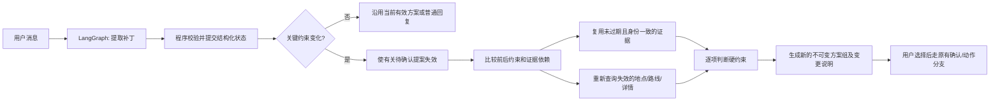

# SoloVibe 重新设计与发布方案 V2

> 版本：V2.0｜日期：2026-10-13｜性质：后续实施方案，未完成项不能视为已交付。
>
> 基线：`Refactor` 分支提交 `25b3016a`；依据 [V1 设计](AI_AGENT_REDESIGNED_PLAN_V1.md)和[阶段四交付报告](STAGE4_PROGRESS_2026-10-12.md)。本版继续开发 **SoloVibe 独自城市出行决策 Agent**，不切换为安全、翻译、旅行全链路的 solo trip 产品。

## 1. 决策与目标

保留已运行的 Option B：FastAPI + React、真实 LangGraph、PostgreSQL 业务状态与原生 checkpoint、DeepSeek 语言能力、高德地点/步行路线、Tavily 补充链接。V2 不重新造图，也不为了符合旧设计稿而接入无需求的技术。目标是把阶段零至四的可用原型补成一个**边界清楚、可以恢复、可以验证、可以部署的首版**。

首版用户应能：描述自己现在的状态和限制，得到最多三个有真实地点和路线证据的选择；更改条件后获得相应修订；选定一个方案，明确确认保存或准备导航；刷新或短暂掉线后继续查看真实状态。无法核实的价格、营业、座位、套餐、预约入口和实际到达必须标为未知。发布文案只承诺已经由真实外部接口或本地回执证明的行为。

V1 中的自动预约、支付、持续定位、主动行程监控、商家实时库存、完整旅行安全服务仍不进入本次范围。若没有可靠的分店级官方预约来源，界面不提供“已预约”动作。Tavily 搜索链接不是自动得到的官方商家证明。

## 2. 当前基线与缺口

| 能力 | 基线事实 | V2 后续处理 |
| --- | --- | --- |
| LangGraph 与上下文 | 聊天和动作分支真实执行；业务快照、近期原文、滚动摘要与 checkpoint 已持久化，并经过真实模型/数据库恢复验证 | 保持现有分层；给局部重规划增加确定性的版本与失效规则 |
| 地点与方案 | 高德 POI、详情和**去程**步行路线已真实调用；最多三个方案可持久化；Tavily 只提供未确认分店身份的链接 | 补全可行性表述；返程、活动时长、价格等证据缺失时不通过相应硬约束 |
| 确认与动作 | 版本化提案、15 分钟有效期、持久 `interrupt`、幂等保存、导航前重新核验及链接交接已验证 | 保持动作账本为授权权威；条件变更时使有关待确认提案失效 |
| 前端与 API | 当前主界面为 `frontend/src/StageOneApp.tsx`，使用同步 JSON `/api/chat`；旧 SSE 路由返回 503 | 增加运行状态查询与重连处理；不把旧 SSE 伪装成现行能力 |
| 局部调整与反馈 | 当前能记住新约束并重新规划，但没有依赖级证据复用与可解释的变更记录；没有反馈/过程 API | 按依赖失效重查和重排；提供真实状态时间线、可标明为用户自述的反馈 |
| 运营与数据 | 会话有 30 天 `expires_at`；没有端到端删除/清理流程、部署演练或 CI | 完成生命周期、迁移、故障注入、部署和回滚验证 |

阶段四的真实联调证明了当前链路能工作，不能据此推论长期稳定性或所有城市、商户和网络环境都可用。V2 的验收必须把模拟依赖的契约测试与至少一条真实供应商链路明确区分。

## 3. 产品与证据契约

### 3.1 方案的可执行性等级

每张方案保留 `plan_id`、`plan_set_id`、地点身份、地点坐标、来源、观测时间、路线起终点、路线时长/距离、用户条件版本与明确的未知项。向用户呈现的“可执行”只对**已验证的部分**成立：例如“步行到达时间满足 20 分钟限制”，不能扩展为“整个活动能在一小时完成”。

对用户设置的硬约束逐项判断：`pass`、`fail` 或 `unknown`。`unknown` 不等于 `pass`。如果用户要求“18:00 前回来”，必须知道返程终点并验证去程、活动、返程的时间；缺少目的地或活动时长时提一个必要问题，或明确说明无法确认完整时限。预算若只有未知价格，不能宣称“50 元内”。营业、套餐和评分只在有可追溯且与同一分店匹配的来源时显示，并标注时间；检索不到就写“未核实”。

首版优先把不确定性说清楚，而不是让模型推算出貌似精确的承诺。建议卡片字段区分 `verified_facts`、`estimates`、`unknowns`、`sources`，但迁移必须保持已有客户端可读；实现时以版本化 API 契约决定最终字段名。

### 3.2 外部工具契约

模型不得直接决定工具调用已成功。地图和搜索适配层统一输出：输入规范、供应商、请求关联 ID、目标地点标识、抓取时间、结构化结果、错误类别与是否可重试。至少区分无结果、供应商拒绝、配额、超时、无效响应和地点身份不匹配。未知评分、套餐和价格不能由解释节点补全。

路线与地点必须绑定同一 POI 身份和同一坐标/起点版本；导航确认时沿用阶段四的重新查询。Tavily 搜索内容作为低信任外部文本处理，不得变成系统指令、授权或已经验证的商家事实。地点/路线没有可靠证据时给降级说明或澄清，不展示虚构候选。

## 4. 阶段五的目标架构

### 4.1 LangGraph 与状态

沿用现有 `accept_event → understand_context → commit_context → ... → publish` 聊天图，以及 `prepare_action → await_confirmation → ... → persist_receipt` 动作图。局部调整不是第二套 Agent：在约束补丁提交后，增加确定性的依赖比较与证据处理，再由现有规划/解释节点生成新方案。

业务状态是当前约束与授权的权威来源；原始消息用于追溯，摘要只帮助模型理解较早语境；checkpoint 保存图执行位置。原有的约 80% 节点输入预算触发摘要、保护最近完整回合的策略继续使用。每次约束变更立刻写结构化快照，不能等到摘要触发。执行和授权进度只由程序/数据库回执更新。

新的方案组保持不可变，并记录 `parent_plan_set_id`、触发消息/补丁、条件版本和所复用证据的来源。旧方案与已保存方案可以作为历史查看，但必须标注其“当时条件与观测的快照”；当前可操作的永远只有当前条件版本的方案组。已完成的外部交接不能追溯撤销，只能将后续使用提示为需重新核验。

### 4.2 依赖失效规则

| 变化 | 必须失效或重算 | 可复用条件 |
| --- | --- | --- |
| 城市、起点或起点坐标 | 地理解析、附近地点检索、去程路线；若地点范围改变，候选及详情一起重查 | 与旧起点无关的用户偏好仍保留 |
| 目的地/返程要求 | 返程路线及总时长判断 | 同一 POI 和未过期的去程观测可保留 |
| 可用时间、步行上限 | 硬约束判断、排序、方案解释；路线过期时重查 | 同一起终点且未过期的路线证据可复用 |
| 预算 | 价格约束判断与排序；未知价格仍未知 | 地点和路线身份未变且新鲜时可保留 |
| 兴趣、排除条件 | 候选筛选、必要时重新搜索与排序 | 不冲突的候选证据可保留 |
| 精力或气氛 | 匹配解释、软排序 | 地点/路线硬证据不自动失效 |
| 时间流逝、证据超过有效期 | 对依赖该证据的判断和动作重新核验 | 无关的历史偏好可保留 |

证据复用的前提同时包括供应商地点 ID、坐标、起终点、条件版本、时效和所需字段匹配；仅凭文本名称相似不能复用。初始时效沿用阶段四动作的 30 分钟地点/路线门槛，拆分为可配置策略之前先用现有行为做回归基准。用户改条件时，待确认动作必须先失效并与 LangGraph 中断状态一致，然后才展示新方案。已授权执行中的动作按账本状态完成或明确报告不确定结果，不能静默取消或重试造成重复执行。

### 4.3 运行恢复与 API 选择

本版保留现行同步 JSON 聊天接口作为兼容入口，增加按所有者读取 `run_id` 的有限状态与最终回执，并让前端在刷新/连接中断后恢复读取。前端必须区分“浏览器未收到响应”和“服务端已失败”，不能因前者自动重复发起另一条非幂等请求；同一个 `request_id` 的重放只能拿到原结果或原运行状态。

实现时验证服务器取消、进程重启、网关超时三种情形：若后台运行不能跨断连持续，必须明确记录可重试状态并用既有幂等机制安全恢复。若实测同步链路在目标部署环境超时，再将异步任务/事件流列为独立改造；不能直接启用目前返回 503 的旧 SSE 路由或宣称已经流式输出。

## 5. 阶段五工作包与文件范围

按以下顺序实施，每个包单独提交、验证，失败时能回退到前一个稳定点。文件名表示主要改动位置，不要求为了匹配清单机械新增文件。

### 5.1 S5-A：冻结接口与可行性语义

- 核对 `backend/main.py`、`backend/domain/`、`backend/services/planning.py`、`frontend/src/StageOneApp.tsx` 的实际 API/展示字段；把 `backend/API_PROTOCOL.md` 更新成运行中契约，历史原型内容移到明显的参考区。
- 建立方案的已验证事实、估计和未知项的序列化契约；修正“总时长/预算/营业已满足”的过度承诺。需要返程或活动时长时，明确是新增验证能力还是暂不声明可满足。
- 给地图/搜索适配器增加统一错误和来源字段；前端呈现信息缺口，不把单个搜索结果变成分店事实。
- 验收：真实地点及路线仍可得到；模拟空结果、超时、错分店、缺少价格/时长时没有错误的“满足条件”标签；新旧客户端字段兼容或有明确迁移版本。

### 5.2 S5-B：局部调整与版本化重规划

- 在 `backend/agent_graph.py`、`backend/services/application.py`、`backend/services/planning.py`、`backend/persistence/repository.py` 实现变更集、失效矩阵、受影响证据的重查与新方案组持久化；迁移脚本和 `backend/persistence/schema.sql` 做增量变更。
- `frontend/src/StageOneApp.tsx` 展示“哪项条件改变、哪些证据重查、哪些结论仍未知”；为用户提供修改时间、预算、步行距离和偏好的直接入口，聊天更正仍能工作。
- 调整前后的方案 ID 不复用；新条件下的保存/导航必须基于新 `plan_set_id`。待确认提案与图中断同步失效，跨进程恢复后也如此。
- 验收：分别改变位置、预算、时间、步行上限、偏好；证据复用与重查符合上表；旧 proposal 确认被拒，已保存历史不被误改；无关闲聊不触发外部重查。

### 5.3 S5-C：真实过程、反馈与断连恢复

- 为已有 `runs`、`node_events`、`actions` 建立所有者受控的运行状态/时间线读取接口，增加有限的用户反馈记录；只展示已发生的服务端事件和明确标为用户自述的经历，不推断“到达”“已消费”。
- 前端处理请求等待、刷新、断连、重复点击和可重试失败。运行中状态与最终结果从服务端读取；同一请求 ID 只执行一次。
- 验收：跨浏览器刷新和新进程读取一致；别人的会话/运行/动作不可读；断连、超时、重复提交不会重复写入保存方案或制造两个当前方案。

### 5.4 S5-D：数据生命周期与发布运维

- 明确会话保留期和用户删除行为：删除原始消息、摘要、业务快照、方案、动作、保存项及相应 LangGraph checkpoint。先调查当前 checkpointer 提供的删除 API/表关系，再写事务或分阶段可恢复清理；不能只删消息却留有可恢复个人历史。删除进行时拒绝新的聊天/确认，清理失败需可重试且可审计。匿名 session 的 30 天过期设置应有实际清理任务及测试。
- 制定环境变量清单、秘密存放、生产 API 地址、CORS、cookie 的 Secure/SameSite、代理超时、健康检查、日志去敏、数据库备份与恢复、迁移顺序。`frontend/src/api.ts` 已支持 `VITE_API_BASE_URL`，目标环境需验证其实际配置。
- 加入 CI：不含密钥的 Python 测试、前端类型检查/构建、模拟浏览器契约测试；真实 DeepSeek/高德/数据库测试作为显式启用的集成检查。清理或归档旧前后端入口，修复妨碍全仓检查的 `backend/setup_env.py` 语法错误，并标记旧工具计划/架构文档的历史状态。
- 在隔离环境演练从当前数据库迁移、回滚应用版本和备份恢复；注入模型/地图/搜索失败、超时、数据库中断、进程重启与跨用户访问。部署前写出已知限制和发布检查表。
- 验收：自动检查全绿；无密钥进入仓库或前端包；删除后业务记录和 checkpoint 均不可读/恢复；演练记录可复现；旧入口不会意外被当成正式 API。

## 6. 测试原则与验收矩阵

按“模型/供应商适配层 → 服务与持久层 → Agent 工具与图 → HTTP/前端”设稳定输入输出契约。每个边界测成功、空结果、非法输入、失败、超时、无权限和可恢复性；再做少量真实端到端检查。用户提供的 ROS2 例子中的**分层和边界测试思路适用**，ROS2 service/topic/action 本身不属于 SoloVibe，不引入 ROS2。

| 检查 | 模拟/隔离验证 | 最小真实验证 |
| --- | --- | --- |
| 地点和路线 | 超时、空列表、失效坐标、同名错店、过期证据、供应商错误分类 | 一座已配置城市的 POI、详情与步行路线；确认前重查 |
| 模型与上下文 | 补丁冲突、预算触发压缩、近期原文保留、摘要失败后快照不丢 | 真实多轮更正、重启后状态一致 |
| 图与动作 | LangGraph 中断/恢复、过期、拒绝、错误摘要、不同所有者、重复请求 | 真实 PostgreSQL 多进程恢复和单次保存 |
| 调整 | 各字段失效矩阵、旧方案不可执行、复用条件、无关聊天不重查 | 真实路线证据下更改起点和时间 |
| 前端/运行 | 刷新、断连、重试、未知项显示、错误提示 | 浏览器完成选择→确认→保存/导航交接→恢复 |
| 生命周期/发布 | 删除顺序、checkpoint 清理、过期清理、迁移和回滚 | 隔离数据库的备份恢复和部署检查 |

任何端到端结果必须注明哪些供应商是真实调用、哪些只是假服务或浏览器拦截。模型回答看似合理不代替地点身份、路线、费用、权限和持久化校验。上线前的通过标准是：所有工作包验收完成、关键失败路径可观察可恢复、用户界面不夸大证据、真实配置下完整链路通过、隔离环境迁移/回滚通过。若缺少真实地图或数据库凭据，相应验收不能标记通过。

## 7. 交付节奏与后续扩展

先交付 S5-A，锁定语义与契约；再交付 S5-B，使本项目最关键的“条件变化后仍可信”成立；然后做 S5-C 的恢复与反馈；最后完成 S5-D 的数据治理、运维和发布演练。每一包附变更说明、测试证据、尚未验证的条件与下一包入口。此顺序使每次 PR/提交都能由用户实际运行检查。

首版发布后再根据实际使用数据决定是否做异步流式进度、分店级官方预约合作、其他地图供应商、返程及活动时长的完整计算、更多城市覆盖。扩展前仍遵守同一原则：工具只暴露安全、稳定、可观察的能力；没有可验证回执，就不能把下一步行动宣称完成。
