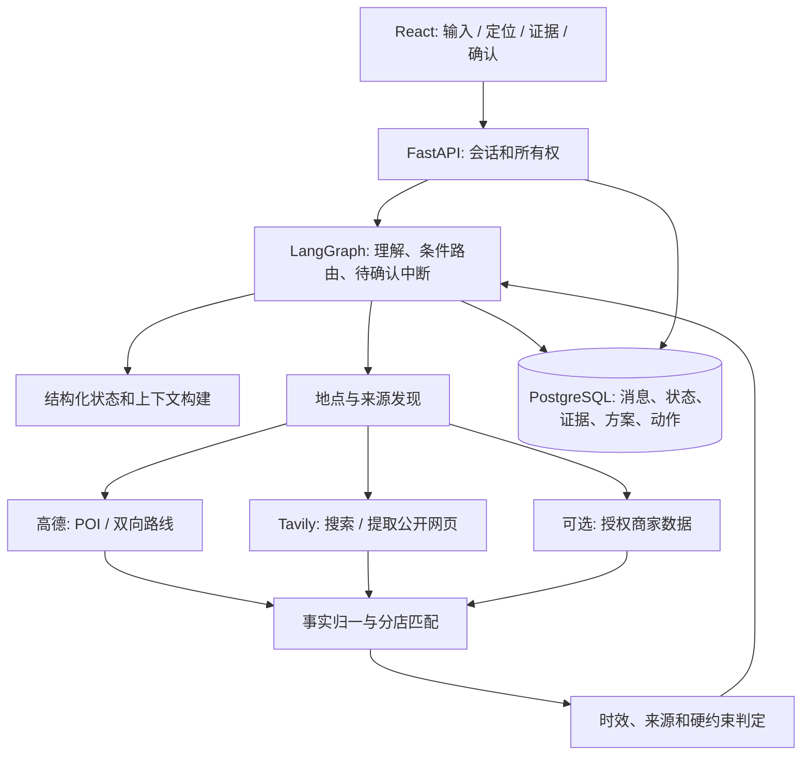

# SoloVibe 完整后续开发方案 V3

> 版本：V3.0｜日期：2026-10-13｜状态：实施计划，非已完成报告。
>
> 当前代码基线：`Refactor` 提交 `5515d30e`。承接 [V2](AI_AGENT_REDESIGNED_PLAN_V2.md)与[阶段五 A 报告](STAGE5A_EXTERNAL_DATA_2026-10-13.md)。本版把“真实外部信息”作为产品能力和数据契约来建设；研究与分级路径详见[外部信息获取方案 V2](EXTERNAL_INFORMATION_ACQUISITION_PLAN_V2.md)。

## 1. 产品结果与范围

SoloVibe 继续服务“一个人想在城市里做什么”的决策：了解精力、时间、预算、步行限制和偏好，给出最多三个带证据的选择；用户改变条件后局部更新；用户确认后保存或交接导航。V3 将“可执行”细化为**实际地点、双向路线、停留时间、可用的商家/活动信息及明确的未知项**，而不是一张字段填满的卡片。

V3 有两个可诚实交付的等级：

- **公开数据版**：真实地址/可选的用户定位、高德往返路线、由用户确认或官方页面支持的停留时长、部分商家官网菜单/活动资料、有限的公开优惠、明确的证据与未知项。可以完成选择、确认保存和导航交接。
- **合作数据增强版**：在获得分店/平台业务授权后，才展示可核实的实时营业、可预约座位或库存，并在确认前重新查询。没有这种授权时，界面提供官方入口但不展示“有座/有货”的断言。

本项目不转为 solo trip 安全/翻译平台，也不在本轮做自动支付或通用代订。完整信息覆盖**所有**商家在现有 Key 条件下不可保证；V3 的成功标准是支持已验证的地点、对未知透明、对试点店做到分店级的菜单/优惠，且获得授权后能接入实时供给。

## 2. 继承 V2 的实际状态

| 已经完成并验证 | 仍需建设 |
| --- | --- |
| 真实 LangGraph 聊天/动作分支、PostgreSQL 状态与 checkpoint、滚动摘要 | 条件变化的依赖级失效与局部重规划 |
| 高德地理编码、POI、去程步行、导航前重新查询；地址/路线/评分/参考人均/登记时段/特色标签已真实取得 | 主动定位的坐标处理、返程路线、停留时间与完整时限判断 |
| Tavily 搜索、错分店名称过滤；搜索结果仍标为未验证 | 搜索→正文提取→分店匹配→字段证据链；官网菜单和优惠试点 |
| 用户确认后单次保存、导航链接交接、跨进程恢复；真实浏览器验证 | 运行断连状态查询、反馈时间线、删除/保留、部署/回滚与 CI |

高德 `opentime_today` 是登记时段，Tavily 搜索命中只是线索，高德特色标签不是实时菜单。V3 开发中不得倒退到用模型补齐缺失的套餐、实际花费或到店状态。

## 3. 目标架构

LangGraph 负责流程与中断，不让模型直接访问商户后台或决定 API 是否成功。服务层保持“小工具、强契约”：`resolve_location`、`search_pois`、`route_walk`、`search_sources`、`extract_page`、`read_authorized_merchant`、`evaluate_claims`。每个工具有输入 schema、限时、错误分类、来源记录和可重试规则。外部网页正文仅进入隔离的提取步骤，不进入系统指令或授权状态；动作账本仍是授权权威。

### 3.1 状态、证据与版本

结构化状态新增（按增量迁移）：`origin` 的文本/坐标/坐标系/来源/精度/时间、`return_destination`、`desired_dwell_minutes`、计划开始时间，以及现有预算/偏好/步行约束。位置不自动持续追踪。用户更正这些字段时，仍采用“模型提出补丁 → 程序依据原文与范围校验 → 版本化提交”；历史摘要只辅助语言理解，不能覆盖新状态。

证据单独保存为 `venue_identity`、`source_observation`、`venue_claim` 和计划与证据的引用。Claim 至少含 `field/value/unit/scope/source_id/observed_at/valid_until/status`；地点映射至少核对高德 ID、名称、城市、坐标及可获得的分店地址。`scope=brand` 不得自动升级为 `scope=branch`。旧方案组不可变，当前版方案指向当前约束版本和事实版本；过期/冲突数据回退未知。新表迁移只增不破坏原有已保存方案。

完整行程判断：`outbound_walk + dwell + return_walk + buffer <= available_minutes`。`pass/fail/unknown` 逐字段保存；若时长是用户自己选择的，则说明“按你计划停留 X 分钟计算”，不能说景点客观游览时长必为 X 分钟。只有具体价目/门票/套餐和适用条件足够，预算才可 `pass`；参考人均仅作参考。

### 3.2 方案与动作图

图中 `collect_routes_and_sources` 可在一个受并发上限控制的节点内部并行 I/O，不引入任意动态多 Agent。用户只改预算时重判价格和排序，起点改变时重查地点范围和双向路线，停留时长改变时重算总时限。证据复用须同时满足分店身份、起终点、条件版本、来源时效；无关闲聊不触发重复 API。待确认动作在相关条件更改时先失效，再发布新方案；已保存方案作为历史快照保留。

## 4. 分阶段实施

### V3-0：固定试点和证据协议

- 按[外部信息方案](EXTERNAL_INFORMATION_ACQUISITION_PLAN_V2.md)先固定上海 12 个测试地点和来源清单，记录咖啡、餐饮、景点、公园各类成功/失败；对官网、授权 API、地图字段和搜索摘要设不同的可声明范围。
- 在 `backend/domain/` 定义 VenueIdentity、SourceObservation、Claim、FeasibilityCheck 以及统一的 `success/empty/forbidden/timeout/invalid_response/identity_conflict/stale` 结果；更新 `backend/API_PROTOCOL.md` 和计划响应版本。
- 验收：无网页抓取时仍能得到现有真实方案；错误分店、品牌级菜单、缺价和过期优惠不会变成分店事实。

### V3-1：真实位置与完整路线

- 前端增加手填地址/地标和“使用当前位置”两个入口。浏览器授权后传坐标与精度；后端使用高德坐标转换、逆地理编码、歧义确认。主要位置逻辑落在 `backend/services/planning.py` 的地图适配器或拆出的地理服务，不重复旧原型实现。
- 新增返程目的地选择；高德往返分别算路，路线保留几何字段以支持实际道路折线图。按用户停留时间、双向路程和缓冲判断完整时限；缺一项就澄清或未知。
- 验收：真实高德对同一试点地点给出两条可追溯方向路线；前端画的是供应商折线而非两点直线；定位拒绝/低精度不阻止手填；往返可不对称；完整时限与步行限制有失败和未知测试。

### V3-2：公开商家资料流水线

- 在 `backend/services/` 新增来源发现、Tavily Extract、官网字段抽取与分店匹配服务；不把该功能直接塞进 `AmapProvider`。按域名、URL、抓取状态和字段范围记录；对外链和正文做长度、类型及低信任处理。给餐饮、景点分别定义菜单/票价/营业/优惠 schema。
- `backend/persistence/schema.sql` 和迁移脚本增量加入身份映射、来源观察与字段 Claim；只存短证据片段/哈希，不复制网页全文。前端展示“品牌菜单示例／本分店价目／待核实线索”的明显区别，能点到来源和获取时间。
- 验收：用现有 Tavily Key 重现至少一个商家官网菜单提取；三个固定试点地点取得分店级官方或授权菜单/价目才称“分店菜单已接通”。Tavily HTTP 200 但单 URL 失败、错分店、网页删价、冲突来源均降级。

### V3-3：套餐、时段与预算决策

- 只把带来源、适用门店、明确价格/条款/有效期的优惠写入 `venue_claim`。动态网页先抽候选再做规则验证；缺条件的搜索结果只展示链接。营业分“登记时段／按时段推测／授权实时状态”，预算分“已知价目可判／参考价不可判”。
- `backend/services/planning.py` 的方案排序和前端卡片读取字段级检查；同一时刻来源过期后阻止继续声称可用，确认行动前重查必要事实。将用户可以执行的下一步指向官方页面，不暗示已代订。
- 验收：至少一个试点来源有真实、可回溯且有期限的套餐/优惠；过期和不适用门店不能入预算判断。若固定样本没有合格来源，报告覆盖缺口并进入合作数据轨，不用模拟套餐凑验收。

### V3-4：授权商家实时数据轨（外部依赖）

- 调查美团/大众点评合作接口或直接招募一家试点商家，核对业务授权、字段权限、刷新频率与展示范围。适配层在服务端保管令牌；先只读分店状态、可预约时段或库存。没有授权时这条轨不调用假接口，产品保持公开数据版。
- `prepare_action` 前重新读取实时状态，提案过期或状态变化则要求用户重新确认。若接入实际预约行为，另立动作契约、取消/重试/未知结果处理；本 V3 默认只交接到官方入口，不自动下单。
- 验收：至少一家**真实授权**试点门店的当前状态能在前端显示，包含来源与检查时间；授权过期、库存变化、并发请求和失败时不显示旧“可用”断言。没有合作凭据，不标记本轨完成。

### V3-5：局部调整、运行恢复与用户反馈

- 延续 V2 S5-B/C：在 `backend/agent_graph.py`、`backend/services/application.py`、`backend/persistence/` 落实条件依赖图、不可变新方案组和证据复用；在 `frontend/src/StageOneApp.tsx` 提供直接修改预算/时间/步行/停留时长与“重查该店”入口。
- 增加所有者受控的运行状态读取、断连/刷新后恢复和事实时间线；用户反馈明确标为自述，不代表实际到店或消费。同步 JSON `/api/chat` 继续兼容，若目标部署证实其超时，再独立设计异步任务/事件流，不复活旧 SSE 503 入口。
- 验收：位置、预算、时间、偏好分别更正；只重查受影响证据；旧方案确认被拒；跨进程和断连后不重复请求/保存；不同用户不能读彼此运行和资料。

### V3-6：数据生命周期、可靠性与发布

- 完成 V2 S5-D：会话和 LangGraph checkpoint 的一致删除、过期清理、敏感信息去日志、后台密钥管理、生产域名/CORS/cookie/代理超时、迁移备份与回滚演练。保留固定样本的原始来源 URL、抓取结果状态和测试时间，但不把用户位置公开入库或日志。
- CI 运行隔离依赖的 Python 契约测试、前端类型与构建、浏览器模拟用例；真实外部服务检查显式启用并限制用量。修复仓库旧脚本语法问题，标明/归档旧前后端入口。
- 验收：成功、空、错店、超时、403、配额、格式变化、过期、越权、重启、删除和回滚均有记录；真实浏览器完成“地址/定位→双向路线→来源资料→条件修改→确认保存/导航”；生产前复测至少一条无模拟的完整路径。

## 5. 数据与供应商权限的交付门槛

当前 `backend/.env` 的 DeepSeek、高德、Tavily、数据库配置足以开发并验证公开数据版，不需要把密钥粘贴到聊天中。若用户期待“任意美团/点评商家的当前套餐、座位和库存”，需要适用的商业/商家授权或获许可的数据源；代码和爬虫不能替代这些权限。V3-4 的合作接入可以在其他包开发时并行洽谈，但**未经真实授权的库存/实时状态不能验收**。

对外发布时报告两个分开的指标：`真实链路成功率/覆盖率` 和 `字段证据准确性`。固定样本里的失败不删除；“未知”是有意的产品结果，不计为成功获取，但也不能误报为假数据。以零错店事实、零伪造实时状态、可从 UI 回到原始来源、确认动作只执行一次作为硬门槛。

## 6. 下一步的具体入口

从 **V3-0 → V3-1** 开始：冻结试点名单和 Claim 契约，再做浏览器定位坐标转换、返程路线及真实路线图。随后 V3-2 用本轮已验证可提取的官网菜单做第一条端到端数据流水线。这样用户最早能在页面上看到“真实位置、真实往返路线、真实来源商品资料”，同时清楚知道哪些是品牌信息、哪些属于具体分店。每阶段提交代码、中文交付报告、自动与真实联调结果，更新 README 的完成状态。
