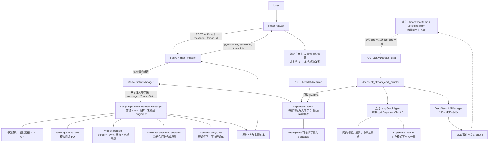
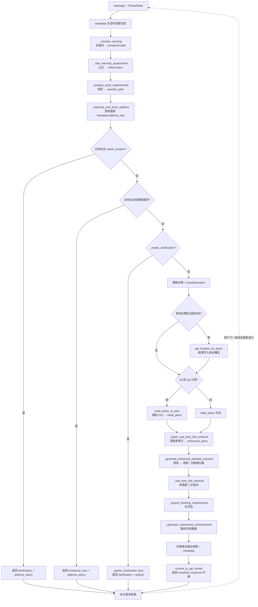
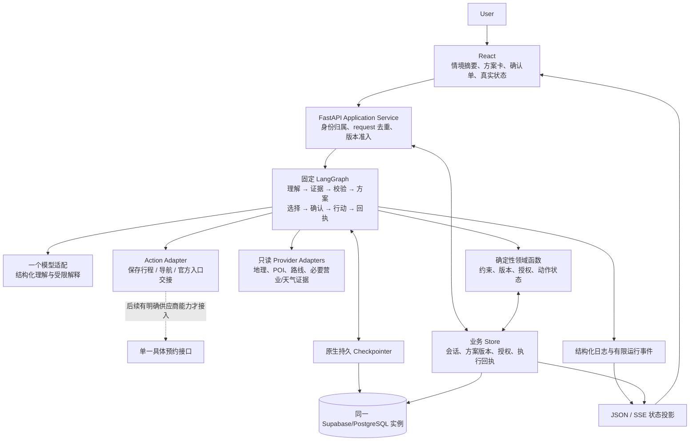
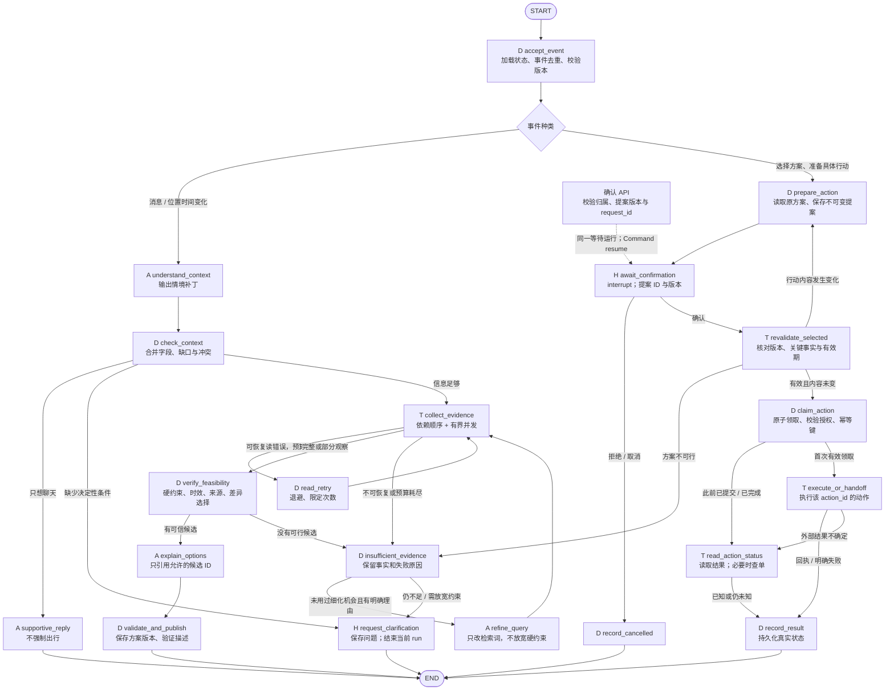

# AI Agent Project Redesign Proposal

> SoloVibe：从城市探索演示，升级为理解当下约束、提供可信选择并承接行动的独行陪伴应用。
>
> 审查日期：2026-09-12 至 2026-09-13。审查对象：[SOLOVIBE_APP][repo]，提交 [da89caf9c69288cbf369238a66a18455cfccaae5][commit]（2026-07-01）。
>
> 本文为静态 Repository Analysis + Architecture Design + Product Redesign。未修改实现、安装依赖、启动项目、运行测试、执行 Benchmark 或 Evaluation。文中的实现阶段验收项是未来工作，不是本次测试结果。

## 1. Executive Summary

**推荐 Option B：保留独自出行场景，建设“经现实约束校验的选择—行动闭环”。** 产品聚焦用户当下的一次短时城市活动：把“累、不知道去哪、还有一小时、最多花五十元”等表达变成可修正的情境与约束，给出最多 2–3 个有实际差异的选项；用户确认具体动作后，保存计划并交接导航或官方预约入口；条件改变时，只调整受影响部分。

最重要的审查结论是：**当前代码没有真正构建 LangGraph，也没有模型驱动的 ReAct 循环。** LangGraph 出现在依赖、类名和说明中，但生产 Python 代码没有相应图构建、节点注册、编译或调用。实际核心是一个顺序执行的 async 函数，使用关键词、模板和普通工具方法；DeepSeek 主要位于另一条 SSE 出口，负责润色或独立回答。[核心入口][g-process]

现有项目已经积累了界面设计、地点槽位、搜索适配和领域对象的雏形，但尚未形成可靠闭环：

- 主 App 接收文字聊天结果，方案卡来自前端静态数据；选择方案没有真正传递到预约执行。[主界面][ui-chat]
- 主流程的附近 POI 是模拟列表；搜索结果进入场景生成时又丢失商家绑定；营业状态未知有时被当作开放。[POI 方法][poi]、[场景生成][scenario-plans]
- Supabase 的线程写入实际只写进程内存；自定义 checkpoint 不能恢复到原执行位置；resume 接口只改状态。[线程保存][db-save]、[恢复接口][api-resume]
- 时间、预算、可行路线、营业窗口和用户能量尚未共同约束最终方案；当前“情境感知”主要影响模板与少量搜索参数。

因此，升级的主线不应是“给现有 ReAct 再套 Workflow”，而应是：**统一事实与状态契约 → 接通真实选择与行动 → 用一个小型固定 LangGraph 管理有状态流程，把语言理解和解释交给模型，把约束、授权和执行交给确定性代码。**

不推荐通用 Agent Runtime 产品化、Multi-Agent、动态 DAG 生成、向量库、Redis、消息队列或通用浏览器代订系统。当前价值缺口不需要这些技术解决。工程辨识度应来自可追溯的方案、受约束的调整和真实行动结果；本文不把这些工程设计宣称为新的 Agent 算法。

## 2. Current System

### Current Product

当前是一个独处陪伴与城市漫游交互原型：聊天、三类活动卡、地图展示、预约进度、打卡和手记等界面已存在。主入口为 frontend/index.html → frontend/src/main.tsx → App.tsx，主聊天请求固定发送到 localhost:8000/api/chat。它没有挂载独立的 StreamChatDemo、useSoloStream 或 MapPage。

“生成三个方案”目前只切换页面；“换一批”只重排本地数组并改标题；预约进度由定时器推进，确认按钮只更新 React 状态和弹窗。不能将这些交互解释为服务端已完成规划或预订。/api/v2/wander-plans 也返回模拟三方案，没有与当前会话关联。[方案交互][ui-plans]、[预约界面][ui-booking]、[模拟方案 API][api-plans]

仓库 docs/PRD.md 实际为 25 页 PDF，已按文件内容只读提取正文。它要求多约束方案、预约失败降级，并明确移除 PK；当前仍有 PK 遗留状态和空路由。PRD 是产品意图，不能代替接线证据。[PRD，第 7–15、23–25 页][prd]

**版本与覆盖边界。** 工作目录 D:/SOLOVIBE 的 origin 指向 SOLOVIBE.git，HEAD 为 a6bcdd24，与本次指定仓库不同。因此在临时目录获取了指定仓库的独立源码快照，未改动本地 origin 或工作树实现。审查覆盖后端入口、会话与存储、Agent 主模块、工具/数据/安全模块、主前端、独立 SSE Demo、协议与部署配置，并静态抽读测试；未逐行审计第三方 node_modules、二进制缓存和历史备份。未发现快照内 AGENTS.md。以下源码链接固定到同一提交。

### Current Architecture

下图 B 表示源码接线，不表示这些路径已成功运行。尤其要区分主 App 与没有挂载到主 App 的 SSE Demo。

实际组件职责与接入状态：

| 层 | 已有实现 | 关键限制 |
| --- | --- | --- |
| 主 UI | 聊天输入、静态方案、预约/地图演示 | 会话 ID 只在 React 内存；方案不是聊天结果投影 |
| HTTP | /api/chat 返回 JSON；/api/v1/stream_chat 返回 SSE；线程查询/恢复接口 | 两套编排和三种协议口径：代码、Hook、API_PROTOCOL 文档 |
| 会话 | ConversationManager 加载 metadata、调用 Agent、保存 metadata | 每轮重新创建 ThreadState，消息历史没有按完整线程还原 |
| “Agent” | process_message 顺序编排、多个规则/模板方法 | 无 LangGraph 调度、无模型工具循环 |
| 外部数据 | 高德地理编码、Serper/Tavily HTTP 调用 | 附近 POI 和大量场景字段为模拟；搜索不是实时可用性证明 |
| 行动 | BookingSafetyGate 与浏览器执行类存在 | 生产主链没有调用 execute_booking / resume_booking |
| 存储 | 真实 Supabase 初始化/查询、checkpoint insert、内存后备 | 线程/消息没有对称的真实数据库写入 |
| 部署 | Vite、FastAPI、Vercel 静态构建配置 | 主 UI 硬编码 localhost；Vercel 配置未承接 Python 后端 |

### Current LangGraph

**图 A 的事实前提：不存在已注册的 LangGraph Graph。** 不能从方法名中的“node”或注释中的“ReAct Stage”虚构节点、条件边和 reducer。下面画的是 process_message 的真实函数控制流；菱形是 Python 条件，虚线是下一次 HTTP 请求，不是当前执行中的图回边。[process_message，第 533–787 行][g-process]

图中顺序对应真实调用；内部查询的 catch/fallback 在第 4 节说明。主函数没有统一的异常节点，异常可上抛至 API/ConversationManager 后被转为通用回复。_difficulty_adapter_and_generator、_check_execution_safety、_generate_response_plan、_requires_confirmation、resume_execution 不能作为已接入主流程的节点。

所谓 reasoning 的实际内容是：关键词加分、固定地名和正则、模式阈值、模板选择、评分排序。LangGraphAgent 内没有 LLM 调用；DeepSeekLLMManager 的请求没有工具 schema、tool_calls 分派或工具 observation 回传。主 App 使用的 /api/chat 路径也不经过这个模型润色出口。[规则分析][g-react]、[情绪与模板][g-emotion]、[模型出口][llm]

### Current State Design

| 状态/对象 | 实际位置及流动 | 问题 |
| --- | --- | --- |
| ThreadState | Pydantic：thread_id、status、messages、metadata、created_at、updated_at | 是会话容器，不是 LangGraph State Schema；没有 run/方案/确认/执行状态 |
| metadata.address_slot | 地址方法原地写；地理编码再补 lat/lng；不同层反复加载保存 | 无定位来源/精度/坐标系；过期和覆盖规则不统一 |
| _reaction_plan | 运行时挂到 ThreadState 的非声明属性 | 依赖隐式传值，不属于明确序列化契约 |
| EmotionProfile / VibeContext / QuestNarrative | 局部 dataclass，依次传递 | 与用户修正、跨轮约束缺乏统一合并规则 |
| detailed_scenario / updated_scenario | 可能是 dataclass、字典或特殊无数据对象 | hasattr、下标、asdict 和字符串降级混用 |
| emotion_memory | Agent 实例内字典，末尾写入 | 主推理路径不读取；不能称为有效长期偏好记忆 |
| checkpoint_data | 自定义输出快照字典；部分可写数据库 | 不保存调度位置；恢复只查另一处内存索引 |
| 前端 plan/booking/thread state | React 本地状态 | 与服务端方案及执行结果没有共同主键和版本 |

ConversationManager.load_thread_state 每轮从空 messages/ACTIVE 开始，只把历史 metadata 放回去；save_thread_state 也只提交 metadata。因此“存在 messages 字段”不能证明多轮记忆有效。已存在的字典默认值不是本次的核心问题；不把 Pydantic 模型字段简单等同于普通函数可变默认参数缺陷。[State 定义][types]、[会话管理][conversation]

## 3. Key Problems

以下 9 项按对产品可信性和升级路径的重要程度排序。它们是静态代码结论或明确标出的风险，不是运行测试报告。

### 1）P0：推荐数据无法证明真实可执行

**现状：** route_query_to_pois 使用 mock_pois，未匹配地区生成“某地附近安静角落”等名称，radius 没有用于实际范围搜索。generate_with_plans 即使收到候选也回到未传商家的标准生成器；天气随机生成。Serper 空搜索结果默认 open；部分查询失败被标成 unknown 且 is_open=True，随后通过可用筛选。[POI][poi]、[生成器][scenario-plans]、[天气][weather-mock]、[营业解析][web-status]、[可用筛选][g-feasible]

**为什么是问题：** “用户现在能去”是本产品的基础承诺。真实地理编码加上一次搜索，并不能使后续合成商家、费用或天气成为真实信息。

**根本原因：** 数据对象没有保留来源与稳定 POI ID；生成器可以重新选择事实；unknown、error、synthetic 与 verified 没有贯穿全链路的不同语义。

**是否值得解决：** 必须，优先于新增 Agent 框架能力。

**推荐方案：** 接一个真实 POI/路线来源，保留 provider+poi_id；硬约束在代码中校验；方案引用已筛选证据。营业状态保留 open/closed/unknown，查询状态另列；无法核实的内容不进入“已确认可行”结论。真实缓存过期后标 stale，不合成“缓存事实”。

**实际收益：** 方案与店家、路线、观测时间可一一追溯；失败时不会用虚构确定性填空。**增加复杂度：** 中等，主要是数据契约与少量真实供应商适配，没有必要引入 RAG 或向量库。

### 2）P0：方案选择、确认和后续行动没有接通

**现状：** 前端方案来自静态数组，选择 B/C 后预约摘要仍固定；确认只弹窗。服务端只评估 booking_requirements，未调用 execute_booking；resume 接口只改 ACTIVE，未消费确认内容或恢复行动。[UI 选择与确认][ui-booking]、[风险评估][g-booking]、[resume][api-resume]

**为什么是问题：** 用户以为系统承接了选中的方案，实际上系统没有对应动作或回执。即使推荐质量改善，产品任务仍未完成。

**根本原因：** 缺少贯穿 UI/API/存储的 plan_id、plan_revision、action_id；“显示等待确认”和“具有可恢复的待执行动作”被混为一谈。

**是否值得解决：** 必须，是从原型成为应用的分界。

**推荐方案：** 卡片仅渲染服务端方案；确认单绑定不可变行动内容及版本；先接保存行程、真实导航或官方预约入口交接。只有接入能返回可核验结果的供应商后，才增加自动预约；取消、失败、已交接、未知结果必须区分。

**实际收益：** 用户选择与最终动作一致，确认可恢复，界面不再产生虚假成功。**增加复杂度：** 中等；导航交接低于通用自动代订，第一版值得做。

### 3）P0（公网前）：会话访问与状态隔离没有可信边界

**现状：** 聊天、线程查询和 resume 接口未见身份/所有权校验；客户端提交 thread_id 即被使用。SQL 启用了 RLS，但 policies 使用 true，允许匿名宽泛访问。主 UI 仅用内存保存 thread_id，连续首轮发送可能生成多个线程。[HTTP 入口][api-chat]、[线程接口][api-resume]、[RLS][rls]、[前端聊天][ui-chat]

**为什么是问题：** 应用保存位置、偏好和情绪表达；部署后他人若取得线程标识，存在越权读写风险。thread_id 的不可猜测性不等于授权。

**根本原因：** 原型以“能复用同一线程”为目标，没有 owner/session 与并发版本契约。

**是否值得解决：** 公网多人使用前必须完成；本文没有声称真实数据库已应用这些宽松 policies 或已经发生泄露。

**推荐方案：** 最简采用服务端签名的匿名会话，线程绑定 owner_session；全部 API 验证归属，用户升级登录后可迁移所有权。对外数据库访问收紧 RLS。同一线程活动 run 采用版本比较/单写入准入，首个请求前建立稳定会话标识。

**实际收益：** 避免串线、越权和过期响应覆盖新选择。**增加复杂度：** 低至中等；无需增加独立身份微服务或 Redis 锁。

### 4）P1：入口和数据契约不统一，基础可运行性也存在静态阻断点

**现状：** Agent 将场景转 dict，main 仍用对象属性读取正常结果；/api/chat 丢掉结构化方案；SSE Hook 按旧标签解析新事件。data_types.py 引用了未定义的 SoloIndexDimensions；main.py 在 logger 初始化前执行缺配置分支日志。[DTO 转换][scenario-api]、[SSE handler][api-sse]、[Hook][hook]、[模型类型][types]、[入口初始化][api-init]

**为什么是问题：** 正常结果可能退化为泛化话术；地址追问或确认信息到不了 UI。Python 3.10–3.13 的即时注解路径会在未定义类型处报错；3.14 延迟注解语义不同，但类型仍未解析，不能假设兼容。

**根本原因：** 文档、模拟对象、兼容分支和实际 HTTP 契约分别演进；没有唯一入参/结果定义。

**是否值得解决：** 必须先于图重构，否则重构只会搬运错误。

**推荐方案：** 一个应用服务入口、一组经过校验的判别联合结果（clarification/options/action_required/result/error），JSON 与 SSE 仅是同一结果的传输投影；纠正初始化与未解析类型，锁定可工作的依赖组合。

**实际收益：** 前后端能传递真实方案和状态；运行问题不会被通用回复掩盖。**增加复杂度：** 低至中等，通常还会减少分支和维护负担。

### 5）P1：持久化、memory 与 checkpoint 的名称超过实际能力

**现状：** save_thread、save_message 只写内存；checkpoint 可以真实 insert，但 restore_from_checkpoint 仅查 Agent 内存。主 SSE 的 API 与 Agent 分别建 SupabaseClient，内存状态分裂；ConversationManager 每次只还原 metadata，情绪字典只写不读。[存储][db-save]、[checkpoint][g-checkpoint]、[会话管理][conversation]

**为什么是问题：** 重启/换进程会丢失状态；保存成功日志不代表可恢复；用户补充地点后，前轮疲惫与预算不一定保留。

**根本原因：** 业务会话、输出快照、运行恢复混用同一“状态保存”概念，没有唯一状态所有者。

**是否值得解决：** 必须；但短推荐流程不需要自己开发逐工具事件溯源系统。

**推荐方案：** 修复一个真实业务存储；会话情境和确认单是持久业务对象。目标 LangGraph 采用受支持的持久 checkpointer 保存运行位置，自定义末尾快照退出恢复职责。短推荐失败可重跑；确认等待和执行记录必须可跨进程恢复。

**实际收益：** 澄清可连续、刷新可恢复、确认不会丢失，状态语义可解释。**增加复杂度：** 中等，可复用现有 Supabase/PostgreSQL，不引入第二个数据库。

### 6）P1：情境感知没有稳定表达真实约束

**现状：** energy 从 5 开始只增不减，低能量分支不可由该规则到达；pressure 的 0–10 分数又用 >0.7 判高压。“累”按现有算术得到 pressure=1.5、energy=5、vibe=7.45，模式进入 DEEP，而搜索策略可能按高压处理。预算/截止时间没有统一约束对象。[情绪与模式][g-emotion]、[搜索规则][g-search]

**为什么是问题：** 文案表现得理解用户，选择却未必降低其行动负担。用户“不知道去哪”又会触发固定澄清，可能增加决策成本。

**根本原因：** 以单句分类替代跨轮情境；混合心理推断、偏好与必须满足的现实限制；缺少缺失、否定和用户修正语义。

**是否值得解决：** 必须，是核心产品价值而非语言润色。

**推荐方案：** 模型只提取结构化情境补丁和解释偏好；明确区分用户声明、模型推断和默认值。时间、预算、最大步行量、必须室内等条件由程序校验；用户可以用简短选项纠正“今天想少走路”，无需接受虚构心理评分。

**实际收益：** 下一轮只给地址时仍保留前轮约束；减少无效追问和不适合当下的推荐。**增加复杂度：** 中等，增加结构化解析及字段合并规则；无需心理诊断模型或长期向量记忆。

### 7）P1：缺少真实流程边界，扩展靠继续增长单体函数

**现状：** process_message 混合需求分析、工具调用、对象转换、预订评估与持久化；没有 LangGraph 或真正 ReAct。预设“优化现有图”会误判改造量。[核心编排][g-process]

**为什么是问题：** 出错只能依赖跨层日志；很难让“天气改变只更新室外段”“确认后继续原动作”成为清楚的状态转换。

**根本原因：** 方法命名按架构概念组织，控制权仍集中在顺序 Python 流程中。

**是否值得解决：** Option A 可只拆应用服务，不必加框架；推荐方案包含跨轮等待和状态化调整，因此小型真实 Graph 值得引入。

**推荐方案：** 固定拓扑 Workflow，少量 agentic 节点；按业务恢复边界拆分，不逐函数机械转成节点。工具接收窄参数并返回证据对象，不能修改全局会话。

**实际收益：** 状态更新、失败位置、确认等待和重新校验可见且可维护。**增加复杂度：** 中等；这是首次真正接入 Graph，不是原有 Graph 的微调。

### 8）P1：降级策略与并发资源生命周期会放大错误和延迟

**现状：** SSE 中纯模型 fallback 位于 except 之外，正常结果后仍继续生成；主流程逐 POI 串行检索并可能二次查询同一商家。独立 batch_search_businesses 有 gather，但主流程未使用。WebSearchTool 将 ClientSession 放在共享可变 self.session 上；部分 async 存储方法内部仍调用同步 execute。[SSE fallback][api-sse]、[批量主链][g-batch]、[搜索工具][web]、[数据库][db]

**为什么是问题：** 用户可能先收到基于工具的结果，随后又收到无依据的第二段回复；多个请求共享工具时，重入上下文存在 session 覆盖/关闭冲突风险。串行查询的等待时间随候选数增长。

**根本原因：** fallback 被当成普通后续步骤；缺少请求预算、错误分类和客户端生命周期管理。

**是否值得解决：** 必须，先纠正行为，再做有上限的并发。

**推荐方案：** 每次 run 一个截止时间，外部只读调用分类重试；同一 POI 的同类观察只查一次。管理应用级客户端连接池或显式传入客户端，不在并发 run 间覆盖 session；独立候选详情采用有界并发。

**实际收益：** 消除重复生成，降低可预期的 IO 等待与资源冲突。**增加复杂度：** 低至中等；没有测量依据，不声称已提升多少毫秒或百分比。

### 9）P2：演示、观测和验证没有对准核心闭环

**现状：** 预约进度、人数、部分地图状态是模拟；主 UI 无 run 级轨迹。测试目录有真实 API 调试脚本，也有复制业务逻辑或调用 Hook 未导出方法的样例；不能据数量认为闭环已覆盖。PK 遗留与 PRD 范围冲突。[Hook 测试][hook-test]、[流程脚本][flow-test]、[UI][ui-booking]、[PRD][prd]

**为什么是问题：** “看上去完成”掩盖真实失败，团队容易持续优化视觉演示而不改善用户出发决策。

**根本原因：** 缺少可复核的业务终态与少量关键验收情境。

**是否值得解决：** 基础 trace 和真实状态必须做；交互式 Graph 大屏可后置。

**推荐方案：** 记录 run/node/tool/耗时/结果来源/错误类别/状态版本；用户仅看必要进度，开发者查看详细轨迹。清除模拟成功与 PK 残留，实施阶段围绕闭店、超预算、断线确认、重复点击、未知外部结果建立少量关键验收。

**实际收益：** 能定位方案为什么产生、为什么失败，并衡量用户是否更容易行动。**增加复杂度：** 基础日志低，完整可视化中高；先做低成本部分。

## 4. Architecture Review

### Agent vs Deterministic Logic

当前并非“过度依赖 LLM”的系统，恰恰是模糊语言理解被大量关键词固定，模型主要在出口写文案。不能把解决方案简化为“减少模型调用”，也不能让模型接管所有控制权。

| 职责 | 推荐控制者 | 理由 |
| --- | --- | --- |
| 理解“想透气但不想走太远”、处理否定/修正 | 模型输出受校验的情境补丁 | 语言开放、多义，关键词表难覆盖 |
| 决定哪个缺口最影响方案 | 程序先识别缺口，模型组织一个简短问题 | 避免无关追问，保持表达自然 |
| 计算时间/预算/步行约束、判断证据有效性 | 确定性函数 | 可复核、可测试，不能由模型绕过 |
| 地理编码、POI、路线/营业查询 | 确定性工具适配 | 调用依赖清楚，不需要每步“思考用什么工具” |
| 根据观察细化类别或检索词 | 有预算的 agentic 节点 | 只有第一次查询不足且换词可能改善时触发 |
| 生成 2–3 个不同取舍的解释 | 模型，输入仅为已验证候选 | 模型擅长解释偏好取舍；不能新造地点/金额 |
| 方案版本、授权、幂等、执行与回执 | 程序 | 这些属于业务正确性边界 |

**选择固定 Workflow + 受限 agentic 节点。** 首版不需要自由 ReAct 循环；如果后来证明多源歧义必须动态调查，可在只读证据收集范围增加最多若干步的工具循环，而不改变外层授权与执行流程。官方也区分预定路径的 Workflow 与动态决定过程/工具使用的 Agent；本项目的大部分依赖天然是预定的。[LangGraph 官方 Workflow/Agent 说明][lg-workflows]

### LangGraph & State

保留 LangGraph 的理由是推荐方案开始具有真实的状态生命周期：信息补充、方案版本、选择、确认等待、恢复和条件改变。框架价值在这些边界，不在把每个现有 helper 变成节点。

State 只放后续节点必需的结构化值和引用；工具客户端、完整网页、浏览器 context、截图字节、日志全集不进入 State。节点返回明确字段的部分更新；单写字段默认覆盖。只有独立并行结果聚合才需要 reducer，按 provider+poi_id+observation_kind 合并，而不是对所有列表无限追加。[LangGraph Graph API][lg-graph]

现有 requirements 固定 langgraph==0.0.30。本文的 interrupt/checkpointer 设计基于当前官方概念；实施前选择并锁定相互兼容的 Python、LangGraph、LangChain、Pydantic 版本，不能将当前文档 API 直接粘贴到旧依赖中。此次未安装或验证版本组合。

### Workflow / DAG

确实存在依赖：位置确认 → 地理编码 → POI 候选 → 候选路线/营业证据 → 可行性校验 → 方案展示 → 用户授权 → 行动。

也存在分支：纯陪伴、不足以规划、无可行结果、部分数据未知、用户拒绝、方案过期、行动结果未知。存在有限循环：检索词细化、用户修正、只更新受影响方案。部分候选观察可以并发。

**这些需要一个有条件边的固定有向图，不需要 Natural Language → 任意任务分解 → 自动生成 DAG。** 节点拓扑不随用户改变；变化的是活跃分支、候选数量、约束补丁和受影响事实集合。推荐与执行存在回路，完整流程也不是 DAG。路线优化首版限制一次短活动或少量连续活动，不求解多日旅行的通用组合优化。

### Reliability

现状并非完全没有可靠性机制：Web 查询有可配置超时、Serper/Tavily 备选和内存 TTL；浏览器类有锁和等待逻辑；但后者没有形成生产执行链。主链缺乏总预算，广泛 catch、默认开放与成功后 fallback 使失败语义失真。缓存 TTL 使用 timedelta.seconds，跨天会取余，也需在真正保留缓存时改为总秒数。[搜索实现][web]

推荐的最小错误策略：

| 情况 | 处理 | 不应采取的处理 |
| --- | --- | --- |
| 只读 API 超时、429、部分 5xx | 在总 deadline 内退避重试，初值最多额外 2 次；429 尊重服务端等待指示 | 无限制重试或让模型反复调用同一失败工具 |
| 鉴权失败、参数错误、确定性代码/类型错误 | 明确失败并定位；配置类问题退出相关能力 | 换线程、编造结果、重复同一调用 |
| 无搜索结果、状态未知 | 降级为有限证据；换一个有理由的查询，或请用户调整 | 将未知标成营业、可预订或安全 |
| 数据已过期、用户位置/时间改变 | 只刷新依赖这些事实的候选；已有确认可能失效 | 每次从零重跑所有查询，或沿用旧授权 |
| 模型输出不合 schema | 至多一次受限修正；再失败用事实模板或明确失败 | 把未校验自由文本当方案 |
| 外部写动作超时，无法确认是否成功 | 记录 outcome_unknown；只读查单/人工交接 | 自动重发订单并声称 exactly-once |

HTTP 断线不等于取消外部动作。用户重连先取 run/action 状态；读任务可以在取消后结束，已经提交的写动作必须核对结果。短推荐可从最近有效业务快照重跑；用户确认等待值得持久化。原生 checkpoint 保存图状态，但不会自动消除外部副作用重复。[LangGraph 持久化][lg-persistence]、[中断与恢复][lg-interrupts]

### Persistence

**需要数据库，因为用户选择和确认跨请求，出行本身跨时间；不是因为 Agent 必须配数据库。** 复用已有 Supabase/PostgreSQL 的意图，修复写入及所有权控制。至少保存线程所属会话、经确认的情境、不可变方案版本、行动提案、授权与执行结果。原始地理轨迹和推断情绪不默认长期保存。

Graph checkpoint 负责运行恢复；业务表负责用户可见事实与授权。两者共享同一数据库实例但职责不同；Graph State 引用 action_id，不能依赖恢复旧 checkpoint 重新创造订单。数据库不可用时，推荐可显式进入不保存的浏览模式；需要持久授权的外部动作不能静默切到内存执行。

不再增设 PostgreSQL、Redis 或向量数据库。单机演示的 Option A 可以仅用 SQLite；但推荐方案既已使用 Supabase，就没有迁移出再迁移回的必要。

### Concurrency

**值得做有界并发的部分：** 定位和候选集合确定后，互不依赖的少量候选详情、到达路线、营业证据可以并发；同一城市/时间的天气只查一次并复用。POI 获取前的定位依赖、硬约束过滤后的行动准备不能乱并发。

首版先粗筛最多约 5–8 个候选，再以 3–4 个并发槽查询必要事实，最终呈现最多 2–3 个方案。这些是待调整初值，不是 Benchmark 结论。相较串行的 Σ查询耗时，并发可把独立部分逼近分批中最慢查询的耗时；真实收益仍取决于限流和长尾。

同一线程只允许一个写运行提交当前版本；跨线程可以并行。用数据库版本/唯一约束保护确认与行动领取，避免仅依赖进程内 Lock。所有查询需有请求级结果归属，避免全局 session 被并发覆盖。此规模不需要消息队列或分布式任务调度器。

### Observability

值得把执行过程可视化，但分两层：用户界面显示“正在核对距离”“这家营业状态未知”“方案已更新”等可行动信息；开发者轨迹显示 node、工具、来源、耗时、失败、重试和字段版本变化。

最小事件字段为 thread_id、run_id、request_id、node、event_type、sequence、latency、attempt、status、state_revision、evidence_refs。记录决策摘要（如“超过步行上限被排除”），不展示模型隐藏思维链；位置、原始消息和鉴权信息做必要脱敏。

先用结构化日志和普通时间线。等 Graph 稳定且确有调试价值，再把 Mermaid 节点映射为带状态的开发者视图。不做任意 DAG 拖拽编辑器；不为了展示执行轨迹另建 Event Bus。SSE 只是状态投影，最终业务状态持久化后可查询，断线不依赖重放所有 token 才恢复 UI。

## 5. Product Direction

### Is the Current Use Case Worth Keeping?

**值得保留，但应从“推荐城市里的地点”收窄为“帮我决定现在做什么，并减少从决定到行动的步骤”。** 用户提供的背景已经指出比旅游攻略更具体的切口：独自出行、决策困难、状态与现实约束同时存在。PRD 中 2–3 个选项、低社交压力、用户确认后承接行动的思路也支持这一方向。

一个典型待满足情境是：“我刚下班，在静安寺附近，有点累，八点前得回去，最多花五十，不想走太多。”地图需要用户自己筛选和组合条件；普通聊天可以提出建议，却容易忽略实际营业窗口、交通与下一步。SoloVibe 的价值应是把这些组合成本移到系统侧，同时让用户保留选择权。

这里的需求价值是基于用户描述与代码/PRD 的产品判断，**尚无访谈、留存或付费数据证明市场成立**。不要据此宣称比现有地图/旅行产品有竞争壁垒。第一轮产品验证应关注少问几次、是否选到方案、能否顺利行动，而非聊天轮数或生成字数。

保留的产品约束：

- 优先服务一个已覆盖城市中的一次 30–120 分钟短活动；用户可以要求更短，时段以实际输入为准。
- 最多 2–3 个有明确取舍的选项；只有 1 个可行时就给 1 个，不为凑数降低质量。
- “只想聊聊”“今天不出门”都是合法结局，不强制定位、规划或消费。
- 独处友好以可说明的特征呈现，如单人座位、是否需要互动；没有数据就标未知，不制造 0.93 一类精确指数。
- 不以“累”推导心理诊断，也不把用户每次情绪推断长期存档。状态可由用户一键修正。

### Alternative Directions

真正可保留的技术资产不是已经成熟的 Runtime，而是以下雏形：

| 资产 | 保留方式 | 不应高估的部分 |
| --- | --- | --- |
| 聊天与少量方案卡 UI | 拆成可复用组件，改为服务端状态投影 | 当前预约/地图进度不是真执行可视化 |
| 地点槽位与多轮入口 | 保留领域概念，重写状态合并与所有权 | 不是稳定 memory 系统 |
| 高德地理编码与 Web 查询适配 | 保留有效 HTTP 调用，分离接口与数据来源 | 模拟 POI 不是地图检索能力 |
| 商家、路线、成本等领域对象 | 统一单位、来源和可选字段，缩减重复结构 | 不能沿用随机数据作为现实证据 |
| 用户确认的产品概念 | 重建为具体 action proposal + authorization | 风险打分和模拟 resume 不是授权执行引擎 |
| 工具日志与测试情境 | 保留有意义的错误情境和排查经验 | 脚本数量不等于可复用评估体系 |

三个候选核心技术方向比较如下。开发成本为相对判断，不是工期承诺。

| 方向 | 实际产品价值 | 技术价值 | 与现有项目适配度 | 开发成本 | 推荐程度 |
| --- | --- | --- | --- | --- | --- |
| **A. 经约束校验的独行选择与行动闭环** | 直接降低当下决策成本，帮助出发 | 情境补丁、证据绑定、确定性可行性校验、授权后行动 | 高：复用界面和领域概念 | 中 | **主方向** |
| B. 途中受扰动后的行程修复助手 | 对闭店、降雨、临时赶时间有明显价值，但使用更低频 | 变化检测、依赖失效、局部重规划与版本管理 | 中高：需要先有真实行程 | 中高 | 作为 A 的第二阶段能力，不单独扩张 |
| C. 面向开发者的可观测 Agent 执行/恢复工作台 | 需要另一类用户与明确开发工具需求；本仓库无此证据 | 通用 trace、恢复协议、工具适配、执行视图 | 低：真实 Runtime 尚未形成 | 高 | 不建议转型 |

也考虑了更换为预约型生活事务 Agent：预约维修、到店服务等同样需要确认和工具执行，但本项目缺少相应服务商、用户渠道和领域流程。换场景会损失现有产品积累，却不消除身份、可靠数据和执行回执问题；没有证据说明更值得做。

### Recommended Direction

**主方向：SoloVibe — 经现实约束校验的独行决策陪伴 Agent。**

技术故事可以表述为：系统把模糊状态转成可修正约束，以带来源的现实事实筛选少量方案，并把用户授权绑定到确定版本的行动；情况变化时使依赖它的方案和授权失效，再进行局部调整。

这比“用了 LangGraph”更有内容，也比泛化的“自愈 Agent”更可证明。核心演示应是一个连续案例：疲惫用户只想走十分钟 → 返回确实满足条件的不同选项 → 用户选 B，系统确实承接 B → B 临时不可用，解释变化并提供受原约束限制的替代，而不是生成更多文案。

## 6. Three Redesign Options

### Option A

**保守升级：真实的短活动推荐器。** 保留现有 Python 顺序服务和主要 UI，暂不引入 LangGraph。

完成统一输入/输出、真实 POI 与路线、上下文持久化、最多 2–3 个方案、导航/官方入口跳转；删除模拟成功与未接入的复杂预约模块在产品中的承诺。把关键词规则保留为明确的有限策略，必要时增加一次结构化语言解析。

保留 Supabase 或单机 SQLite 即可。推荐生成是短请求，失败明确返回、允许重试；不开发原生图 checkpoint、动态重规划和通用执行器。维护成本最低，也足以验证用户是否愿意使用。

**适用条件：** 时间很紧，目标是验证“有限选择 + 现实约束”是否减少决策困难。**局限：** 跨时段出行、待确认恢复和执行追踪较弱，技术故事偏可靠产品工程。若只做这一范围，不加 LangGraph 是合理选择。

### Option B

**推荐升级：有状态的选择—确认—行动—调整闭环。** 在 Option A 事实与契约基础上，首次真正构建小型 LangGraph，保留 FastAPI、React 和现有数据库方向。

增加结构化情境更新、固定 Workflow、只读证据查询、确定性可行性筛选、少量方案解释、版本化行动提案、持久确认与恢复、结果记录和受限局部调整。最初行动适配只包括保存当前计划、生成真实地图导航和官方预约入口交接。

**真实自动预约不是第一版成立的前提。** 在存在合法可用、能核实结果的供应商接口时，再扩展一个具体动作适配器。若没有，不保留“已帮你订好”的 UI 文案。方案 B 相比 A 的增量价值来自跨轮状态、授权绑定、恢复及变化管理，不是更多基础设施。

**适用条件：** 目标是完成一个有清晰技术设计、能展示完整用户任务的应用。**成本：** 中等；最主要投入在真实数据质量和业务契约，而非图节点数量。最终建议采用此方案。

### Option C

**大幅重设计候选：独行途中事件响应助手。** 把产品入口改成用户已有行程，主要解决降雨、闭店、晚点、能量下降后的下一步调整；固定少量事件触发重校验和替代选择，地图与出行状态成为主界面。

技术上需新增行程导入、当前执行位置、已完成段冻结、事件来源、变化去重和局部修复。可复用部分 UI/地理适配，但其价值依赖用户已经在用系统管理行程，数据时效要求更高，也更容易需要后台提醒与持续服务。

**目前不推荐直接采用 C，更不推荐换成完全不同场景。** 现阶段没有用户使用证据证明“途中修复”比“帮助开始行动”更重要。先以 B 验证，再将 C 中确有需要的局部重规划合入；持续定位、后台监控、主动通知应在用户明确需要之后评估。

## 7. Recommended Design

### Product & Pain Point

产品要完成的任务是：**用户只表达一次当前状态与边界，就能从少量可信方案中选一个，并得到清楚、可执行的下一步。**

用户不必重复比较地图评分、计算来回时间、确认花费和处理“这个店现在可能不开”的信息；系统承担这些查询与组合工作。陪伴语气负责降低沟通压力，不能替代事实和约束。

Agent 的必要性来自跨轮语言理解、工具证据与用户反馈之间的连续决策。例如“这家太吵，换个离地铁近的，但预算别变”需要保留旧约束、解析增量、查询受影响事实并解释取舍。单次 CRUD 不足以处理这个开放输入；普通聊天接几个工具也能解决简单版本，因此 B 只在需要持续状态和确认恢复的部分使用 Graph，不把所有工作都包装成自主 Agent。

### Core Technical Idea

核心是四个可检查的不变量：

1. **一个地点贯穿全链路。** 候选、路线、卡片、行动使用相同 provider+poi_id；模型只能引用允许的候选 ID。
2. **硬约束不能被文案绕过。** 超过时间、预算、最大步行量或违反明确排除条件的方案不进入可行集合；未知不能当已满足。
3. **授权只适用于用户见过的行动版本。** 商家、时间、金额/上限、操作范围改变后旧确认失效；选择方案本身不默认授权付费或外部写操作。
4. **对外结果有真实语义。** 已生成、已保存、已交接导航、外部已确认、失败、取消、结果未知分别呈现；没有回执不写“预订成功”。

首版的“可执行”定义是：存在真实目标、经过必要约束校验、有可用的下一步入口、关键未知清楚标注；它不等于保证到店有空位，更不等于保证活动体验。

### Target Architecture

单体部署足够：React 主 App + FastAPI 应用服务 + 一个 LangGraph Runtime + 少量 provider adapters + 现有 Supabase/PostgreSQL。HTTP handler 只做会话校验、入参校验、运行准入和结果投影；领域节点不导入 HTTP UI 细节。

建议的模块责任是 conversation/application、context、planning/constraints、graph、providers、actions、storage、api projection。这里是重构边界，不要求立即新建通用插件框架、微服务或每种对象一个类。现有 booking_execution_tool 混入的地理能力拆到 geo provider；自动化浏览器模块退出首版主路径。

最小 API 语义如下，具体路由名可在实施中确定：

| 请求 | 必须携带/由服务端绑定 | 输出 |
| --- | --- | --- |
| 提交消息或情境变化 | owner session、thread_id、request_id、expected_revision | run_id、当前状态、clarification 或 options |
| 选择方案并准备行动 | 服务端 plan_id + plan_revision + action_kind | 不可变 action proposal；不执行外部写入 |
| 确认/拒绝具体动作 | action_id、proposal_version、confirm/reject、request_id | 服务端校验归属后恢复等待；返回当前 action 状态 |
| 查询 run/action | 归属校验后的 ID | 持久状态、结果、需用户处理项；不重新执行 |
| 取消 | run/action ID、版本 | 停止未提交动作；已提交动作先核对，不伪装撤回 |

SSE 的事件统一为 run_started、context_updated、clarification_required、options_ready、action_confirmation_required、action_status、run_finished、run_failed；可选 text_delta 只用于说明文字。所有事件有 run_id、递增 sequence 和 state_revision，前端丢弃过期 run 的写入。断线先查询终态；没有长期后台任务时，不为断线恢复增加消息队列。

### Target LangGraph

图 C 为**目标设计**。D=确定性节点，A=agentic 节点，T=工具执行，H=用户等待。入口消息、选择请求、确认恢复是不同事件，确认不能绕过已有 proposal 直接跳到执行节点。

两个控制边界需特别说明：

- 普通澄清和展示方案先持久化必要业务状态并结束 run，下一条消息作为新事件进入；不为每次聊天等待都保持一个悬挂图。只有已准备的具体行动采用 durable interrupt，确认通过服务端读取映射到相同等待运行。
- 图中的 read_retry 只包围可重试只读调用；collect_evidence 保存已完成的观察，重试仅补失败项。refine_query 每个 run 初值最多一次，重试计数、deadline 和查询预算不得在回边上重置。新的用户输入开启新预算；内部循环不能无限续命。

主要节点的职责与状态更新：

| 节点 | 输入 → 输出 | 边界 |
| --- | --- | --- |
| accept_event | 外部事件 + 持久上下文 → event、base_revision | 身份先在 API 校验；此处重复校验运行/对象归属与版本 |
| understand_context | 当前输入 + 已确认情境 → ContextPatch | 不把缺省字段覆盖为默认值；不能写授权 |
| check_context | patch → ContextSnapshot、missing_fields、route | 用户明确更正优先；数据冲突不偷偷替用户选择 |
| collect_evidence | 有效情境 → Observations、errors、query_budget | 位置→POI 有依赖；候选路线/详情有界并发；不写最终方案 |
| verify_feasibility | 观察 + 硬约束 → feasible candidates、rejections | 单位/时间窗口明确；unknown 不当 pass；不靠 LLM 判断金额是否超标 |
| refine_query | 失败摘要 + 原约束 → 更精确检索词 | 不可扩大用户禁止的距离/预算，也不可选择执行工具 |
| explain_options | 已选候选 → 理由与取舍说明 | 不改变商家、路线、事实；可用模板 fallback |
| validate_and_publish | 候选 + 说明 → PlanSet revision | 校验候选 ID 引用；数字/营业状态等关键字段由程序渲染 |
| prepare_action | plan/version + action_kind → ActionProposal | 明确受益对象、时间、金额范围和动作边界；固定版本 |
| await_confirmation | proposal → Authorization 或拒绝 | 节点中不做外部副作用；可恢复时再次核对提案 |
| revalidate_selected | 授权后的提案 → valid/changed/unavailable | 事实未过期则复用；不可确定结果时不提交不可逆动作 |
| claim_action | action_id + authorization → 已领取或已有状态 | 使用数据库原子条件更新/唯一键，防重复点击与多 worker |
| execute_or_handoff | 已领取行动 → 本地结果/交接信息/外部回执 | 只做已授权动作；工具不可借机更换地点或费用 |
| read_action_status / record_result | 已提交记录与查询结果 → 真实终态或 outcome_unknown | 查不到订单不等于可以重新下单 |

图拓扑固定。用户说“开始下雨了”只改变 context_revision，并使引用天气/室外条件的计划需要重校验；用户已完成的活动段冻结。若只是改变文案语气而不影响事实/授权，不重查全部工具。跨计划共享的近期 POI 基础事实可复用，但“库存/报价/当前路线”不能无期限复用。

### State Design

不再将所有内容塞进 ThreadState.metadata。区分输入、图运行、业务持久状态和工具瞬时对象，并约定明确写入者。

| 状态组 | 建议内容 | 生命周期/存放 | 写入规则 |
| --- | --- | --- | --- |
| Identity | owner_session/user_id、thread_id、run_id、request_id、schema_version | 业务表 + 图引用 | API 生成/校验；模型不可修改 |
| Event | kind、message/selection、expected_revision、received_at | 本次 run；有限审计 | 原始事件不可在节点间改写 |
| Context | origin、timezone、time_window、budget、walking_limit、transport、energy_preference、avoid/prefer | 会话级业务快照；图内复制本次版本 | 明确字段补丁；显式用户值优先；记录来源/时刻 |
| PendingQuestion | question_id、missing_fields、已问次数、选项、关联 context_revision | 跨消息保存，解决后清理 | 下一轮补充优先回答该缺口 |
| Observations | provider、poi_id、kind、value、unit、observed_at、valid_until、source_ref、quality | 本次运行；关键证据摘要随方案持久化 | 并发按稳定 observation key 合并；新事实替代旧事实但可追溯 |
| PlanSet | plan_set_id、revision、context_revision、1–3 个 Plan | 用户可见方案持久化 | 发布后不可原地更改；修改产生新 revision |
| Plan | plan_id、poi_ids、segments、time/cost ranges、evidence_refs、constraint_checks、unknowns、reason | 方案版本的一部分 | 事实由程序绑定；模型仅写理由 |
| Selection | plan_id、plan_revision、selected_at | 会话/行程业务记录 | 引用必须属于当前用户可见方案 |
| ActionProposal | action_id、kind、plan_revision、目标/时段/金额边界、canonical_digest、expires_at | 持久化，确认前已存在 | 不可变；内容改变新建版本并清理旧授权 |
| Authorization | action_id/version、digest、decision、owner、confirmed_at | 持久审计 | 只接受经身份校验的明确用户事件，不从模型文本读取 |
| Execution | idempotency_key、status、provider_ref、attempt、last_error、receipt_ref | 持久业务表，图存引用 | 数据库原子转移；写动作状态不由 UI 推进 |
| RunControl | phase、base_revision、deadline、query_count、retry_counts、refinement_count、errors | 图状态/checkpoint | 预算单调消耗，失败类型明确 |
| Presentation | 安全的文字说明、建议按钮、UI 状态摘要 | 可重建；方案解释可随版本保存 | 不能成为业务事实来源 |

**情境字段语义。** 每个重要值保留 origin（user/device/provider/inferred/default）、updated_at；适用时保留定位 accuracy 与坐标系，统一时区、货币和距离/时长单位。硬约束需要显式用户表达或已确认默认；模型推断“可能累”只能先影响软排序，用户可以更正。省略表示不改，明确“没有预算限制”表示清除预算，不能把二者都编码成 None。

**持久化范围。** thread 保存所有权和当前 context revision；plans 保存具体发布版本；actions 可在一张表中保留提案、授权、状态及回执，必要时另存少量 attempt 记录。近期观察有 TTL，过期再取；只有用户明确保存的偏好进入跨会话 profile。敏感原文和精确位置只保留完成任务所需时长，并支持删除；不默认收集连续轨迹。

**避免 State pollution。** 不保存完整网页正文、模型隐藏思维、SDK ClientSession、数据库客户端、Playwright Page、截图二进制或无限消息历史。需要参考的外部文本截取有限证据摘要，标明不可信来源；不能将网页内容升级为控制指令。短上下文用近期对话与结构化字段，暂不引入语义记忆检索。

**并发更新。** 默认节点返回窄 patch，非并行字段采用单写者。若用并发工具任务，统一返回 observation 集合后单节点提交最简单；只有拆成图内并行节点时才定义合并 reducer。进程内 reducer 不能替代数据库版本校验；过期 run 的发布使用 compare-and-set 拒绝覆盖新版本。

### Runtime Flow

以下案例是目标行为说明，不是已执行测试，也不指代真实商家报价。

**1. 理解与必要澄清。** 用户说“我在静安寺，有点累，只有一小时，预算五十，不想走远”。模型提取状态与明确约束；若“走远”是影响候选的唯一关键缺口，问一次“步行十分钟以内可以吗？”并保存其余字段。下一轮只答“可以”，系统补充步行上限，不重新推断为中性情绪。无需每次强制收集精确 GPS。

**2. 收集并校验。** 真实地理编码确定起点；查询真实 POI，先粗筛再取候选路线/营业证据。推荐规划采用确定性检查：

- 出发时间 + 到达耗时上界 + 活动时长 + 必需返程/缓冲 ≤ 用户截止时间。是否含返程必须明确，未给返程目标时不能伪造“按时回家”。
- 到达时段与可证实营业窗口兼容，而非只问“现在是否开门”；跨午夜按当地时区计算。
- 交通与活动费用上界 ≤ 预算；只有价格区间时呈现估计，缺少关键费用时不能承诺预算已保证。
- 总步行或最长步行段满足用户的明确限制；公里与米、分钟与秒统一后计算。直线距离可作粗筛，不能代替步行路线。
- 室内/室外、用户明确回避类型等条件满足；缺乏无障碍、安静度等证据时标未知。

硬约束筛完后，才按步行负担、成本、偏好和证据充分程度排序；使用可解释的简单排序与去重，选择“最近/最低负担”“更符合偏好”等真正不同选项。先不引入复杂推荐模型或优化求解器。

**3. 输出可比较的选择。** 卡片显示活动、真实目的地、预计来回/单程时间、预算范围、为什么适合、来源更新时间、未知事项和下一步。模型解释不能加入未提供的座位数、实时排队、安全评分或新商家。未验证的选项可以作为“需自行确认的线索”另列，不能与已满足关键条件的方案混为同一可信等级。

**4. 选择与一次明确授权。** 用户选 B 后，服务端读取 B 的版本并准备具体动作。“保存 B 并打开其导航”的明确按钮可以同时表达这一低风险动作的确认，不再弹同义确认；但不能因此自动预约或付款。预约若可用，则必须展示具体店家、日期时段、人数、费用/上限和操作范围后才确认。普通“好的”只有在唯一待确认、内容清楚的语境下才可映射到对应动作，否则要求明确选择。

**5. 恢复与执行。** 确认写入后恢复同一等待运行，检查计划/提案版本和关键事实。interrupt 恢复可能重新执行所在节点，因此等待节点只处理提案和确认；外部副作用在独立执行节点。执行前原子领取 action；恢复时如果它已执行则读回执，不重新产生同一副作用。[LangGraph 中断语义][lg-interrupts]

第一版保存行程后返回地图导航或核验过的官方入口，浏览器实际交接成功后显示 handed_off；这不证明用户已经到店，也不证明订单已成立。外部预约扩展必须有 provider reference/回执；超时后查单仍不明确则显示 outcome_unknown，提供人工核对入口。

**6. 情况改变时局部调整。** 用户说“只剩半小时”或“到店发现关门”：更新 ContextPatch、增加 revision，找出依赖改变事实的方案；保留已完成段和仍有效偏好，只刷新必要路线/候选。旧确认在商家、费用、时段或动作范围改变时失效。替代建议依然遵守原预算与步行上限；若无解，说明是哪条约束冲突并让用户选择是否放宽。

**7. 反馈闭环。** 用户可自愿点“出发了/没去/换了地方”和一个原因。导航点击、外部下单、实际出发是不同事件；没有用户确认或可靠观测，不把点击等同于真实到访。反馈用于改进下一次排序；无需积分、PK 或排行榜。

## 8. Implementation Roadmap

以下按开发依赖排序。每阶段都能得到可展示的结果；验收在用户另行授权实现阶段后进行，本次没有执行。

### Phase 1 — 统一真实入口、契约与基础状态

**保留：** FastAPI、React 视觉组件、ConversationManager 的应用服务职责、Supabase 连接方向。

**删除/退出主路径：** 双重聊天编排、成功后无条件 fallback、错误时伪称正在生成的 UI；模拟预约成功与随机实时人数。将 SSE Demo 的有用解析经验迁入统一客户端，迁移完成后删除孤立演示入口。root main.py、simplified_main.py、备份/临时文件和旧协议先核对启动引用再归档，不盲删可被脚本调用的文件。

**重构：** backend/main.py 只保留 HTTP 适配；data_types.py 建唯一可校验 DTO；ConversationManager 共享注入客户端；SupabaseClient 修复真实 upsert/读取对称性。前端统一 API base URL，创建稳定匿名 session，API 校验线程归属；主 App 使用服务端状态和明确 loading/error。

**新增：** request_id、run_id、owner_session、revision；明确的错误与结果类型。确定并锁定可工作的 Python/依赖版本；处理未解析类型、logger 初始化与模块导入问题，不在当前文件集合中随意升级全部依赖。

**交付与验收：** 同一用户两轮消息不丢上下文，另一个用户不能读取此线程；刷新能读取持久状态；正常响应不再追加 fallback；JSON 与 SSE 表达同一业务结果。先验证主路径，无须为所有历史样例补测试。

### Phase 2 — 接通真实约束与方案证据链

**保留：** 已有效的高德地理编码、搜索 HTTP 适配、商家/路线的必要字段、2–3 张方案卡的表现形式。

**删除/替换：** mock_pois、随机天气/费用/安全评价作为产品事实的用法；标准生成器无条件替换候选的路径；用 is_open=True 表示未知；硬编码地图位置和起点。模拟数据仅保留在显式 fixture/demo 模式，不与生产 fallback 共用。

**重构：** 从 booking_execution_tool 拆出 geo provider；scenario_generator 拆成证据标准化、约束校验、候选排序、展示转换。ContextPatch 先覆盖地址、时间、预算、步行限制和可修正的能量偏好。Web 搜索只补充有来源的线索，不承担无法证明的实时库存职责。

**新增：** 真实 POI 与路线适配、字段级来源与有效期、可行性检查、plan_id/revision/evidence_refs；候选有界并发；模型结构化提取与解释可在这一阶段接入，避免继续扩张固定地名表。

**交付与验收：** 固定一座城市，真实候选贯穿卡片和导航；预算/时间/步行上限正确限制选项；空结果、闭店、数据未知和无解时不凑三个方案；用户只补地点时保留前轮约束。用少量可控 fixture 验证规则，再在实现阶段检查必要供应商契约。

### Phase 3 — 建立真实 Graph 与可恢复的运行边界

**保留：** Phase 2 的领域函数和 provider adapters；Graph 调用这些函数，不复制第二套业务逻辑。

**删除/替换：** 单体 process_message 的编排职责；自定义末尾输出快照的“恢复引擎”职责；各处重复读写 metadata 和独立创建 SupabaseClient。

**重构：** 按图 C 注册小型真实 StateGraph、条件边和窄状态更新；模型位于 context understanding、受限查询细化与解释节点。普通澄清保存业务状态后结束 run，待具体行动确认才 interrupt。

**新增：** 原生持久 checkpointer、统一 deadline/查询预算/错误类型、每个 run 的结构化 trace；API 只经唯一运行服务调用 Graph，前端可显示真实阶段。配置缺失时退出对应能力，不声称处于“真实数据库模式”却仅写内存。

**交付与验收：** 节点/分支与状态流可复核；失败不无限循环；已完成只读事实能复用；跨 worker 的线程版本冲突不覆盖新状态。检索细化最多一次；模型不得改硬约束或生成任意工具调用。

### Phase 4 — 完成选择、确认与行动回执

**保留：** 用户选方案后集中确认的交互理念、行程详情 UI。

**删除/退出首版：** 固定 A 方案的预约摘要、定时器“锁位成功”、模拟 resume、通用 Playwright 代订及反机器人处理链在产品中的主路径。fixed_* 与 browser snapshot 模块主要用于独立测试的部分先隔离，迁移其有价值情境后再删除，避免把测试引用当生产接线。

**重构：** 确认页绑定真实 plan/version/action；主后端处理 confirm/reject，不能只切 ACTIVE。清理多个风险评估实现：保留金额/对象/权限等简单策略，去掉与当前动作无关的复杂评分。

**新增：** 不可变 ActionProposal、Authorization、ActionExecution，数据库唯一键与原子领取；真正的保存行程、导航及官方入口交接适配。恢复只读已有结果，不重复写动作。执行状态至少包含 prepared、awaiting_confirmation、submitted、handed_off/succeeded、failed、cancelled、outcome_unknown。

**交付与验收：** 选 B 最终交接 B；拒绝后不执行；重复点击只产生一项行动；重启后原确认可恢复；提案内容改变后旧确认失效；任何模拟按钮不能触发“订单成功”状态。只有另有可核实的供应商接入时，再验收真实自动预约及不确定结果查单。

### Phase 5 — 局部调整、可解释轨迹与小范围产品验证

**保留：** 现有上下文、方案版本与动作状态，不另建 Planner/Replanner Agent。

**删除：** PK 残留、空路由、无依据的在线人数和成功率展示；不符合核心任务的挑战/积分分支优先退出。

**重构：** 将时间减少、位置改变、闭店反馈等事件转为 ContextPatch 和证据失效；只更新受影响候选/活动段；已完成段和已提交外部动作不能随意重写。

**新增：** 前后方案差异解释、轻量真实出发反馈、开发者 node/tool 时间线。只有排查复杂度证明有必要，才做 Graph 节点着色视图；没有用户需要前不做后台常驻监控。

**交付与验收：** 用户缩短时间后仅收到仍满足原预算/步行限制的替代；解释为什么改变、哪些保留；天气数据不可得时显示未知；记录实际查询量和延迟，再决定是否扩大缓存/并发。产品小范围使用中衡量“更容易做决定”，而不是统计演示进度条完成次数。

建议后续采用少量明确指标，先建立基线再定目标：

| 指标 | 定义/注意点 |
| --- | --- |
| 到第一个可行选项的时间 | 输入所需最小情境完成至 options_ready；另记首次响应，不混为一项 |
| 决策负担 | 必要澄清次数、放弃原因，以及自愿反馈“是否更容易决定” |
| 硬约束违反率 | 发布方案中违反已明确约束的比例；unknown 单列，不能计为 pass |
| 选择后行动完成率 | 明确区分保存/导航交接/外部确认；不把交接当到店 |
| 真实出发反馈 | 用户自报出发率及未出发原因；报告分母和自报偏差 |
| 恢复正确性 | 重复确认、刷新/重启、旧版本确认是否造成重复或错误动作 |
| 性能与成本 | 每 run 查询数、模型调用数、p50/p95 耗时；本次未测量 |

## 9. Priority & Trade-offs

每项新增技术只在对应问题存在时进入。复杂度为相对等级，包含实现与维护；不是代码行数估计。

### MUST

| 改动 | 为什么 | 收益 | Complexity | 是否做 |
| --- | --- | --- | --- | --- |
| 修基础类型/初始化、统一入口与 DTO | 现有返回形状与消费者不一致 | 主路径能传真实结果，错误不被掩盖 | 低–中 | 先做 |
| 真实 POI/路线与来源契约 | 合成地点无法支撑出行 | 用户有真实可行动目标 | 中 | 做，先限一座城市 |
| 约束模型与确定性校验 | 预算/时段/步行尚未共同约束 | 输出真正适合当下的选择 | 中 | 做 |
| 主 UI 绑定服务端方案与行动版本 | 当前选择未进入真实执行 | 选谁就承接谁 | 中 | 做 |
| 明确未知与失败，移除模拟成功 | 当前默认开放/定时成功损害可信性 | 失败不会产生错误承诺 | 低 | 立即做 |
| 会话所有权、运行版本与幂等 | 公网越权/重复点击/串线风险 | 状态隔离与授权正确 | 中 | 多用户发布前做 |
| 修复现有业务数据库读写 | 真实读取与内存写入不对称 | 跨请求/重启保存情境和选择 | 中 | 做，复用 Supabase |
| 小型固定 LangGraph | B 需要状态分支、确认等待、恢复 | 运行边界明确 | 中 | B 做；A 不强加 |
| 原生持久 checkpointer | 具体行动确认需要跨进程继续 | 恢复同一运行位置 | 中 | B 做，不自研恢复引擎 |
| 不可变提案、授权绑定与结果账本 | 布尔确认无法指定操作 | 具体授权与可追溯结果 | 中 | 做 |
| 只读超时、总预算、受限重试 | 失败可能拖延/重复生成 | 可控结束与明确降级 | 低–中 | 做 |
| 关键 trace 与闭环验收情境 | 现有脚本无法证明主闭环 | 可定位原因与回归关键行为 | 低–中 | 做，避免大规模先行评测 |

### SHOULD

| 改动 | 为什么 | 收益 | Complexity | 是否做 |
| --- | --- | --- | --- | --- |
| 候选证据有界并发 | 当前串行 IO 延迟随候选数增长 | 减少独立查询等待 | 低–中 | 客户端生命周期理顺后做 |
| 结构化模型理解与用户修正 | 固定地名/关键词不覆盖开放表达 | 保留跨轮真实需求 | 中 | 做，限定输出 schema |
| 一次受限检索细化 | 部分无结果来自歧义/词汇不匹配 | 有理由地增加召回机会 | 低–中 | 有明确失败原因才触发 |
| 局部重新校验/规划 | 时间、地点或店况可能改变 | 保留有效部分并快速替代 | 中 | 核心闭环之后做 |
| 客户端断线恢复与旧 run 隔离 | 旧响应可能覆盖新选择 | 可恢复且一致的 UI | 低–中 | 做，先状态查询不做 token 全量回放 |
| 2–3 个不同取舍方案与轻反馈 | 太多相似选项加重决策困难 | 降低比较成本 | 低 | 做 |
| 有效事实的短 TTL 缓存 | 同一事实会被重复查询 | 减少查询数 | 低 | 先进程内有界缓存；关键事实执行前重验 |

### OPTIONAL

| 改动 | 为什么 | 收益 | Complexity | 是否做 |
| --- | --- | --- | --- | --- |
| 开发者交互式 Graph 可视化 | 时间线不足以定位复杂分支时 | 更直观检查节点与重试 | 中 | Graph 稳定后再判断 |
| 一家供应商的自动预约 | 用户需要且接口能核实结果时 | 进一步减少操作步骤 | 中–高 | 有真实接入条件才做 |
| 用户明确保存的长期偏好 | 重复使用后减少重新说明 | 个性化复用 | 低–中 | 用普通结构化字段即可 |
| 行程导出/日历文件 | 用户希望在其他工具继续使用 | 提高可携带性 | 低 | 需求出现再做 |
| 用户主动启用的途中提醒 | 用户已经依赖行程且需要提醒时 | 辅助及时调整 | 中–高 | 不作为首版前提 |
| 更复杂路线优化器 | 少量活动的简单筛选已不够时 | 处理更大组合空间 | 高 | 先有真实多站需求与基线 |

### DO NOT DO

| 改动 | 为什么 | 收益 | Complexity | 是否做 |
| --- | --- | --- | --- | --- |
| Multi-Agent / Planner / Replanner / Evaluator Agent 群 | 当前任务可由固定图和几个模型节点完成 | 尚无超过单模型的已证收益 | 高 | 不做 |
| 自然语言动态生成任意 DAG | 业务依赖已知，变化是数据与条件 | 不能修复事实和授权问题 | 高 | 不做 |
| RAG + 向量数据库 | 核心是新鲜结构化地理事实，非私有文档知识检索 | 当前收益不足 | 中–高 | 不做 |
| MCP / A2A 作为首版内部协议 | 只有单应用少量工具，没有跨系统协作需求 | 普通函数接口足够 | 中 | 不做；未来对外集成有需求再评估 |
| Redis / MQ / Event Bus | 当前规模的并发/恢复可由数据库与有界 IO 处理 | 尚无吞吐或长任务证据 | 中–高 | 不做 |
| 新增第二个数据库 | 已有 Supabase/PostgreSQL 方向 | 重复状态源反而增风险 | 中 | 不做 |
| 微服务 / Kubernetes | 没有独立扩缩容或团队边界要求 | 不能改善核心决策质量 | 高 | 不做 |
| 通用浏览器代订、反机器人策略平台 | 主产品闭环未成，网站流程维护成本高 | 价值依赖大量外部不确定条件 | 高 | 首版不做，采用导航/官方入口交接 |
| 自研逐工具 checkpoint/event-sourcing 引擎 | 原生 checkpointer + 业务行动记录足够 | 重复基础设施 | 高 | 不做 |
| 连续定位与默认后台监控 | 尚无用户对持续服务的需求证据 | 对当前短任务增益不明确 | 中–高 | 不做 |
| PK、排行榜、随机共鸣人数 | 与低压力独处目标和 PRD 冲突 | 不能补上出行闭环 | 中 | 清理遗留，不继续扩展 |
| 为“自主性”让模型决定授权/费用校验 | 这些判断有明确可验证规则 | 增加不可控性 | 高 | 不做 |

## 10. Final Recommendation

**选择 Option B，继续做独自出行场景。核心方向只有一个：经现实约束校验、用户确认后能承接下一步的独行决策陪伴应用。**

先修复事实、契约和状态，再形成真实 Graph。保留前端体验和有效工具适配；重建情境、方案、授权、执行之间的绑定；删除模拟成功与不必要的通用执行基础设施。Graph 使用固定拓扑，模型处理开放语言和偏好解释，代码保证现实约束、状态转移与动作权限。

第一版完成标准应是：用户表达当下需求后，获得少量真实且条件清楚的方案；选择 B 就承接 B；确认后得到真实导航/官方入口交接或可核验的执行结果；条件改变时说明失效原因并保留有效约束。**如果这个闭环还没有完成，增加 Agent 数量、动态 DAG 或执行大屏都不是下一项最值得做的工作。**

### Evidence Index

以下源码链接均固定到审查提交。未链接到本地另一个 SOLOVIBE 仓库，以免文件行号与审查版本混淆。文档建议基于代码静态阅读；外部官方文档仅用于目标框架语义，不用于推断项目已实现能力。

| 证据范围 | 主要文件/函数 |
| --- | --- |
| 主运行入口与实际控制流 | [langgraph_agent.py → process_message][g-process]；[_analyze_react_requirements][g-react]；[_emotion_sensing][g-emotion] |
| 实时数据到方案 | [booking_execution_tool.py → route_query_to_pois][poi]；[scenario_generator.py → generate_with_plans][scenario-plans]；[convert_to_api_format][scenario-api] |
| 数据可信性与重试/缓存 | [web_search_tool.py][web]；[_extract_status_from_results][web-status]；[generate_weather_info][weather-mock] |
| 会话与恢复 | [data_types.py][types]；[ConversationManager][conversation]；[SupabaseClient][db]；[checkpoint/restore][g-checkpoint] |
| HTTP、SSE、确认 | [main.py → chat_endpoint][api-chat]；[deepseek_stream_chat_handler][api-sse]；[resume_thread][api-resume] |
| UI 接线与假执行 | [App.tsx → handleSendMessage][ui-chat]；[方案状态/操作][ui-plans]；[预约页][ui-booking]；[useSoloStream][hook] |
| 测试与产品意图 | [Hook 测试][hook-test]；[test_full_flow.py][flow-test]；[PRD（文件内容为 PDF）][prd] |
| 目标 Graph 语义 | [Workflow/Agent][lg-workflows]；[Graph API][lg-graph]；[Persistence][lg-persistence]；[Interrupts][lg-interrupts] |

[repo]: https://github.com/wangyux07-cmd/SOLOVIBE_APP
[commit]: https://github.com/wangyux07-cmd/SOLOVIBE_APP/commit/da89caf9c69288cbf369238a66a18455cfccaae5
[g-process]: https://github.com/wangyux07-cmd/SOLOVIBE_APP/blob/da89caf9c69288cbf369238a66a18455cfccaae5/backend/services/agent/langgraph_agent.py#L533
[g-react]: https://github.com/wangyux07-cmd/SOLOVIBE_APP/blob/da89caf9c69288cbf369238a66a18455cfccaae5/backend/services/agent/langgraph_agent.py#L115
[g-emotion]: https://github.com/wangyux07-cmd/SOLOVIBE_APP/blob/da89caf9c69288cbf369238a66a18455cfccaae5/backend/services/agent/langgraph_agent.py#L789
[g-search]: https://github.com/wangyux07-cmd/SOLOVIBE_APP/blob/da89caf9c69288cbf369238a66a18455cfccaae5/backend/services/agent/langgraph_agent.py#L270
[g-feasible]: https://github.com/wangyux07-cmd/SOLOVIBE_APP/blob/da89caf9c69288cbf369238a66a18455cfccaae5/backend/services/agent/langgraph_agent.py#L1547
[g-booking]: https://github.com/wangyux07-cmd/SOLOVIBE_APP/blob/da89caf9c69288cbf369238a66a18455cfccaae5/backend/services/agent/langgraph_agent.py#L1095
[g-checkpoint]: https://github.com/wangyux07-cmd/SOLOVIBE_APP/blob/da89caf9c69288cbf369238a66a18455cfccaae5/backend/services/agent/langgraph_agent.py#L1252
[g-batch]: https://github.com/wangyux07-cmd/SOLOVIBE_APP/blob/da89caf9c69288cbf369238a66a18455cfccaae5/backend/services/agent/langgraph_agent.py#L1464
[poi]: https://github.com/wangyux07-cmd/SOLOVIBE_APP/blob/da89caf9c69288cbf369238a66a18455cfccaae5/backend/services/tools/booking_execution_tool.py#L1107
[scenario-plans]: https://github.com/wangyux07-cmd/SOLOVIBE_APP/blob/da89caf9c69288cbf369238a66a18455cfccaae5/backend/services/data/scenario_generator.py#L1085
[scenario-api]: https://github.com/wangyux07-cmd/SOLOVIBE_APP/blob/da89caf9c69288cbf369238a66a18455cfccaae5/backend/services/data/scenario_generator.py#L1025
[weather-mock]: https://github.com/wangyux07-cmd/SOLOVIBE_APP/blob/da89caf9c69288cbf369238a66a18455cfccaae5/backend/services/data/scenario_generator.py#L368
[web]: https://github.com/wangyux07-cmd/SOLOVIBE_APP/blob/da89caf9c69288cbf369238a66a18455cfccaae5/backend/services/tools/web_search_tool.py#L53
[web-status]: https://github.com/wangyux07-cmd/SOLOVIBE_APP/blob/da89caf9c69288cbf369238a66a18455cfccaae5/backend/services/tools/web_search_tool.py#L256
[types]: https://github.com/wangyux07-cmd/SOLOVIBE_APP/blob/da89caf9c69288cbf369238a66a18455cfccaae5/backend/data_types.py#L35
[conversation]: https://github.com/wangyux07-cmd/SOLOVIBE_APP/blob/da89caf9c69288cbf369238a66a18455cfccaae5/backend/services/conversation/manager.py#L26
[db]: https://github.com/wangyux07-cmd/SOLOVIBE_APP/blob/da89caf9c69288cbf369238a66a18455cfccaae5/backend/db/supabase_client.py#L12
[db-save]: https://github.com/wangyux07-cmd/SOLOVIBE_APP/blob/da89caf9c69288cbf369238a66a18455cfccaae5/backend/db/supabase_client.py#L132
[rls]: https://github.com/wangyux07-cmd/SOLOVIBE_APP/blob/da89caf9c69288cbf369238a66a18455cfccaae5/backend/db/schema.sql#L93
[api-init]: https://github.com/wangyux07-cmd/SOLOVIBE_APP/blob/da89caf9c69288cbf369238a66a18455cfccaae5/backend/main.py#L24
[llm]: https://github.com/wangyux07-cmd/SOLOVIBE_APP/blob/da89caf9c69288cbf369238a66a18455cfccaae5/backend/main.py#L94
[api-chat]: https://github.com/wangyux07-cmd/SOLOVIBE_APP/blob/da89caf9c69288cbf369238a66a18455cfccaae5/backend/main.py#L654
[api-sse]: https://github.com/wangyux07-cmd/SOLOVIBE_APP/blob/da89caf9c69288cbf369238a66a18455cfccaae5/backend/main.py#L426
[api-resume]: https://github.com/wangyux07-cmd/SOLOVIBE_APP/blob/da89caf9c69288cbf369238a66a18455cfccaae5/backend/main.py#L597
[api-plans]: https://github.com/wangyux07-cmd/SOLOVIBE_APP/blob/da89caf9c69288cbf369238a66a18455cfccaae5/backend/main.py#L805
[ui-chat]: https://github.com/wangyux07-cmd/SOLOVIBE_APP/blob/da89caf9c69288cbf369238a66a18455cfccaae5/frontend/src/App.tsx#L182
[ui-plans]: https://github.com/wangyux07-cmd/SOLOVIBE_APP/blob/da89caf9c69288cbf369238a66a18455cfccaae5/frontend/src/App.tsx#L274
[ui-booking]: https://github.com/wangyux07-cmd/SOLOVIBE_APP/blob/da89caf9c69288cbf369238a66a18455cfccaae5/frontend/src/App.tsx#L1107
[hook]: https://github.com/wangyux07-cmd/SOLOVIBE_APP/blob/da89caf9c69288cbf369238a66a18455cfccaae5/frontend/src/hooks/useSoloStream.ts#L49
[hook-test]: https://github.com/wangyux07-cmd/SOLOVIBE_APP/blob/da89caf9c69288cbf369238a66a18455cfccaae5/frontend/src/hooks/__tests__/useSoloStream.test.tsx#L1
[flow-test]: https://github.com/wangyux07-cmd/SOLOVIBE_APP/blob/da89caf9c69288cbf369238a66a18455cfccaae5/test_full_flow.py#L12
[prd]: https://github.com/wangyux07-cmd/SOLOVIBE_APP/blob/da89caf9c69288cbf369238a66a18455cfccaae5/docs/PRD.md
[lg-workflows]: https://docs.langchain.com/oss/python/langgraph/workflows-agents
[lg-graph]: https://docs.langchain.com/oss/python/langgraph/graph-api
[lg-persistence]: https://docs.langchain.com/oss/python/langgraph/persistence
[lg-interrupts]: https://docs.langchain.com/oss/python/langgraph/interrupts
