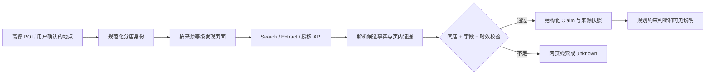

# SoloVibe 外部真实信息获取方案 V2

> 日期：2026-10-13｜状态：研究与实施方案，尚未实现的来源不得标为已接通。承接 [阶段五 A 真实验证](STAGE5A_EXTERNAL_DATA_2026-10-13.md)，并作为 [重新设计方案 V3](AI_AGENT_REDESIGNED_PLAN_V3.md)的数据章节。

## 1. 先定义“获取成功”

本项目不是给任意商家生成一张看似完整的资料卡。只有当程序取得**可访问的真实来源、匹配到正确地点、解析出字段、保存获取时间，并能在再次请求时重复验证**，才算取得该字段。页面上出现品牌名称，不等于该分店有某件商品；登记营业时段不等于此刻开门；搜索摘要写“有套餐”不等于套餐仍有效。

每条用户可见事实都带四个属性：`source`（URL/API 与供应商）、`scope`（具体分店／品牌／附近区域）、`observed_at`（本次获取时间）和 `validity`（来源明确的生效/结束时间；没有就不能称当前有效）。接口还返回 `status=verified | indicative | unknown | stale | conflict`。`verified` 只表示来源、身份和该字段契约都通过，不保证外部世界永远不变。

## 2. 个人开发者可走的实际路径

公开工具与文档显示，个人项目可组合下面几种路径。这里是**技术方案归纳，不是对所有个人开发者的统计**。

| 路径 | 可以实际取得 | 无法由它单独证明 | 本项目决策 |
| --- | --- | --- | --- |
| 高德 Web 服务 | 地址/坐标、POI、步行路线；部分 POI 的评分、参考人均、登记营业时间、特色标签 | 完整菜单、现价套餐、实时开门、座位或库存 | 已接通，继续作为地理与路线权威；标签只作描述。[高德 POI 2.0](https://lbs.amap.com/api/webservice/guide/api/newpoisearch)、[路线 2.0](https://lbs.amap.com/api/webservice/guide/api/newroute) |
| Tavily Search → Extract | 发现公开商家/活动页面，再取得该页正文或相关片段；失败 URL 有独立结果 | 页面是否属于同一分店、网页内容是否仍有效、未公开库存 | 使用现有 Key 做受控发现和提取；HTTP 200 也要检查 `results`、`failed_results`。[Search](https://docs.tavily.com/documentation/api-reference/endpoint/search)、[Extract](https://docs.tavily.com/documentation/api-reference/endpoint/extract) |
| 商家官网或官方活动页 | 品牌菜单、活动时间、门票/价目、部分门店页与明示优惠 | 品牌菜单在目标分店的可售性；没有实时接口时的座位 | 优先试点、逐站点适配；官网菜单若未列分店，只显示“品牌菜单示例” |
| 美团/大众点评合作接口 | 获授权范围内的门店菜谱、商品、经营或预约数据，具体取决于接口与授权 | 未授权的任意第三方商家信息 | 作为合作扩展，不假设普通 Key 可访问；相关[门店商品接口](https://developer.meituan.com/docs/api/foodmop-sku-queryVendorSpu)标注需要业务授权，[大众点评原平台](https://open.dianping.com/)已公告迁移 |
| 商家自愿提供的数据源 | 分店菜单、优惠有效期、营业变更、可预约时段和库存 | 超过上报时间后的继续有效性 | 为少量试点商家做带身份审核的后台/CSV/API；每条更新保留商家签名/操作者与时间 |
| 合规的第三方数据供应商 | 经协议覆盖的门店信息或价格/库存 | 供应商未覆盖的商家 | 取得许可与样本数据后再接入；先核对分店 ID、刷新频率、展示权和费用 |

直接抓取大众点评/美团页面可以作为**待评估来源**，但不能被当成默认的稳定 API：公开页可能登录后可见、由脚本渲染、随时变更或只展示其他分店。若选用爬取，应先核对该来源的使用条件与获取权限，只访问允许的公开页面，不绕登录、验证码或访问限制；用限速、来源留痕和失败降级，不把网页正文直接当成模型指令。项目当前不实施这条路径。

## 3. 六类信息的具体落地方式

### 3.1 地址与当前位置

保留现有“用户输入地标 → 高德地理编码 → 用户确认歧义结果”。新增用户主动点击“使用当前位置”时才调用浏览器 `getCurrentPosition`；拒绝权限、定位精度差或超时后仍允许手填。浏览器坐标为 WGS84，调用高德 `coordsys=gps` 转为高德坐标，再做逆地理编码和周边 POI；不得直接混用两套坐标。[浏览器定位权限](https://developer.mozilla.org/en-US/docs/Web/API/Geolocation/getCurrentPosition)、[高德坐标转换](https://lbs.amap.com/api/webservice/guide/api/convert)、[逆地理编码](https://lbs.amap.com/api/webservice/guide/api/georegeo/)。位置只在用户当前会话中按已有数据保留策略处理，不做后台连续定位。

### 3.2 去程、返程与导航

用户选择返程终点：默认原出发点，或明确输入另一个地址。高德分别查询 `origin → POI` 和 `POI → return_destination`，保存每段的起终点、POI ID、耗时、距离、查询时间及失败原因。不能把去程数值直接乘二，反向路线须独立调用。需要展示地图时，按高德路线接口请求 `polyline` 并按产品所需的地图展示协议实现；只有两个地点坐标的直线图不算真实路线图。导航继续采用用户确认后重新验证与高德 URI 交接；URI 不能证明客户端启动。[高德步行路径与可选路线/几何字段](https://lbs.amap.com/api/webservice/guide/api/newroute)、[高德 URI 导航](https://lbs.amap.com/api/uri-api/guide/travel/route)。

### 3.3 菜单与商品

按 `高德 POI → 规范化分店 → 官方网页候选 → Tavily Extract → 字段抽取 → 身份校验` 执行。先选择公开、可访问的官方菜单做试点；抽取商品名、类别、价格、货币、页内原文位置和来源 URL。品牌总菜单只能生成 `scope=brand` 的事实，不能直接附着为 `scope=branch`。例如本轮用现有 Tavily Key 从[星巴克中国早餐菜单](https://www.starbucks.com.cn/menu/food/great-breakfast/)成功取回 2,581 字符并识别商品名，但该页面不能证明某家分店当日有售。需要分店菜单时，必须有页面上的分店标识/地址或商家授权数据。若网页提供 [Schema.org Menu](https://schema.org/Menu) 等结构化数据，优先解析结构化字段，再用文本抽取补缺；页面没有明示价格就不生成价格。

### 3.4 套餐与优惠

优惠必须有对应分店/适用范围、套餐内容、价格、使用条件、有效期以及来源。缺任何关键项只显示“发现相关链接，条款待核实”，不能参与预算硬筛选。公开官网或官方活动页若能给出完整条款可展示，但快照过期后必须重查；需要登录、限人群或需购买才能知道当前价格的，交给官方页面让用户核实。平台团购商品若要作为结构化可售方案，走适用的授权合作接口，不从搜索摘要拼接。

### 3.5 营业状态

高德 `opentime_today` 是**记录中的今日营业时段**；可据此提示“按登记时间可能营业”，并加节假日/临时停业未核实。真正的 `open_now=verified` 仅允许来自有当前状态字段和获取时间的商家/授权接口；缓存超过短时效、来源失败或状态冲突即回到 `unknown`。如果没有该接口，产品给出商家联系电话或官方页面的“自行确认”入口，不把估算写成实时状态。不同供应商的“当前营业时间”字段也应核对其定义，例如 [Google Places 的 currentOpeningHours](https://developers.google.com/maps/documentation/places/web-service/reference/rest/v1/places)表示包含例外的未来七天营业时段，仍不同于店内实时回执。

### 3.6 座位、库存与完整活动时长

座位/库存是频繁变化的交易状态，只有分店授权的预约/库存接口或商家主动上报才显示“当前可用”，并记录检查时间、可用数量/时段、再次确认结果。没有权限时只能提供官方预约入口并标注“请在对方页面核实”，不能展示虚构可用量。预约平台的[可用时段数据](https://developers.google.com/actions-center/verticals/reservations/e2e/reference/feeds/availability-feed)也采用合作方提供的时段/席位数据，说明它不是地点搜索的自然附带字段。

活动时长从**用户选择的停留时长**、有明确来源的活动/场次时长，或标注为估计的类别范围取得；估计范围不能单独让硬时限变为 `pass`。完整行程检查采用 `去程 + 停留 + 返程 + 缓冲 ≤ 可用时间`。如果缺返程终点、停留时长或任一必要路线，就提出澄清或标 `unknown`；价格检查也用实际可验证价目，不用高德人均代替某个具体活动费用。

## 4. 外部事实流水线

核心表/对象建议：`venue_identity`（高德 ID、规范名称、坐标、地址及外部映射）、`source_observation`（URL/接口、抓取状态、时间、内容哈希、短证据片段、来源类型）、`venue_claim`（字段、值、单位、适用分店/品牌、有效期、观察 ID、身份校验结果）。不保存大段网页全文；不把站点正文写入 LangGraph 的权威状态。模型只负责从提取片段**提出候选字段**，程序检查 schema、明确数值、页面证据、分店归属和有效期；冲突时显示冲突或回退未知，不“投票”编出一个值。

抓取预算：每次规划先最多 3 个候选地点；每地点最多 2 个网页提取；来源、地点、字段使用不同 TTL 和缓存键。真正需要实时判断或用户准备行动时再重查。超时、配额、403、页面空、解析失败、错店、字段缺失分别记录，失败的来源不能被旧缓存伪装为新鲜事实。对允许访问的站点设域名白名单、请求限速、大小上限与外链安全检查；前端只显示 HTTPS 来源链接。

## 5. 从实验到可验收产品

**第一轮真实样本**固定上海 12 个地点，覆盖咖啡、餐饮、景点和公园；选定名单后不能只报告成功的店。每个样本记录地点 ID、来源页面、能够取得的字段、失败类别、时延和调用成本。既验证真实调用，也保留失败样本。试点以“零错分店、零无来源价格、零虚构库存”为硬门槛；覆盖率单独报告，不靠模型生成完整卡片来抬高覆盖率。

分三个验收等级：

1. **公开数据可用版**：真实地点、双向路线、用户确定的停留时间，以及来源明确的部分官网菜单/活动页能展示；未覆盖的字段显示未知。真实浏览器端到端和刷新恢复通过。
2. **分店商家资料版**：至少三个试点地点能用分店级官方/授权来源展示菜单或价目；至少一个来源能提供带期限和条款的套餐/优惠。每条可回到原始页核验，错店故障注入不会显示。
3. **实时供给版**：至少一个已授权试点门店可读取当前营业状态或可预约时段/库存，并在确认前再次查询；网络失败或授权过期时降级为未知。**没有真实商家/平台授权，就不能宣称完成这一级。**

第 1 级不依赖新的平台商业授权，可以先开发并真实验证；第 2 级取决于公开分店页面的实际覆盖或商家参与；第 3 级取决于外部合作/凭据。用户能实际看到“来源于哪里、适用于哪家店、何时取得”，才算产品功能，而不是后台打印一次搜索结果。
