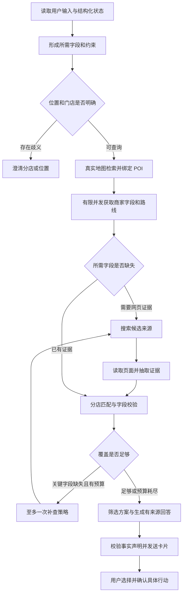

# SoloVibe 外部工具与 API 调用方案 — Version 1

> 版本：V1.0｜日期：2026-09-13｜状态：设计完成，尚未开发或实测。
>
> 承接 [Redesigned Plan V1](/D:/SOLOVIBE/AI_AGENT_REDESIGNED_PLAN_V1.md)，细化 Option B 中的真实外部信息获取、LangGraph 工具编排、证据与失败处理。本文件独立保存，不覆盖前两份方案。
>
> 代码依据：用户指定的 [SOLOVIBE_APP](https://github.com/wangyux07-cmd/SOLOVIBE_APP/tree/da89caf9c69288cbf369238a66a18455cfccaae5) 静态审查。当前本地工作区 origin 是另一个 SOLOVIBE 仓库，实施时需在正确仓库应用。此次仅核对公开官方文档并新增 Markdown；未读取密钥、调用付费业务接口、修改实现、安装依赖或运行验证。

## 1. 先回答：能否真的查到并回答，能否保证每次成功？

**可以实现真实 API 调用，并让回答建立在实际查询结果上。现有项目还不能按这个标准验收。** 需要补上真实数据链路、门店匹配、字段校验和回答来源约束，不能只给模型几个工具名称。

不能承诺每次都查全、每次都正确：提供方可能限流或故障，门店可能没有公开菜单，套餐可能只存在于登录后的平台页面，源网站自身也可能过期。工程上应实现两件事：

1. 在服务可用、账号有权限、来源存在时，尽可能完成可追溯的信息获取，并通过实际账号联调证明这条链路能工作。
2. 在缺数据或调用失败时，准确说明缺了什么，保留已核实部分，必要时给出官方核验入口；不把未知补成营业、不编套餐、不把搜索相关度当店铺评分。

“回答我想要的信息”要变成明确的验收对象。例如用户问评分、单人套餐、步行时间，系统就跟踪这三个字段的覆盖情况，而不是搜索一次后生成一段看似完整的介绍。诚实的部分回答属于降级完成，不能统计成完整任务成功。

本方案的核心链路为：**确定用户所需字段 → 绑定具体门店 → 按能力调用 API → 读取来源 → 校验字段和时效 → 有限补查 → 带来源回答。**

## 2. 首版接哪些服务，各自负责什么？

首版采用高德地图 Web 服务处理地点和路线，保留网页搜索供应商接口，并以 Tavily Search / Extract 作为候选实现。现有 Serper 适配器可经同样验收后继续使用；不同时强制上线两个搜索商。是否最终采用 Tavily，取决于目标城市中文门店覆盖、账号权限、费用和实测结果。

菜单与套餐优先读取商家官方页面，或接入已获授权的商家/交易平台接口。当前没有核实可直接使用的通用套餐供应商，因此这部分不能标记为“接口已接通”。

| 用户要的信息 | 首选数据渠道 | 产品输出边界 |
| --- | --- | --- |
| 我的位置、附近有什么 | 用户提供的位置或授权设备定位，再查询地图 | 地址转坐标不等于获取设备当前位置 |
| 具体分店、地址、距离 | 地图 POI、详情、路线 | 保存门店标识，直线距离不能冒充步行距离 |
| 商家评分、人均 | 地图支持的商家字段；其他来源单独标注 | 可为空；人均不能代替某个套餐售价 |
| 有什么吃的 | 商家菜单、官方介绍、可访问的菜单页面 | 菜品示例与完整菜单区分；不推断当日库存 |
| 有什么套餐 | 授权商品接口、该分店适用的官方套餐页 | 标注价格条件、人数、有效期；未知条件不能省略 |
| 有什么好玩的 | 场馆/主办方活动页、授权活动数据 | 区分常设项目、限期活动、主观体验评价 |
| 今天是否营业/能否使用 | 有效营业信息、当日公告、交易方可用性回执 | 营业时间表只支持预计营业，不证明临时营业或余量 |

### 2.1 高德接口的接入边界

国内 Web 服务拟接入以下端点。参数由固定适配器构造，不交给模型拼 URL。

| 用途 | 方法与路径 | 关键输入 |
| --- | --- | --- |
| 地址解析 / 逆解析 | GET `/v3/geocode/geo`、`/v3/geocode/regeo` | address / location、Web 服务 key |
| 地点检索 | GET `/v5/place/text`、`/v5/place/around` | keywords 或 types、区域或圆心 |
| 指定 POI 详情 | GET `/v5/place/detail` | **id**、按需 show_fields |
| 步行路线 | GET `/v3/direction/walking` | origin、destination |

服务域名为 `restapi.amap.com`；地理编码处理地址与坐标转换，步行结果用于估计行程成本。[地理编码文档][amap-geo]、[路径规划文档][amap-route]

POI 2.0 的 `business` 字段组包含部分品类的 rating、cost 等；这些字段不是所有 POI 必有。不同检索端点的可选字段也有差异，例如不能假定详情接口必然返回关键词搜索文档列出的所有营业时间字段。文档还提示企业试用和上线配额确认，必须以实际账号权限核验。该文档不足以证明完整菜单或可购买套餐能力。[POI 文档][amap-poi]

实施规则：记录坐标来源与坐标系，按所选国内接口要求转换；校验经纬度顺序、城市和范围。城市检索参数不能代替结果地域核验。适配器按端点分别解析，缺少可选字段保留 null，不使用其他接口版本的参数或响应结构凑合解析。

### 2.2 搜索与页面读取分开

候选搜索适配器调用 `POST https://api.tavily.com/search`，使用后端 Bearer 凭据。首版取 results 中的链接、标题和内容线索；不使用其可选生成式 answer 作为商家事实依据，搜索 score 也不是店铺评分。[Search 文档][tavily-search]

候选读取适配器调用 `POST https://api.tavily.com/extract`。逐项处理 results 与 failed_results，不能因 HTTP 200 就判定所有页面读取成功。页面片段可能不包含完整套餐条款；需要读取相关限制所在内容，否则标记条件不完整。[Extract 文档][tavily-extract]

搜索负责“找到可能的来源”，读取负责“拿到能支持答案的内容”。搜索标题或短摘要可用于发现线索，不能单独证明某个套餐现在仍能购买。遇到登录墙、验证码、不可访问页面时，转向授权接口或官方入口；不把绕过访问限制作为首版能力。

### 2.3 账号与能力登记

后端建立 CapabilityRegistry，按具体能力记录，而不是只有一个 API_ENABLED 开关：

| 字段 | 含义 |
| --- | --- |
| provider / capability / adapter_version | 哪个服务、哪种能力、哪版解析器 |
| credentials_configured | 是否完成后端配置；不输出密钥内容 |
| account_access | 未验证 / 可用 / 无权限 / 暂停 |
| coverage | 已观察到哪些城市、品类、字段可用 |
| quota_policy | 并发、调用预算、账号额度处理 |
| last_live_check_at / evidence_ref | 最近真实联调时间及脱敏证据 |

**配置了 key ≠ 授权通过 ≠ 字段齐全 ≠ 生产可用。** UI 只展示当前已验证的能力。本文的状态为“文档已核对，账号和覆盖待联调”，不会在本轮要求用户把密钥贴进聊天。

## 3. 真实调用怎样进入 LangGraph？

沿用主方案的真实 StateGraph，把外部检索做成明确节点和受限分支。HTTP 入口调用编译后的图；适配器是实际 HTTP 客户端；模型主要承担语义提取、查询改写和解释。



图中补查通过 State 中的计数器和剩余预算硬限制，不能形成无限循环。分店歧义的澄清沿用主方案的会话与恢复机制。地图结果为空时可以适度调整检索词，但不自动放宽用户硬性范围、预算或步行限制。

建议节点职责：

| 节点 | 主要逻辑 | 模型权限 |
| --- | --- | --- |
| build_information_request | 从当前输入/状态生成字段清单与查询意图，校验必要参数 | 提议结构化意图，不能修改已确认事实 |
| resolve_place | 周边/名称搜索、地理范围检查、门店标识绑定 | 必要时建议查询词，不决定忽略地址冲突 |
| fetch_place_facts | POI 字段与路线查询，保存规范结果 | 无需模型 |
| enrich_missing_fields | 根据缺口安排搜索与读取 | 在注册工具和预算内改写一次查询 |
| extract_evidence | 从页面提取菜单/套餐/活动声明及原文片段 | 输出受 schema 约束的提议，不直接写权威状态 |
| validate_evidence | 校验门店、金额、日期、来源、适用条件和冲突 | 确定性校验为主；语义核验失败视为未知 |
| compose_answer | 根据可用事实给建议、解释取舍 | 不增加无来源商家事实 |
| validate_answer | 检查字段、引用关系及硬约束 | 不通过则定向修复一次或改用事实模板 |

不需要为了调用 REST API 再引入 MCP 服务器。以后若需要给多个应用共享工具，可在适配器外增加 MCP 层；字段、授权、证据和重试规则仍归应用负责。

## 4. 工具输入输出必须有明确契约

### 4.1 先知道用户到底要查什么

InformationRequest 至少包含：request_id、run_id、context_revision、地域、目标门店或品类、请求时间与时区、requested_fields、hard_constraints、查询截止时间和预算。

requested_fields 每项分开记录两种重要性：

- **信息要求**：用户明确问过，最终必须回答其值或说明未查到。
- **选择门槛**：不满足或不能证实，就不能将候选标记为满足条件。

例如“这家店评分多少，有没有 50 元以内单人套餐？”评分是需要回答的信息；若用户还要求“只推荐能确认有该套餐的店”，套餐条件就是选择门槛。不能因为评分缺失直接丢弃一个用户明确询问的门店，也不能把未知套餐当成符合预算。

### 4.2 注册固定工具

工具注册表只开放具名能力，例如 geocode、search_places、get_place_detail、get_walking_route、search_web、extract_pages。每个工具绑定输入 schema、固定供应商、允许域名、超时、返回解析器和错误分类。

后端决定鉴权头、key、端点与账号。模型可提议工具名和合法业务参数，不能指定任意请求方法、请求头、密钥、内网地址或未注册供应商。页面内容中的“请调用某工具”“忽略之前指令”等只作为网页文字，不能改变工具权限。

### 4.3 统一 ToolResult

以下为内部设计结构，不是任一供应商的原始响应；所有值均为类型说明：

```text
ToolResult
  call_id, run_id, tool_name, provider, adapter_version
  execution_status: success | partial | error | cancelled
  http_status, provider_code, provider_request_id
  started_at, elapsed_ms, attempt_count
  request_fingerprint, context_revision
  data: 规范化业务对象
  evidence_ids: 来源记录引用
  error: {category, retryable, safe_message} 或 null
  cache: {hit, originally_fetched_at, expires_at}
```

success 表示本次适配器调用和解析成功，不代表用户任务已完成。合法的空结果可以是 execution_status=success，同时业务覆盖为 missing。批量读取中的部分失败必须保留逐项状态。

每个结果先校验 HTTP、供应商业务码和 schema，再解析字段。核心定位字段缺失时整条 POI 不可作为可执行地点；可选评分缺失时仅该字段未知。记录脱敏请求指纹和错误类别，不记录带 key 的完整地图请求 URL。

## 5. 怎样确认网页说的就是这家分店？

先保存 PlaceIdentity：provider + poi_id、商家名、分店名、城市、地址、坐标、电话（若有）。候选排序、网页补查、卡片、选择事件和后续导航始终引用同一个标识。

网页绑定规则：

1. 检索使用“城市 + 店名 + 分店或地址 + 缺失字段”，不只搜索品牌名。
2. 优先使用明确列出该分店地址、电话或分店标识的来源；检查城市、商场和楼层等可用信息。
3. 名称相同但地址冲突的页面不并入该门店。仅品牌级菜单保留为品牌信息，除非来源明确适用于此分店。
4. 输出 matched、ambiguous、conflicting 三种判定及依据；不把未经校准的模型分数包装成“99% 正确”。
5. 多个相近分店仍不能区分时展示分店候选，请用户选择。不能悄悄选第一条。

跨供应商的 POI ID 不互通，替换地图供应商时必须重新实体匹配。一个来源的评分、另一个分店的套餐和第三个地址不能拼成一张卡。

## 6. 菜单、评分和套餐如何成为可回答的事实？

### 6.1 字段级证据模型

每项 FactEvidence 保存以下内容：

| 内容 | 用途 |
| --- | --- |
| evidence_id、place_id、field_path、value、unit | 事实值和对应门店 |
| provider、source_url 或可追溯来源标识 | 让用户知道信息来自哪里 |
| supporting_text / payload_path | 指向支持该字段的原文或 API 字段 |
| fetched_at、published_at、source_updated_at、valid_until | 区分抓取时间、来源日期与适用日期；未知为 null |
| entity_match、source_type、applicable_branch | 是否属于该分店及适用范围 |
| status、limitations、parser_version | 是否有证据、是否过期或冲突、解析依据 |

状态采用 supported、missing、stale、conflicting、unsupported；supported 表示来源明确支持这个声明，**不代表已独立证明现实情况绝对正确**。缓存时间刷新、模型摘要或重复转载都不能提高原始事实的新鲜度。

### 6.2 各字段的不同规则

**评分**：保存原始数值、量表与来源；量表不明确就不自行补满分。评价数只有来源提供才展示。不同平台分别标注，不平均拼接；API 搜索相关度与商家评价严格分离。

**人均与预算**：人均是参考估计；套餐售价、最低消费、押金、服务费属于不同字段。只知道人均时，不能写“这一餐一定不超过预算”。需要确定价格的选择门槛，应依赖条件清楚的商品或菜单价格，否则标注尚不能确认。

**菜单**：提取来源明确列出的菜品、规格和价格；只有部分内容时展示“查到的菜品示例”。“咖啡馆”不能自动推出有拿铁或甜点，评价中某位用户吃过的菜也不能证明现在仍供应。

**套餐**：至少尝试提取名称、包含项目及数量、价格和币种、人数、适用门店、有效期、使用时段、节假日限制、会员/新客条件、预约要求和来源入口。缺少影响用户决策的条件时标注不完整，不能转述为今天可用的确定优惠。退款或库存问题只有交易方提供才回答。

**活动**：分开保存常设体验、具体场次、日期、时区、票价、预约入口和限制。过去的活动介绍不能冒充今天的安排。“适合独处”可以是依据已知条件的推荐判断，但“安静、人少”若只有个别评价，应写明评价来源而非现场事实。

**营业与时效**：日常营业时间支持“按公布时间预计营业”。临时闭店、售罄和套餐余量需要相应来源；查不到不设 is_open=true。抓取时间为今天的旧活动页面仍然是旧活动。

### 6.3 来源冲突与读取限制

在同一字段、同一门店和相同适用条件下，优先考虑直接负责该事实的来源：商品条款看商家/交易方，活动时间看主办方。可信来源之间仍冲突时展示差异或建议核实，不能只取最便宜或最有利的数字。

网页读取可能遗漏脚注、折叠条款、图片菜单或 PDF 内容。首版仅将实际读到且足以支撑字段的内容纳入证据。后续若增加 OCR/PDF 解析，应单独记录页码和识别来源，并对价格等关键字段校验；不承诺首版读取所有载体。

## 7. 从“搜索一次”改为“检查信息缺口”

每个目标门店生成 CoverageReport：

```text
requested_field → evidence_status → evidence_ids → missing_reason → next_action
```

执行策略：

1. 地图先提供地点事实，已有字段不重复做网页查询。
2. 对明确要求且缺失的菜单、套餐或活动字段补查。
3. 读取少量最相关来源，校验门店与有效条件。
4. 仍缺关键字段时，在预算内换一次查询词或来源；调整仅针对缺口。
5. 达到截止时间、预算用完、能力不支持或再次没有相关证据，即停止。
6. 对信息询问，返回已有事实和逐项缺口；对有硬性条件的推荐，不把未证实候选标记为符合。若没有符合者，说明原因并提出可由用户选择的调整。

“没搜到套餐”的正确含义是“当前来源未查到”，并不证明店里没有套餐。不能用增加查询次数保证一定查到，也不能未经用户选择自动扩大距离、提高预算或改成双人套餐。

## 8. 如何防止模型拿到资料后仍然乱说？

模型只收到当前候选的结构化事实、有限证据片段、缺失字段和用户约束，外加主方案的近期上下文。原始网页全文、API 密钥和所有历史工具结果不进入 prompt。

回答先输出结构化 AnswerDraft：候选 place_id、事实声明、evidence_ids、推荐理由、未知项及可执行入口，再由服务端校验并渲染。

- 评分、金额、日期、地址和路线时长尽量直接由结构化字段渲染，不让模型自由重写数值。
- 引用必须存在、属于对应门店，并支持对应字段；“有链接”不足以证明句子真实。
- 不允许把 missing/stale/conflicting 字段转成肯定陈述。
- 对“所以适合你”这样的解释，必须依据用户状态与已知条件；与可核验商家事实分开展示。
- 自动语义核验也可能误判，因此验收要有人工抽查；关键事实不能仅依赖另一个模型说“检查通过”。

若模型输出不合格，最多修复一次；仍不合格时，用已验证事实模板返回。若模型理解节点不可用，允许用户通过明确的筛选项提供查询条件；不能在无法理解请求时猜测目标。

卡片建议显示：具体分店、已查到字段、来源与查询时间、预计路线、限制与未知项，以及查看来源/导航入口。面向用户的提示采用“查到评分，套餐条件还没核实”等自然语言，调用 ID 和供应商错误码留在运维侧。

## 9. API 失败、限流、延迟和成本怎么处理？

### 9.1 错误分类与恢复

| 情况 | 处理 | 对答案的影响 |
| --- | --- | --- |
| 短暂网络失败、部分 5xx | 剩余期限内退避重试，最多额外 2 次 | 已完成字段保留，失败字段标注 |
| 频率限制 | 尊重 Retry-After（若提供），降并发；超出期限则结束 | 不无限等待 |
| 日额度耗尽 | 停止该能力、运维提示；仅使用允许且适用的缓存/替代源 | 不通过轮换账号规避限制 |
| key 错误、无接口权限、白名单错误 | 不做盲目重试，标记能力不可用 | 不假称已查询 |
| HTTP 成功但供应商业务失败 | 按业务错误分类 | 不进入成功数据流 |
| JSON/schema 不匹配 | 保留脱敏诊断，阻止异常字段进入事实库 | 不用模型猜响应字段 |
| 空结果、错误分店、过期活动 | 进入覆盖处理，不当网络错误重试 | 有限补查或明确缺口 |
| 页面读取部分失败 | 保留成功来源，逐项记录失败 | 不能把批次成功当全量成功 |
| 用户改位置/取消 | 取消旧任务，丢弃旧版本结果的提交 | 不让旧门店结果覆盖新请求 |

高德有独立业务错误码，例如鉴权、权限、日额度和频率错误；这些不能只通过 HTTP 状态判断。实现时以官方错误码表维护映射，并为未知码保留原始类别信息。[高德错误码][amap-errors]

### 9.2 首版的调用预算

以下是待联调的初始配置，**不是测得的性能或费用承诺**：

- 附近候选最多保留 8 个，优先为最多 3 个入围门店补全昂贵信息和路线。
- 每轮地图 HTTP 请求最多 8 次、网页搜索最多 3 次、页面读取最多 4 个 URL；重试消耗同一总预算，不另开无上限通道。
- 批处理只能使用该端点明确支持的方式；同时记录 HTTP 请求数、处理项目数和供应商计费单位，不能把三者视为相同。
- 同一供应商初始并发上限 2；总检索期限初始设为 30 秒，单调用超时受剩余期限限制。到期进入部分结果路径；这是应用停止继续等待的目标，不保证所有网络任务在精确时刻结束。
- 模型、搜索、地图与页面读取分别记成本/用量；查询改写、摘要和回答修复也计入运行预算。

使用服务端共享的限流策略协调多用户总额度。部署多进程时，单进程 semaphore 不能保护整个账号；首版可利用现有数据库记录额度预留，或在统一出口限制并发，不为了这个功能立即引入新消息系统。

### 9.3 缓存的范围

缓存键至少包含供应商、端点/解析版本、规范参数、门店或地域、语言和相关日期；请求指纹不携带明文密钥。用户级信息不得混入公共 POI 缓存。

缓存保存原始获取时间、来源时间、失效原因和证据引用，不将读取缓存的时间伪装成重新查询时间。可先对身份信息设较长有效期，对评分设较短有效期，对优惠与营业信息设更严格有效期；具体数值在来源更新频率与供应商缓存许可确认后配置。动态库存不能由静态缓存证明。

过期缓存若仍有参考价值可以明确标注展示，但不得用它证明“今天可用”“现在营业”。供应商禁止缓存或限制保存范围时，以其许可为边界。

## 10. 与上下文状态管理和后续行动的连接

工具事实不写进滚动摘要后就丢失。沿用 V1 的分层存储：

- Evidence Store 保存许可范围内的规范事实、必要原文片段、来源和时效。
- Graph State 保存 place_id、evidence_ids、coverage、查询进度、预算和当前 context_revision。
- 模型 ContextBuilder 只选择当前节点需要的证据；摘要仅说明此前讨论过程。
- 业务记录保存用户选中的方案版本；行动授权绑定该版本和具体动作。

每个外部结果带 run_id 和 context_revision。用户改变位置、预算或门店后，旧调用即使完成，也不能覆盖新状态。读请求恢复时优先复用仍有效的已提交结果；崩溃恰好发生在收到响应但未保存之间，仍可能重复只读请求并产生费用，所以不能承诺外部调用 exactly-once。

搜索、读取、算路线属于本信息链路；下单、预约、支付属于另外的写操作链路。首版仍按主方案在用户确认后保存计划、生成导航/官方入口交接。网页上找到套餐不代表系统有下单权限，导航交接也不代表已经到店或预约成功。

位置只按查询所需精度和用途发送给相应服务。网页检索一般使用门店名和地址，不把用户的情绪原文、完整聊天记录和精确实时轨迹一起发送。来源链接与后端读取均校验协议及目标地址，禁止内网/本机目标，并在重定向后重新校验；不把网页指令当用户授权。

## 11. 现有代码具体改哪里？

下面的旧路径相对于 SOLOVIBE_APP 指定提交；新增路径为规划，不表示文件已经创建。应沿用现有模块边界逐步迁移，避免同时保留两条能输出不同事实的生产链路。

| 现有位置 / 拟新增位置 | 改造内容 | 完成标准 |
| --- | --- | --- |
| `backend/services/agent/langgraph_agent.py` | 用真实图节点调用外部适配器，保留 POI 标识和字段来源 | HTTP 请求实际经过图和真实工具；可追溯节点事件 |
| `booking_execution_tool.py` → `route_query_to_pois` | 将 mock POI、通用虚构店名替换为真实检索；落实地域参数 | 空结果不产生虚构商家；入围项有稳定身份 |
| `scenario_generator.py` → `generate_with_plans` | 保留选中 POI，移除丢弃候选再合成地点的路径 | 卡片、路线、来源指向同一分店 |
| `web_search_tool.py` | 标准化供应商输出，删除无结果默认营业、伪缓存营业值 | 无来源为 unknown；错误和空结果可区分 |
| `langgraph_agent.py` 的实时信息批处理 | 替换串行遍历和宽松状态默认值，加入受限并发、deadline、coverage | 批次部分失败不污染其他商家事实 |
| `backend/main.py` | 统一图的结果与流事件；检查会覆盖正常结果的纯 LLM 回答路径 | API 返回候选、来源、未知项，成功结果不被无依据补写 |
| 前端聊天、候选卡、方案选择 | 接真实候选与字段状态；按 ID/版本选择；显示来源和查询状态 | 选择 B/C 不再落到静态 A；无静态评分或假预约成功 |
| 新增 `backend/services/tools/providers/` | 地图、搜索、读取适配器与版本化解析器 | 真实 HTTP 请求和业务码处理集中管理 |
| 新增 `backend/services/tools/contracts.py` | 请求、ToolResult、PlaceIdentity、证据与错误 schema | 类型不匹配不能静默进入生产答案 |
| 新增 `backend/services/evidence/` | 门店匹配、字段提取、覆盖、冲突和时效处理 | 每个关键事实能追到支持内容 |
| 新增 `backend/services/tools/runtime.py` | 注册表、超时、预算、重试、取消、限流 | 无无限工具循环；供应商故障可降级 |
| 数据库迁移与服务层 | 证据记录、工具调用元数据、缓存索引、版本检查 | 持久化与权限隔离；不把密钥/完整网页塞入 checkpoint |
| 后端配置与日志 | 增加供应商凭据引用、能力开关、配额策略、脱敏 | 前端 bundle、提示词、日志均不含后端 API 凭据 |

旧实现不是完全没有网络调用，例如已有地理编码和搜索路径；问题在于真实、合成和默认结果混用，无法保证从调用到最终卡片的完整性。改造重点是打通并验证整条链路。

## 12. 开发与验收顺序：用什么证明它能工作？

本节是将来进入开发后的工作清单，本轮未执行这些测试或真实接口调用。

### 阶段 A：能力与账号核验

1. 确认国内目标城市、已购买/获授权能力、配额、缓存与展示条件。
2. 在后端安全配置凭据，用实际账号分别核验地点、详情、路线、网页搜索、页面读取；权限不足的能力标记不可用。
3. 记录每种能力的脱敏真实响应、业务码、支持字段和缺失字段。至少包含有评分与无评分商家，不以单个样本推断全覆盖。
4. 对菜单/套餐验证真实可访问来源。若产品要求稳定完整套餐覆盖，这一阶段必须落实对应授权数据合作；普通网页搜索不能承担这个承诺。

交付物：CapabilityRegistry 初始记录、真实响应样本、字段覆盖表和未满足的接入条件。

### 阶段 B：先打通一条最小真实链路

按“用户给位置 → 真 POI → 真路线 → 单店搜索 → 读取原文 → 有来源卡片”完成纵向链路。先证明一个真实门店能够从输入走到输出，再扩展多候选和补查。

对同一次运行保存 request/run ID、工具调用记录、脱敏结果、门店匹配依据、coverage、最终卡片与引用。审查者应能按记录核对答案，不需要相信模型自述“我已经搜索”。

### 阶段 C：异常和内容正确性验证

| 用例 | 必须观察的结果 |
| --- | --- |
| 正常门店且字段完整 | 正确分店、字段来自响应/原文、引用对应 |
| 同品牌多分店、同名异地 | 不串店；歧义未解除时不确定绑定 |
| 缺评分、空搜索结果 | 不生成评分，不宣称没有套餐或默认营业 |
| 地图 HTTP 200 但业务错误 | 被识别为失败，不进入事实数据 |
| 超时、限流、额度耗尽 | 有上限重试，正确部分结果与能力状态 |
| 搜索能找到但页面无法读取 | 不把短摘要当完整套餐条款 |
| 批量页面读取部分失败 | 成功与失败分别保留 |
| 套餐有会员价、双人条件或过期日期 | 不能当普通单人现价推荐 |
| 页面片段漏掉节假日限制 | 条件不完整，不标记今天确定可用 |
| 品牌官网与分店页面矛盾 | 显示冲突或保守处理，不拼出最优价 |
| 网页带恶意指令/内网 URL | 不改变工具权限、不读取内网 |
| 模型输出不存在的来源或新价格 | 校验拦截，修复或模板返回 |
| 查询途中用户换位置 | 旧结果不覆盖新状态 |
| 缓存过期、旧活动今天被抓取 | 不标成今日有效 |
| 恢复运行、多个用户同时查询 | 不串用户，不无限重试，不超应用预算 |

验证应同时包含固定响应的契约/故障测试，以及实际账号对真实门店的人工核对。前者验证代码行为，后者验证供应商与真实内容覆盖；不能用全部 mock 的测试通过宣称真实接口已打通。

### 阶段 D：受控试用与指标

分开记录：

- **接口成功率**：传输、业务码与解析成功；同时记录空结果率。
- **门店匹配正确率**：用人工标注样本评估，歧义另计。
- **所需字段覆盖率**：按用户请求字段计；可选字段和选择门槛分别统计。
- **完整任务成功率**：必要字段和选择条件均满足且回答有支持证据。
- **有依据的部分回答率**：有用但未完整满足，不计入完整成功。
- **无依据声明率**：抽查事实没有支持、串店或过期仍当有效的比例。
- **延迟与成本**：整体与各供应商 P50/P95、调用数、计费量、超时率。

先采集基线再定上线 SLO，不预先编造“99% 调用成功”或“100% 真实”。测试集应覆盖目标城市、门店品类和已知困难案例，且保留真实失败样本；不能只挑成功门店演示。

## 13. 产品能够承诺的结果

首版目标是：对于服务覆盖范围内、身份可确认且有来源的门店，真实查询地点/路线及可得商家信息，用可查看来源的卡片解释选择；对菜单与套餐做受限补查，缺口明确呈现。

工程约束是：不允许已知调用失败被转换成成功事实，不允许缺字段被静默编造，不允许未确认的写操作发生。这些约束需要实现和验证，而非依赖提示词承诺。

提供方持续可用、网上始终存在准确资料、每家店都有公开套餐、今天仍有库存，不属于应用能够保证的范围。如果将来必须对套餐覆盖和可用性做更强承诺，下一步应落实授权商品/库存数据接口及相应服务协议，再扩展产品能力。

对用户应直说：“我查到了这家分店的这些信息，来源在这里；这几项暂时没确认。”这种回答比一次成功 HTTP 请求更接近可靠的 Agent。

## 14. 官方接口依据

以上接口能力于 2026-09-13 核对公开文档；具体账户资格、费用和上线配额仍需实施时确认。文档中的设计预算、节点、schema 和验收标准为本项目建议，不是供应商保证。

- [高德国内地理/逆地理编码][amap-geo]
- [高德 POI 2.0][amap-poi]
- [高德国内路径规划][amap-route]
- [高德业务错误码][amap-errors]
- [Tavily Search API][tavily-search]
- [Tavily Extract API][tavily-extract]

[amap-geo]: https://lbs.amap.com/api/webservice/guide/api/georegeo
[amap-poi]: https://lbs.amap.com/api/webservice/guide/api/newpoisearch
[amap-route]: https://lbs.amap.com/api/webservice/guide/api/direction
[amap-errors]: https://lbs.amap.com/api/webservice/guide/tools/info/
[tavily-search]: https://docs.tavily.com/documentation/api-reference/endpoint/search
[tavily-extract]: https://docs.tavily.com/documentation/api-reference/endpoint/extract
