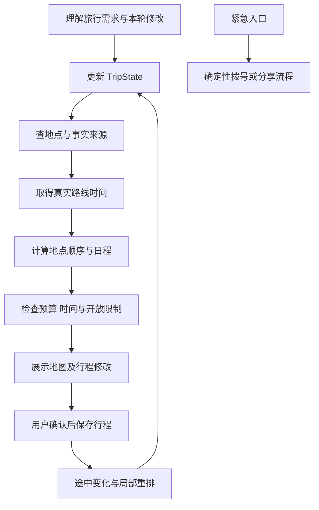

# Solo Trip 产品方向评估 — V0

日期：2026-09-13。性质：讨论稿；未启动新方向开发。以下是产品与架构建议，不代表外部 API 能力已核实或功能已实现。

## 判断

建议重新定义产品，但在已有仓库和基础设施上改造。新建仓库、重写所有代码不是当前必要条件。

旧方向以一次城市活动决策为中心，新方向以一段独自旅行为中心。变化集中在用户旅程、主界面和业务状态；工程基线、模型适配、持久化设计仍可复用。阶段一目前尚未接通，调整方向的沉没成本较低。

建议定位：帮助独自旅行者安排有个人特色、可执行的行程，并在途中提供路线调整和紧急信息入口。

## 首版做什么

| 用户真正担心的事 | 对应能力 | 建议优先级 |
| --- | --- | --- |
| 一个人去哪里，有没有适合我的地方 | 根据兴趣、时间、预算发现候选地点，展示来源与未知信息 | 首版 |
| 景点顺序乱，来回折返，赶不上营业时间 | 地图上的多地点路线、每日时间轴、出发与返回地点、真实交通时间 | 首版核心 |
| 临时累了、下雨或某处关闭 | 调整剩余路线，保留已经完成和明确固定的安排 | 首版核心 |
| 遇到事情不知道找谁、位置说不清 | 紧急联系人快捷入口、本人确认的位置分享、住宿地址与当地紧急信息 | 首版基础能力 |
| 没网络时找不到住处和重要信息 | 可离线查看的行程、住宿地址、紧急联系资料，并标注最后更新时间 | 首版限定范围 |
| 在国外无法沟通 | 常用语与地址展示、文本翻译；语音和拍照以后再定 | 取决于是否定位出境游 |

“小众”应按用户偏好解释，例如当地特色、低商业化或特定主题。没有可靠客流证据时不能直接标成“人少”；偏远或资料稀少也不等于适合独自前往。

## 主界面改为地图与行程

建议以地图和每日时间轴为主体：地点顺序、路线连线、预计通行时间、停留时间、营业限制与返回安排直接可见。聊天是辅助入口，用户可以说“今天太累了，少走一点”，系统给出可查看的行程修改。

不必保留旧的多张活动方案卡片作为主交互。地点详情仍需要小面板或底部抽屉；是否使用卡片属于表现形式，取决于用户当前要完成什么。

地图上的线路应来自真实地理与路线数据，不交给图像生成模型画。多地点顺序需要结合路网时间、开放时间、起终点、固定安排和用户偏好进行计算；LangGraph 编排查询、求解与解释，路线算法计算顺序。产品承诺宜为“减少折返并说明取舍”，而非所有情况“绝对不绕路”。

## 安全能力的边界

建议首版提供明确可操作的入口：紧急联系人、本人确认后分享当前位置或行程、住宿与返程信息、目的地紧急号码。发送失败或定位过期必须明确显示。

后续可以评估定时报平安与未确认提醒，但这需要通知、后台调度、接收方渠道和送达状态，不能仅靠一个聊天 Agent。后台定位、自动提醒及电话/短信等能力应在选择 Web、PWA 或原生移动端时逐项验证。

紧急入口应走确定性流程，不能等待语言模型批准或生成回复。用户需要明确知道按下按钮后会拨号、打开分享界面还是实际发送消息；不能把打开分享界面显示为“已通知”。不做无依据的地区安全评分，不宣称提供救援保障。

## LangGraph 与状态怎样变化

LangGraph 可以保留，但应围绕行程生命周期重新设计，而非沿用旧的活动卡片流程。

这是候选结构，不是已运行的图。建议 `TripState` 包含旅行日期、目的地、住宿、起终点、每日约束、候选地点与证据、已确认行程、当前进度和待确认修改。紧急联系人等敏感资料单独存储、最小化访问，不默认放进模型上下文。

业务快照、对话原文、近期窗口、滚动摘要与 checkpoint 的分工仍成立；只是权威业务状态从一次活动扩展为多日行程。

## 哪些复用，哪些重做

- 复用并继续验证：项目环境、前后端通信、配置管理、模型适配、结构化补丁及原文来源、持久化和请求去重思路。
- 调整：Graph 节点、State 字段、数据库中的旅程/每日路线模型、工具接口和测试场景。
- 重做：以旧活动卡片为中心的主界面与用户流程。
- 暂缓：自动预约、复杂语音翻译、持续定位、自动报警、多 Agent。这些不是验证新核心价值的必要条件。

## 下一步决策

先明确首批用户是“国内城市独自旅行”还是“出境独自旅行”。这会改变地图覆盖、翻译优先级、紧急信息和离线需求。

建议先完成一个目的地、1–3 天的闭环：输入偏好 → 真实地点 → 可解释的顺路行程 → 地图展示 → 途中调整，并配基础紧急信息入口。用这一闭环验证产品，再扩展更多旅行工具。
