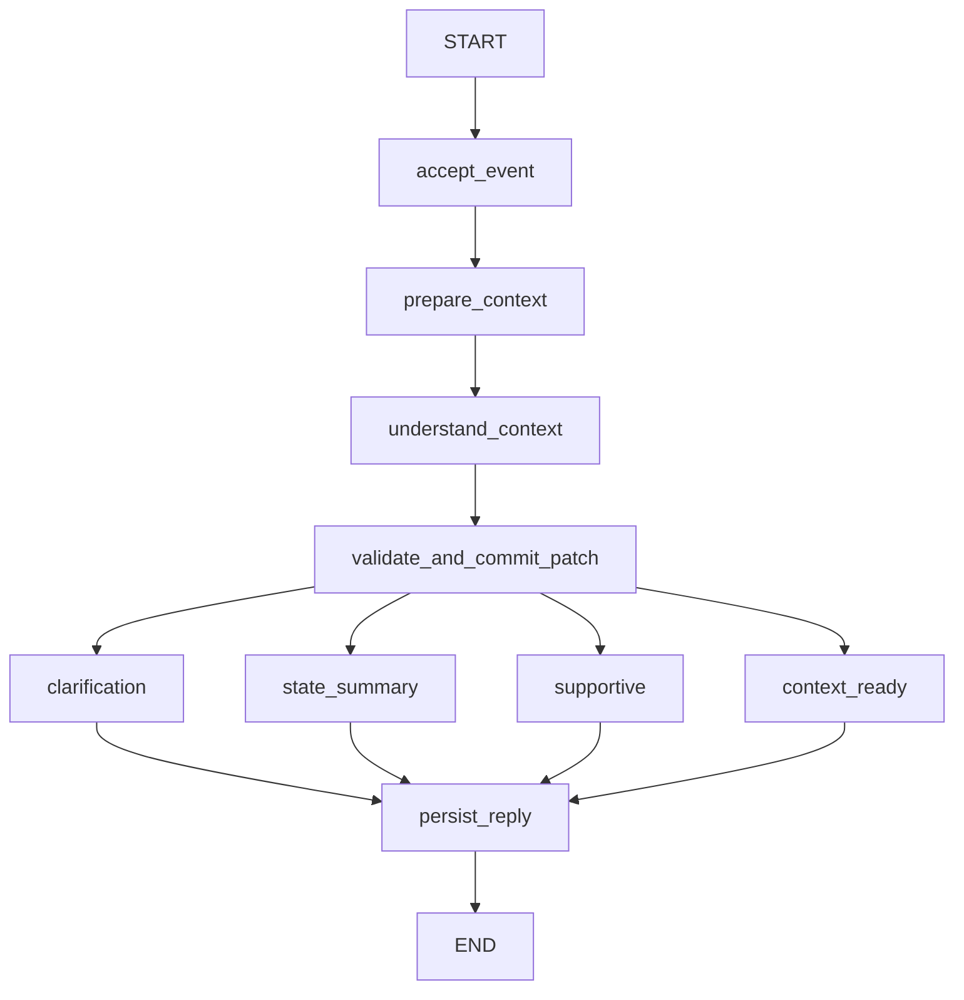

# 阶段一实施进度 — 2026-10-12

状态：**阶段一已实现，并通过真实模型与数据库的主要链路验收**。项目继续使用 SoloVibe 城市活动决策定位，按 `AI_AGENT_REDESIGNED_PLAN_V1.md` 的 V1.1 分层契约实施。地图、网页搜索、活动方案、确认行动和 token 预算摘要属于后续阶段。

## 已接入的代码

- 默认 `/api/chat` 已调用 `Application.chat` 和编译后的 LangGraph。请求要求 `thread_id`、`request_id`、`expected_revision`，不接受客户端传入 owner。
- 模型提出结构化补丁后，程序检查类型、范围和当前消息中的原文依据；有效更改写入有版本的业务快照。
- 匿名浏览器会话使用 HttpOnly cookie，数据库只保存令牌哈希。消息、业务状态、运行记录、节点事件与原生 checkpoint 分开保存。
- 会话级 advisory lock 和单进程执行槽限制并发；重复 request ID 和待处理运行有明确处理。
- `StageOneApp.tsx` 从后端读取对话、约束、字段来源和图节点记录，不生成未经查询的商家或路线。
- 健康接口报告启动阻塞；`/api/v1/graph` 导出编译图的 Mermaid 和 ContextSnapshot schema。

`AgentState` 包含 `schema_version`、`thread_id`、`run_id`、`request_id`、`input_event`、`context_snapshot`、`recent_messages`、`understanding`、`model_meta`、`reply`、`output`。`ContextSnapshot` 保存 `revision`、`constraints`、逐字段 `sources`。约束包括城市、位置、预算、时间、步行上限、精力、兴趣与排除项。阶段二的 token 预算和滚动摘要尚未实现；当前近期窗口最多取 12 条消息。

## 本次真实检查

| 检查 | 结果 | 范围 |
| --- | --- | --- |
| 当前后端模块编译与导入 | 通过 | 新主入口及引用模块 |
| 后端测试 | 26 passed | 基线接口、数值依据校验、状态补丁、图分支、模型错误与超时契约；stub 测试不是外部联调 |
| 前端类型检查、生产构建 | 通过 | 代码静态与打包 |
| 浏览器测试 | 常规 2 passed；可选真实 UI 1 passed | 就绪、移动宽度、断线；真实发送、状态与节点显示、刷新后恢复 |
| DeepSeek `/models` 与 `/chat/completions` | 鉴权、可用模型和真实结构化生成通过 | 启动探针与 HTTP 图运行均实际调用服务 |
| PostgreSQL Session pooler 与迁移 | 连接成功，`solovibe_v1` 和 `solovibe_graph` schema 建立 | 真实 Supabase 数据库；增量迁移，未删除旧表 |
| 本地 `/api/v1/health` 与 `/api/v1/readiness` | `ready=true`，就绪接口 200 | 后端启动时同时检查数据库、模型列表与一次真实生成 |
| HTTP 多轮及 LangGraph | 真实模型调用、字段原文依据、版本 0→2、六个节点事件通过 | `scripts/verify_stage1_live.py`；测试会话 `9b01659a-4713-4ad0-a422-c64fac304a62` |
| 幂等、并发、权限 | 相同 request ID 重放、旧版本拒绝、同线程并发只完成一条、另一浏览器 404 | 真实 HTTP 与数据库，不是 stub |
| 跨进程恢复 | 第二个后端进程读取并继续同一会话，版本 2→3 | 测试会话 `4e9c2772-19e5-4451-8a69-d84cb1baa85f`；第三轮更新在首个进程可见 |
| 数据库落盘核对 | 完成运行 9 条、完成节点事件 54 条、原生 checkpoint 72 条 | 测试时只读计数；`scripts/verify_stage1_storage.py` |

对整个历史 `backend/` 执行 compileall 时，未作为当前入口使用的旧文件 `backend/setup_env.py` 第 145 行有缩进错误；本阶段引用的模块单独编译通过。该旧文件仍待清理。

## 验收边界与后续工作

- 已验证 Session pooler 的持久业务状态与跨进程继续运行。模型/数据库故障、超时和重试有确定性契约测试，但没有对真实供应商进行可控故障注入；这仍是后续运维演练项目。
- 浏览器自动化已覆盖实际就绪屏、断线屏，以及显式设置 `SOLOVIBE_LIVE=1` 时的真实模型回复、状态显示和刷新恢复。默认浏览器测试不会消耗模型额度。
- `backend/.env` 只在本地读取并被 Git 忽略。VS Code 的 `python.terminal.useEnvFile` 提示只涉及向终端自动注入变量；后端由 `config.py` 显式读取该文件，因此不要求打开此设置。不要提交或粘贴密钥、数据库 URI。
- 下一阶段按计划实现 token 预算、近期原文和滚动摘要；之后才接地图/网页搜索、真实活动选项和用户确认后的行动。
