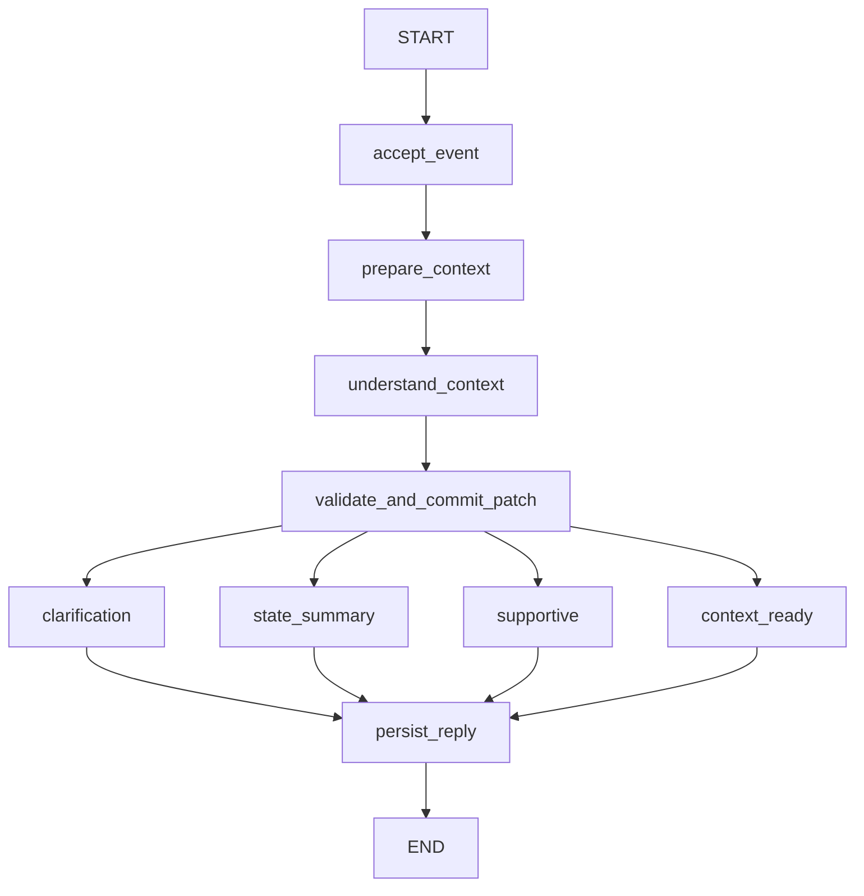

# 阶段一实施进度 — 2026-10-12

状态：**已恢复开发，尚未完成真实集成验收**。项目继续使用 SoloVibe 城市活动决策定位，并按 `AI_AGENT_REDESIGNED_PLAN_V1.md` 的 V1.1 分层契约实施。

## 已接入的代码

- 默认 `/api/chat` 已调用 `Application.chat` 和编译后的 LangGraph。请求要求 `thread_id`、`request_id`、`expected_revision`，不接受客户端传入 owner。
- 模型提出结构化补丁后，程序检查类型、范围和当前消息中的原文依据；有效更改写入有版本的业务快照。
- 匿名浏览器会话使用 HttpOnly cookie，数据库只保存令牌哈希。消息、业务状态、运行记录、节点事件与原生 checkpoint 分开保存。
- 会话级 advisory lock 和单进程执行槽限制并发；重复 request ID 和待处理运行有明确处理。
- `StageOneApp.tsx` 从后端读取对话、约束、字段来源和图节点记录，不生成未经查询的商家或路线。
- 健康接口报告启动阻塞；`/api/v1/graph` 导出编译图的 Mermaid 和 ContextSnapshot schema。

`AgentState` 包含 `schema_version`、`thread_id`、`run_id`、`request_id`、`input_event`、`context_snapshot`、`recent_messages`、`understanding`、`model_meta`、`reply`、`output`。`ContextSnapshot` 保存 `revision`、`constraints`、逐字段 `sources`。约束包括城市、位置、预算、时间、步行上限、精力、兴趣与排除项。阶段二的 token 预算和滚动摘要尚未实现；当前近期窗口最多取 12 条消息。

## 本次真实检查

| 检查 | 结果 | 范围 |
| --- | --- | --- |
| 当前后端模块编译与导入 | 通过 | 新主入口及引用模块 |
| 后端测试 | 26 passed | 基线接口、数值依据校验、状态补丁、图分支、模型错误与超时契约；stub 测试不是外部联调 |
| 前端类型检查、生产构建 | 通过 | 代码静态与打包 |
| 浏览器测试 | 2 passed | 本地实际服务状态、移动宽度、断线提示 |
| DeepSeek `/models` | 鉴权成功，可列出 `deepseek-flash` | 仅模型列表 |
| DeepSeek `/chat/completions` | 首次 HTTP 402；复查时余额接口返回可用，简单生成和项目结构化提取均成功 | 已验证模型适配层真实调用与 JSON 补丁校验；完整 Graph 仍未联调 |
| PostgreSQL 探针 | `password_placeholder`，未尝试连接 | 缺真实数据库密码 |
| 本地 `/api/v1/health` | `ready=false`，`DATABASE_NOT_CONFIGURED` | API 如实阻断会话与聊天 |

对整个历史 `backend/` 执行 compileall 时，未作为当前入口使用的旧文件 `backend/setup_env.py` 第 145 行有缩进错误；本阶段引用的模块单独编译通过。该旧文件仍待清理。

## 完成阶段一仍需

1. 在被 Git 忽略的 `backend/.env` 中填入真实 PostgreSQL `DATABASE_URL`，并确认使用直连或 Session pooler；密码不能提交仓库或发到聊天。
2. 在真实数据库执行 `scripts/migrate_stage1.py`，核对业务表和原生 checkpoint schema。
3. 用真实模型和数据库验证多轮更正、状态来源、重启恢复、请求重放、并发、跨浏览器隔离与故障重试。

以上完成前，不能宣称阶段一完全 OK。阶段二至阶段五按计划继续分批开发。
