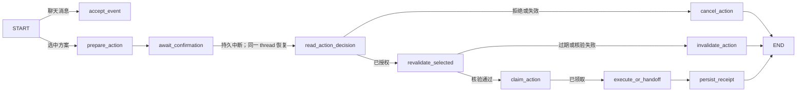

# 阶段四交付报告：确认、持久化与导航交接

> 验证时间：2026-10-12 至 2026-10-13。本文只记录已经实现和验证的行为；尚未取得的商家或外部应用回执不算成功。

## 一、已交付的用户流程

用户从当前版本的方案组 `plan_set_id` 中选定具体 `plan_id`，再选择“保存此方案”或“准备步行导航”。后端先检查浏览器会话归属、情境版本、方案归属、地图地点与路线的观测时间（不超过 30 分钟），以及同一对话中是否已有待处理动作。检查通过后，生成包含 `action_id`、版本号、SHA-256 摘要、方案快照和 15 分钟有效期的不可变提案。界面在确认前展示所选地点与动作范围。

同一对话的 LangGraph 在 `await_confirmation` 节点通过持久 `interrupt` 等待用户决定。确认接口核对会话所有者、动作 ID、提案版本、摘要和请求 ID。PostgreSQL 动作账本是授权与执行状态的权威来源；拒绝、过期、版本失效的提案都不会执行。等待确认时如果用户发送新需求，服务先使旧提案失效，以取消语义恢复并结束图中断，然后才处理新消息。重放一条更早且已完成的聊天请求不会取消当前待确认提案。

确认“保存”后，服务以 `action_id` 为唯一键向 `saved_plans` 写入一次。确认“导航”后，服务重新查询同一高德 POI、重新定位出发点、获取新的步行路线，并核对可用时间和步行上限；通过后才生成高德步行导航链接。服务端回执为 `navigation_handoff_ready`，只表示链接已备好。用户点击链接后记录 `handoff_requested_at`，仍不表示高德已接收、导航已启动或用户已到达。

界面提供提案审查、确认/取消、动作状态和未完成动作的恢复入口；导航链接只在确认和重新核验成功后出现。刷新页面可从数据库恢复最近动作和最多 20 条已保存方案。即使用户之后又进行导航，已保存方案仍可查看；其路线明确标注为**保存时的快照**，出发前须重新核实。

## 二、LangGraph 与持久状态

`AgentState` 新增 `event_kind`、`owner_id`、`action_id`、`action_decision`、`action_evidence` 和 `action_receipt`。普通新消息显式设置 `event_kind='chat'` 并清空动作瞬时字段，避免上一轮图状态串入新请求。动作账本和已保存方案位于 `solovibe_v1`；LangGraph 原生 checkpoint 位于独立的 `solovibe_graph`。应用的同会话锁负责串行处理，数据库事务与唯一约束负责去重、授权和单次写入。

阶段四新增接口：`POST /api/conversations/{thread_id}/actions`、`GET /api/actions/{action_id}`、`POST /api/actions/{action_id}/decision`、`POST /api/actions/{action_id}/recover`、`POST /api/actions/{action_id}/handoff`。读取会话时还会返回 `plan_set_id`、`latest_action` 和 `saved_plans`。

## 三、实际验证结果

- 已对配置好的 Supabase Session pooler 执行增量迁移；服务健康检查返回 `ready=true`、`stage=stage4`、版本 `0.6.0`。
- `scripts/verify_stage4_live.py` 调用了真实 DeepSeek、高德和 PostgreSQL，得到 3 个真实地点方案。测试验证了错误提案摘要和其他会话所有者被拒绝、重复请求与确认不重复执行、方案只写入一次、新 Python 进程从持久中断恢复确认、同一 POI 与步行路线重新核验、导航链接与单次点击记录、拒绝、过期失效、新消息取消，以及重放旧聊天请求不会取消新提案。
- `frontend/e2e/stage4.live.spec.ts` 在真实浏览器中完成保存、刷新后查看回执和已保存列表、确认导航、点击链接、再次刷新后查看交接记录和已保存列表。此测试拦截了浏览器打开的高德目标页面；后端对高德地点及路线的请求是真实调用。另有前端契约测试验证导航链接在确认前不会出现。
- Python 单元/契约测试 **45 项通过**；前端类型检查与生产构建通过。默认浏览器测试 **4 项通过、3 项按配置跳过**；阶段四真实浏览器测试单独启用并通过。

## 四、能力边界与下一步

当前不会代订场所、购票或付款，也不会把网页搜索结果推断为某家分店的官方预约入口。Tavily 搜索结果尚不能可靠确认同一分店，实际消费、实时营业、到店可用性、返程路线及目标导航应用的接收回执仍为未知。导航链接和点击时间只证明 SoloVibe 本地完成了交接步骤，不证明实际出行。

按照 [重新设计方案](AI_AGENT_REDESIGNED_PLAN_V1.md) 的阶段顺序，下一步是**阶段五：局部调整与发布收尾**。先处理预算、时间、位置等条件变化后的依赖失效和局部重校验；随后补用户可理解的过程/反馈、会话及 checkpoint 的保留与删除策略、部署配置与迁移演练、旧入口清理，并对失败、超时、权限及端到端链路做更完整的故障注入。完成这些验收前，不把阶段四的本地联调结果表述为 V1 已可正式上线。
