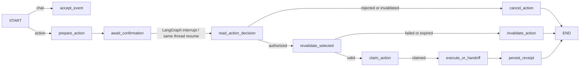

# Stage 4 delivery: confirmation, persistence, and navigation handoff

## Delivered behavior

The user selects a concrete `plan_id` within the latest `plan_set_id`, then chooses **Save this plan** or **Prepare walking navigation**. The backend checks session ownership, context revision, exact plan membership, provider observation age (30 minutes), and whether another action is waiting. It creates an immutable proposal with an `action_id`, version, SHA-256 digest, plan snapshot, and 15-minute confirmation expiry. The user sees the selected place and action scope before confirming.

The same conversation's LangGraph checkpoint enters `await_confirmation` via a durable `interrupt`. The decision API binds the owner, action ID, version, digest, and request ID. PostgreSQL is the authority for authorization and effect status. Rejected, expired, stale, or superseded proposals do not execute. A new chat message invalidates an unconfirmed proposal and resumes the interrupted graph with cancellation before the chat run starts.

After authorization, a save inserts the selected plan into `saved_plans` exactly once under the action ID. Navigation rechecks the same Amap POI, geocodes the origin again, requests a new walking route, and verifies time and walking limits before a one-time claim. It returns an Amap walking-navigation URL as `navigation_handoff_ready`; it does not claim that navigation launched or that the user arrived. Clicking the URL records `handoff_requested_at`, which still does not prove that Amap accepted the request.

The current UI shows the proposal, confirmation/cancel controls, action status, recovery button for an authorized incomplete action, and the link only after confirmation and revalidation. Refresh reloads the latest action and up to 20 saved plan snapshots from PostgreSQL. Saved plans remain visible after the user performs a later navigation action; their route data is explicitly labeled as a historical snapshot.

## Graph and durable state

`AgentState` adds `event_kind`, `owner_id`, `action_id`, `action_decision`, `action_evidence`, and `action_receipt`. New chat runs explicitly set `event_kind='chat'` and reset action fields, avoiding cross-run state bleed. Action records and `saved_plans` live in `solovibe_v1`; the LangGraph saver remains separate in `solovibe_graph`. The repository guard serializes one conversation; database transactions and uniqueness constraints enforce deduplication and authorization.

New endpoints: `POST /api/conversations/{thread_id}/actions`, `GET /api/actions/{action_id}`, `POST /api/actions/{action_id}/decision`, `POST /api/actions/{action_id}/recover`, and `POST /api/actions/{action_id}/handoff`. The conversation read response now includes `plan_set_id`, `latest_action`, and `saved_plans`.

## Verification on 2026-10-12

- Additive migration ran against the configured Supabase Session pooler; the service health check returned `ready=true`, `stage=stage4`, version `0.6.0`.
- `scripts/verify_stage4_live.py` used real DeepSeek, Amap, and PostgreSQL. It obtained three real options, rejected a wrong proposal digest and another owner, verified duplicate request/decision behavior, saved one database row, confirmed another pending action from a fresh Python process, revalidated the selected POI and walking route, created a navigation handoff, recorded a single handoff request, rejected an action, invalidated expired and new-message proposals, and checked that replaying an older chat request does not cancel a newer pending proposal.
- The real browser test `frontend/e2e/stage4.live.spec.ts` confirmed a plan save, restored both its receipt and the saved-plan list after reload, prepared navigation after a fresh Amap check, clicked the link, and restored both the handoff-request record and saved plan after another reload. The external destination page was intercepted in this browser test; the backend's Amap detail and walking-route requests were real. The mocked browser contract test checks that the navigation URL appears only after confirmation.
- Python unit/contract tests passed (45). Frontend type checking and production build passed. The default browser suite passed four tests and skipped three opt-in live tests; the Stage 4 live browser test passed separately.

## Scope and remaining limits

The product does not reserve a venue, buy a ticket, pay, or infer that a merchant's web page is an official booking page. Tavily results still have unverified branch identity, so they cannot safely become booking handoff actions. Actual spending, current opening status, entry availability, return route, and destination-app receipt remain unknown. The Amap link and handoff timestamp are truthful local outcomes, not proof of travel. Broader provider fault injection and deployment validation remain Stage 5 work.
